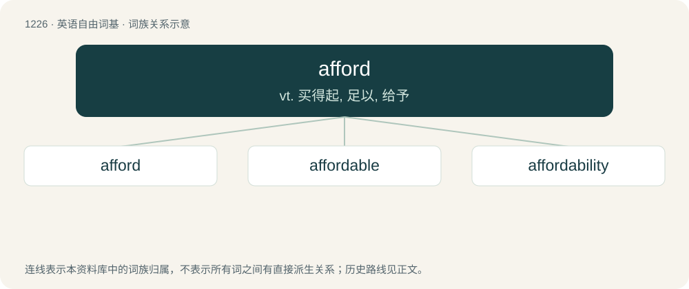

# 1306 · afford — vt. 买得起, 足以, 给予

[总目录](../00_总目录_按常用程度.md)

**类型**：英语自由词基　｜　**来源语言**：见词源记录

## 核心含义与来源

- 核心含义：vt. 买得起, 足以, 给予
- 英文含义：To incur, stand, or bear without serious detriment, as an act which might under other circumstances be injurious; (usually after an expression of ability, as could, able, difficult) to be able or rich enough; to spare.
- 词形：afford

**来源记录 1**（动词；To incur, stand, or bear without serious detriment, as an act which might under other circumstances be injurious; (usually after an expression of ability, as could, able, difficult) to be able or rich enough; to spare.）

From Middle English afforthen, aforthen, avorthien, from earlier iforthen, iforthien, ȝeforthien, from Old English forþian, ġeforþian (“to further, accomplish, afford”), from Proto-Germanic \*furþōną, from Proto-Germanic \*furþą (“forth, forward”), equivalent to a- + forth. Cognate with Old Norse forða (“to forward oneself, save oneself, escape danger”), Icelandic forða (“to save, rescue”).

## 词族图

## 单词速览（常用到不常用）

| 单词 | 音标 | 释义 |
|---|---|---|
| [afford](#w-1) | 英 /əˈfɔːd/；美 /əˈfoɹd/ | vt. 买得起, 足以, 给予 |
| [affordable](#w-2) | 英 /əˈfɔː(ɹ).də.bəl/；美 /əˈfɔɹ.də.bəl/ | \[计\] 普及型 |
| [affordability](#w-3) | /əˌfɔdɚˈbɪlətɪ/ | n. 支付能力；负担能力；可购性 |

## 逐词详解

### 1. afford

**词性**：动词　｜　**音标**：英 /əˈfɔːd/；美 /əˈfoɹd/

**中文释义**：vt. 买得起, 足以, 给予

**英文义项**：To incur, stand, or bear without serious detriment, as an act which might under other circumstances be injurious; (usually after an expression of ability, as could, able, difficult) to be able or rich enough; to spare. / To give forth; to supply, yield, or produce as the natural result, fruit, or issue.

**构词拆分**：a- + forth

**词源与演化**：

From Middle English afforthen, aforthen, avorthien, from earlier iforthen, iforthien, ȝeforthien, from Old English forþian, ġeforþian (“to further, accomplish, afford”), from Proto-Germanic \*furþōną, from Proto-Germanic \*furþą (“forth, forward”), equivalent to a- + forth. Cognate with Old Norse forða (“to forward oneself, save oneself, escape danger”), Icelandic forða (“to save, rescue”).

**例句**：

> I think we can afford the extra hour it will take. We can only afford to buy a small car at the moment.

该用例对应义项：To incur, stand, or bear without serious detriment, as an act which might under other circumstances be injurious; (usually after an expression of ability, as could, able, difficult) to be able or rich enough; to spare.

### 2. affordable

**词性**：形容词　｜　**音标**：英 /əˈfɔː(ɹ).də.bəl/；美 /əˈfɔɹ.də.bəl/

**中文释义**：\[计\] 普及型

**英文义项**：Able to be afforded; inexpensive or reasonably priced.

**构词拆分**：afford + -able

**词源与演化**：

From afford + -able.

**用法示例／搭配（非完整句）**：

> an affordable vacation in the local area

该用例对应义项：Able to be afforded; inexpensive or reasonably priced.

### 3. affordability

**词性**：名词　｜　**音标**：/əˌfɔdɚˈbɪlətɪ/

**中文释义**：n. 支付能力；负担能力；可购性

**英文义项**：The extent or degree to which something is affordable, as measured by its cost relative to the amount that the purchaser is able to pay. / A desirable degree of that characteristic: synonym of inexpensiveness.

**构词拆分**：afford + -ability

**词源与演化**：

From afford + -ability.

**例句**：

> First-time home buyers are feeling the squeeze of higher interest rates with mortgage affordability at its worst level for 16 years.

该用例对应义项：The extent or degree to which something is affordable, as measured by its cost relative to the amount that the purchaser is able to pay.
