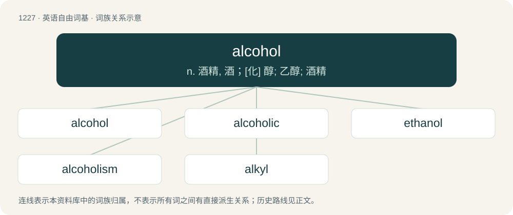

# 1307 · alcohol — n. 酒精, 酒；\[化\] 醇; 乙醇; 酒精

[总目录](../00_总目录_按常用程度.md)

**类型**：英语自由词基　｜　**来源语言**：见词源记录

## 核心含义与来源

- 核心含义：n. 酒精, 酒；\[化\] 醇; 乙醇; 酒精
- 英文含义：Any of a class of organic compounds (such as ethanol) containing a hydroxyl functional group (-OH).
- 词形：alcohol

**来源记录 1**（名词；Any of a class of organic compounds (such as ethanol) containing a hydroxyl functional group (-OH).）

First attested in the 15th century from Middle English alcofol, from Middle French alcohol or Spanish alcohol, derived from the Medieval Latin rendering alcohol transmitted in medical or alchemical literature of Arabic اَلْكُحْل (al-kuḥl, “kohl”), which in Andalusian Arabic also bore the form كُحُول (kuḥūl), قُحُول (quḥūl); bearing thus the meaning of stibnite first, then generalized in meaning to a powder obtained by triturating a material, then also to liquids obtained by boiling down, and specialized to mean spirit of wine, ethanol, in the 18th century, then the narrow chemical sense after 1850. Doublet of alcool and kohl. Various old etymological notes. \* Bartholomew Traheron in his 1543 translation of John of Vigo introduces the word as a term used by "barbarous" (Moorish) authors for "fine powder": the barbarous auctours use alcohol, or (as I fynde it sometymes wryten) alcofoll, for moost fine poudre. \* William Johnson in his 1657 Lexicon Chymicum glosses the word as antimonium sive stibium. By extension, the word came to refer to any fluid obtained by distillation, including "alcohol of wine", the distilled essence of wine. \* Libavius in Alchymia (1594) has vini alcohol vel vinum alcalisatum. \* Johnson (1657) glosses alcohol vini as quando omnis superfluitas vini a vino separatur, ita ut accensum ardeat donec totum consumatur, nihilque fæcum aut phlegmatis in fundo remaneat. \* Some authorities, including Rachel Hajar, suggest that the ultimate etymon was the Arabic term اَلْغَوْل (al-ḡawl, “bad effect, evil result of headache”) (as used in Qur’an verse 37:47, but this word is rather poetical and could for topical reasons not have been picked up from Arabic by Medieval writers, and aside from that the relation to stibium is well documented.

## 词族图

## 单词速览（常用到不常用）

| 单词 | 音标 | 释义 |
|---|---|---|
| [alcohol](#w-1) | 英 /ˈæl.kə.hɒl/；美 /ˈæl.kə.hɔl/ | n. 酒精, 酒；\[化\] 醇; 乙醇; 酒精 |
| [alcoholic](#w-2) | 英 /ˌæl.kəˈhɒl.ɪk/；美 /ˌæl.kəˈhɔ.lɪk/ | n. 酒鬼, 酒精中毒者；a. 酒精的 |
| [ethanol](#w-3) | 英 /ˈɛθ.ə.nɒl/；美 /ˈɛθ.ə.nɑl/ | n. 乙醇, 酒精；\[化\] 乙醇 |
| [alcoholism](#w-4) | 英 /ˈælkəhɒˌlɪzəm/；美 /ˈælkə(ˌ)hɔˌlɪzəm/ | n. 酗酒, 酒精中毒；\[化\] 酒中毒 |
| [alkyl](#w-5) | /ˈælkaɪl/ | n. 烷基, 烃基；a. 烷基的, 烃基的 |

## 逐词详解

### 1. alcohol

**词性**：名词　｜　**音标**：英 /ˈæl.kə.hɒl/；美 /ˈæl.kə.hɔl/

**中文释义**：n. 酒精, 酒；\[化\] 醇; 乙醇; 酒精

**英文义项**：Any of a class of organic compounds (such as ethanol) containing a hydroxyl functional group (-OH). / Ethanol.

**词源与演化**：

First attested in the 15th century from Middle English alcofol, from Middle French alcohol or Spanish alcohol, derived from the Medieval Latin rendering alcohol transmitted in medical or alchemical literature of Arabic اَلْكُحْل (al-kuḥl, “kohl”), which in Andalusian Arabic also bore the form كُحُول (kuḥūl), قُحُول (quḥūl); bearing thus the meaning of stibnite first, then generalized in meaning to a powder obtained by triturating a material, then also to liquids obtained by boiling down, and specialized to mean spirit of wine, ethanol, in the 18th century, then the narrow chemical sense after 1850. Doublet of alcool and kohl. Various old etymological notes. \* Bartholomew Traheron in his 1543 translation of John of Vigo introduces the word as a term used by "barbarous" (Moorish) authors for "fine powder": the barbarous auctours use alcohol, or (as I fynde it sometymes wryten) alcofoll, for moost fine poudre. \* William Johnson in his 1657 Lexicon Chymicum glosses the word as antimonium sive stibium. By extension, the word came to refer to any fluid obtained by distillation, including "alcohol of wine", the distilled essence of wine. \* Libavius in Alchymia (1594) has vini alcohol vel vinum alcalisatum. \* Johnson (1657) glosses alcohol vini as quando omnis superfluitas vini a vino separatur, ita ut accensum ardeat donec totum consumatur, nihilque fæcum aut phlegmatis in fundo remaneat. \* Some authorities, including Rachel Hajar, suggest that the ultimate etymon was the Arabic term اَلْغَوْل (al-ḡawl, “bad effect, evil result of headache”) (as used in Qur’an verse 37:47, but this word is rather poetical and could for topical reasons not have been picked up from Arabic by Medieval writers, and aside from that the relation to stibium is well documented.

**例句**：

> Alcohol (or drink) ruined him.

该用例对应义项：a liquor or brew containing alcohol as the active agent

### 2. alcoholic

**词性**：形容词　｜　**音标**：英 /ˌæl.kəˈhɒl.ɪk/；美 /ˌæl.kəˈhɔ.lɪk/

**中文释义**：n. 酒鬼, 酒精中毒者；a. 酒精的

**英文义项**：Of or pertaining to alcohol. / Having more than a trace amount of alcohol in its contents.

**构词拆分**：alcohol + -ic

**词源与演化**：

First attested 1891, from alcohol + -ic.

**例句**：

> The oysters were sour, and excessively alcoholic.

该用例对应义项：Having more than a trace amount of alcohol in its contents.

### 3. ethanol

**词性**：名词　｜　**音标**：英 /ˈɛθ.ə.nɒl/；美 /ˈɛθ.ə.nɑl/

**中文释义**：n. 乙醇, 酒精；\[化\] 乙醇

**英文义项**：A simple aliphatic alcohol formally derived from ethane by replacing one hydrogen atom with a hydroxyl group: CH₃-CH₂-OH. / Specifically, this form of alcohol as a fuel.

**构词拆分**：ethyl + alcohol + ethane + -ol；ethane + -ol

**例句**：

> Methanol has the same effects as ethanol, but also makes people blind.

### 4. alcoholism

**词性**：名词　｜　**音标**：英 /ˈælkəhɒˌlɪzəm/；美 /ˈælkə(ˌ)hɔˌlɪzəm/

**中文释义**：n. 酗酒, 酒精中毒；\[化\] 酒中毒

**英文义项**：A chronic disease caused by compulsive and uncontrollable consumption of alcoholic beverages, leading to addiction and deterioration in health and social functioning. / Acute alcohol poisoning.

**构词拆分**：alcohol + -ism

**词源与演化**：

From alcohol + -ism. Derived from New Latin alcoholismus chronicus, coined by the Swedish professor of medicine Magnus Huss in 1849.

**例句**：

> He sought treatment for alcoholism at a rehabilitation clinic.

该用例对应义项：A chronic disease caused by compulsive and uncontrollable consumption of alcoholic beverages, leading to addiction and deterioration in health and social functioning.

### 5. alkyl

**词性**：名词　｜　**音标**：/ˈælkaɪl/

**中文释义**：n. 烷基, 烃基；a. 烷基的, 烃基的

**英文义项**：Any of a series of univalent radicals of the general formula CₙH₂ₙ₊₁ derived from aliphatic hydrocarbons. In other words, an alkane minus one hydrogen atom.

**构词拆分**：alcohol + -yl

**词源与演化**：

From alc(ohol) + -yl.

**例句**：

> Methanethiol is an organic sulfur compound containing an alkyl or aryl group and a thiol group.
