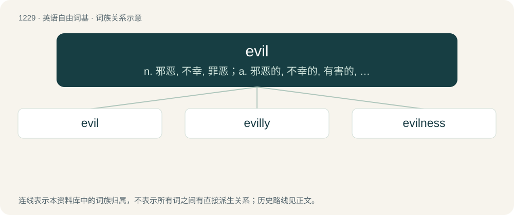

# 1308 · evil — n. 邪恶, 不幸, 罪恶；a. 邪恶的, 不幸的, 有害的, 讨厌的

[总目录](../00_总目录_按常用程度.md)

**类型**：英语自由词基　｜　**来源语言**：见词源记录

## 核心含义与来源

- 核心含义：n. 邪恶, 不幸, 罪恶；a. 邪恶的, 不幸的, 有害的, 讨厌的
- 英文含义：Intending to harm; malevolent.
- 词形：evil

**来源记录 1**（形容词；Intending to harm; malevolent.）

From Middle English yvel, evel, ivel, uvel, from Old English yfel, from Proto-West Germanic \*ubil, from Proto-Germanic \*ubilaz, from Proto-Indo-European \*h₂up(h₁)élos, a deverbal derivative of \*h₂wep(h₁)-, \*h₂wop(h₁)- (“treat badly”). See -le for the supposed suffix. Alternatively from \*upélos (“evil”, literally “going over or beyond (acceptable limits)”), from Proto-Indo-European \*upo, \*h₃ewp- (“down, up, over”). Cognates Cognate with Dutch euvel (“evil”), German übel (“bad, evil”), German Low German övel (“evil”), Luxembourgish iwwel (“queasy, nauseous; bad”), Gothic 𐌿𐌱𐌹𐌻𐍃 (ubils, “bad, evil”). Compare Old Irish fel (“bad, evil”), from Proto-Celtic \*uɸelos, and Hittite 𒄷𒉿𒀊𒍣 (huwapp-ⁱ, “to mistreat, harass”), 𒄷𒉿𒀊𒉺𒀸 (huwappa-, “evil, badness”).

## 词族图

## 单词速览（常用到不常用）

| 单词 | 音标 | 释义 |
|---|---|---|
| [evil](#w-1) | /ˈiːvəl/ | n. 邪恶, 不幸, 罪恶；a. 邪恶的, 不幸的, 有害的, 讨厌的 |
| [evilly](#w-2) | 英 /ˈiːvəli/；美 /ˈivəli/ | adv. 邪恶地 |
| [evilness](#w-3) | /ˈiːvəlnəs/ | n. 恶的, 邪恶的, 有害的 |

## 逐词详解

### 1. evil

**词性**：形容词　｜　**音标**：/ˈiːvəl/

**中文释义**：n. 邪恶, 不幸, 罪恶；a. 邪恶的, 不幸的, 有害的, 讨厌的

**英文义项**：Intending to harm; malevolent. / Morally corrupt.

**词源与演化**：

From Middle English yvel, evel, ivel, uvel, from Old English yfel, from Proto-West Germanic \*ubil, from Proto-Germanic \*ubilaz, from Proto-Indo-European \*h₂up(h₁)élos, a deverbal derivative of \*h₂wep(h₁)-, \*h₂wop(h₁)- (“treat badly”). See -le for the supposed suffix. Alternatively from \*upélos (“evil”, literally “going over or beyond (acceptable limits)”), from Proto-Indo-European \*upo, \*h₃ewp- (“down, up, over”). Cognates Cognate with Dutch euvel (“evil”), German übel (“bad, evil”), German Low German övel (“evil”), Luxembourgish iwwel (“queasy, nauseous; bad”), Gothic 𐌿𐌱𐌹𐌻𐍃 (ubils, “bad, evil”). Compare Old Irish fel (“bad, evil”), from Proto-Celtic \*uɸelos, and Hittite 𒄷𒉿𒀊𒍣 (huwapp-ⁱ, “to mistreat, harass”), 𒄷𒉿𒀊𒉺𒀸 (huwappa-, “evil, badness”).

**例句**：

> Do you think that companies that engage in animal testing are evil?

该用例对应义项：Morally corrupt.

### 2. evilly

**词性**：副词　｜　**音标**：英 /ˈiːvəli/；美 /ˈivəli/

**中文释义**：adv. 邪恶地

**英文义项**：In an evil manner.

**构词拆分**：evil + -ly

**词源与演化**：

From evil + -ly, replacing earlier evil (“evilly”).

**例句**：

> By doing nothing, men learn to act evilly.

### 3. evilness

**词性**：名词　｜　**音标**：/ˈiːvəlnəs/

**中文释义**：n. 恶的, 邪恶的, 有害的

**英文义项**：The quality or state of being evil.

**构词拆分**：evil + -ness

**词源与演化**：

From Middle English yvelnesse, from Old English yfelnyss; equivalent to evil + -ness.
