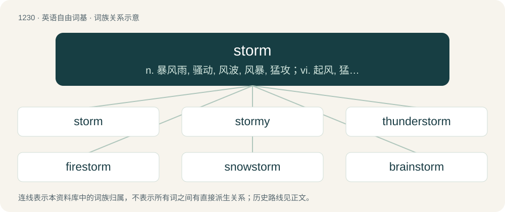

# 1310 · storm — n. 暴风雨, 骚动, 风波, 风暴, 猛攻；vi. 起风, 猛冲, 怒吼；vt. 猛攻

[总目录](../00_总目录_按常用程度.md)

**类型**：英语自由词基　｜　**来源语言**：见词源记录

## 核心含义与来源

- 核心含义：n. 暴风雨, 骚动, 风波, 风暴, 猛攻；vi. 起风, 猛冲, 怒吼；vt. 猛攻
- 英文含义：Any disturbed state of the atmosphere causing destructive or unpleasant weather, especially one affecting the earth's surface involving strong winds (leading to high waves at sea) and usually lightning, thunder, and precipitation.
- 词形：storm

**多个词源／构词路径**：同一拼写可能有不同来源；以下按词性和含义分别列出。

**来源记录 1**（名词；Any disturbed state of the atmosphere causing destructive or unpleasant weather, especially one affecting the earth's surface involving strong winds (leading to high waves at sea) and usually lightning, thunder, and precipitation.）

From Middle English storm (“disturbed state of the atmosphere; heavy precipitation; battle, conflict; attack”) \[and other forms\], from Old English storm (“tempest, storm; attack; storm of arrows; disquiet, disturbance, tumult, uproar; onrush, rush”) \[and other forms\], from Proto-West Germanic \*sturm (“storm”), from Proto-Germanic \*sturmaz (“storm”), from Proto-Indo-European \*(s)twerH- (“to agitate, stir up; to propel; to urge on”). Related to stir. Cognates \* Danish storm (“storm”) \* Dutch storm (“storm”) \* German Sturm (“storm”) \* Icelandic stormur (“storm”) \* Low German storm (“storm”) \* Norwegian Bokmål storm (“storm”) \* Norwegian Nynorsk storm (“storm”) \* Scots storm (“storm”) \* Swedish storm (“storm”) \* West Frisian stoarm (“storm”)

**来源记录 2**（动词；Preceded by the dummy subject it: to have strong winds and usually lightning and thunder, and/or hail, rain, or snow.）

The verb is derived from Middle English stormen (“of the wind: to blow violently; to cause to roll or toss”), from storm (noun) (see etymology 1) + -en (suffix forming the infinitives of verbs). Compare Middle English sturmen (“to attack (someone) with great force”), from Old English styrman (“to rage, storm; to make a great noise, cry aloud, shout, storm”), from Proto-West Germanic \*sturmijan (“to storm”), from Proto-Germanic \*sturmijaną (“to storm”), from \*sturmaz (“a storm”) (see etymology 1) + \*-janą (suffix forming causatives from strong verbs, with a sense of ‘to cause to do \[the action of the verb\]’). The Middle English word did not survive into modern English. The noun is derived from verb etymology 2, verb sense 2.3 (“to violently assault (a fortified position or stronghold, a building, etc.) with the aim of gaining control of it”). Cognates \* Dutch stormen (“to bluster, storm”) \* German stürmen (“to rage, storm; to assault, attack”) \* Icelandic storma (“to storm”) \* Low German stormen (“to storm”) \* Swedish storma (“to bluster, storm”)

## 词族图

## 单词速览（常用到不常用）

| 单词 | 音标 | 释义 |
|---|---|---|
| [storm](#w-1) | 英 /stɔːm/；美 /stoɹm/ | n. 暴风雨, 骚动, 风波, 风暴, 猛攻；vi. 起风, 猛冲, 怒吼；vt. 猛攻 |
| [stormy](#w-2) | 美 /ˈstɔɹmi/ | a. 暴风雨的, 粗暴的, 激烈的 |
| [thunderstorm](#w-3) | 英 /ˈθʌn.dəˌstɔːm/；美 /ˈθʌn.dɚˌstɔɹm/ | n. 雷暴雨 |
| [firestorm](#w-4) | /ˈfaiəstɔːm/ | n. 风暴性大火 |
| [snowstorm](#w-5) | /ˈsnəʊstɔːm/ | n. 暴风雪；\[化\] 雪暴 |
| [brainstorm](#w-6) | 英 /ˈbɹeɪnstɔːm/；美 /ˈbɹeɪnstɔɹm/ | n. 灵机一动；v. 集体讨论 |
| [sandstorm](#w-7) | /ˈsændstɒːm/ | n. (沙漠地带的)沙暴 |
| [stormwater](#w-8) | /stɔːmˈwɔːtə/ | 暴雨水 |
| [rainstorm](#w-9) | 英 /ˈɹeɪnstɔːm/；美 /ˈɹeɪnstɔɹm/ | n. 雨暴 |
| [stormtrooper](#w-10) | /ˈstɔːmtɹuːpə/ | 【英文】A soldier trained in special infiltration tactics. |
| [windstorm](#w-11) | /ˈwɪndstɔː(ɹ)m/ | n. 暴风 |
| [shitstorm](#w-12) |  | 【英文】A chaotic and unpleasant or violent situation. |
| [stormer](#w-13) |  | n. 猛攻者, 发怒者, 大发雷霆者 |
| [superstorm](#w-14) |  | 【英文】A major storm (weather phenomenon). |

## 逐词详解

### 1. storm

**词性**：名词　｜　**音标**：英 /stɔːm/；美 /stoɹm/

**中文释义**：n. 暴风雨, 骚动, 风波, 风暴, 猛攻；vi. 起风, 猛冲, 怒吼；vt. 猛攻

**英文义项**：Any disturbed state of the atmosphere causing destructive or unpleasant weather, especially one affecting the earth's surface involving strong winds (leading to high waves at sea) and usually lightning, thunder, and precipitation. / A heavy fall of precipitation (hail, rain, or snow) or bout of lightning and thunder without strong winds; a hail storm, rainstorm, snowstorm, or thunderstorm.

**词源与演化**：

From Middle English storm (“disturbed state of the atmosphere; heavy precipitation; battle, conflict; attack”) \[and other forms\], from Old English storm (“tempest, storm; attack; storm of arrows; disquiet, disturbance, tumult, uproar; onrush, rush”) \[and other forms\], from Proto-West Germanic \*sturm (“storm”), from Proto-Germanic \*sturmaz (“storm”), from Proto-Indo-European \*(s)twerH- (“to agitate, stir up; to propel; to urge on”). Related to stir. Cognates \* Danish storm (“storm”) \* Dutch storm (“storm”) \* German Sturm (“storm”) \* Icelandic stormur (“storm”) \* Low German storm (“storm”) \* Norwegian Bokmål storm (“storm”) \* Norwegian Nynorsk storm (“storm”) \* Scots storm (“storm”) \* Swedish storm (“storm”) \* West Frisian stoarm (“storm”)

**例句**：

> The boat was torn to pieces in the storm, and nobody survived.

该用例对应义项：Any disturbed state of the atmosphere causing destructive or unpleasant weather, especially one affecting the earth's surface involving strong winds (leading to high waves at sea) and usually lightning, thunder, and precipitation.

### 2. stormy

**词性**：形容词　｜　**音标**：美 /ˈstɔɹmi/

**中文释义**：a. 暴风雨的, 粗暴的, 激烈的

**英文义项**：Of or pertaining to storms. / Characterized by, or proceeding from, a storm; subject to storms; agitated with strong winds and heavy rain.

**构词拆分**：storm + -y

**词源与演化**：

From Middle English stormy, stormi, from Old English \*stormiġ (“stormy”), equivalent to storm + -y. Cognate with Dutch stormig (“stormy”), German stürmisch (“stormy”), Swedish stormig (“stormy”).

**用法示例／搭配（非完整句）**：

> a stormy season or a stormy day

该用例对应义项：Characterized by, or proceeding from, a storm; subject to storms; agitated with strong winds and heavy rain.

### 3. thunderstorm

**词性**：名词　｜　**音标**：英 /ˈθʌn.dəˌstɔːm/；美 /ˈθʌn.dɚˌstɔɹm/

**中文释义**：n. 雷暴雨

**英文义项**：A storm consisting of thunder and lightning produced by a cumulonimbus, usually accompanied with heavy rain, wind, and sometimes hail; and in rarer cases sleet, freezing rain, or snow.

**构词拆分**：thunder + storm

**词源与演化**：

From thunder + storm.

**例句**：

> Communications have been cut off for two hours because of a thunderstorm.

### 4. firestorm

**词性**：名词　｜　**音标**：/ˈfaiəstɔːm/

**中文释义**：n. 风暴性大火

**英文义项**：A fire whose intensity is greatly increased by inrushing winds. / An intense or violent altercation; an intense or violent response; an outburst (as of controversy)

**构词拆分**：fire + storm

**词源与演化**：

From fire + storm.

**例句**：

> The incident triggered a political firestorm.

该用例对应义项：an outburst of controversy

### 5. snowstorm

**词性**：名词　｜　**音标**：/ˈsnəʊstɔːm/

**中文释义**：n. 暴风雪；\[化\] 雪暴

**英文义项**：Bad weather involving blowing winds and snow, or blowing winds and heavy snowfall amount. / A snow globe.

**构词拆分**：snow + storm

**词源与演化**：

From earlier snow-storm, snow storm, equivalent to snow + storm. Compare Scots snawstorm (“snowstorm”), Saterland Frisian Sneestoarm (“snowstorm”), West Frisian sniestoarm (“snowstorm”), Dutch sneeuwstorm (“snowstorm”), German Low German Sneestorm (“snowstorm”), German Schneesturm (“snowstorm”), Danish snestorm (“snowstorm”), Swedish snöstorm (“snowstorm”), Icelandic snjóstormur (“snowstorm”). Compare also Middle English storm of snow (“snowstorm”).

**例句**：

> The snowstorm left more than 30 inches of snow on the ground.

### 6. brainstorm

**词性**：动词　｜　**音标**：英 /ˈbɹeɪnstɔːm/；美 /ˈbɹeɪnstɔɹm/

**中文释义**：n. 灵机一动；v. 集体讨论

**英文义项**：To investigate something, or solve a problem using brainstorming. / To participate in a brainstorming session.

**构词拆分**：brain + storm

**词源与演化**：

From brain + storm. In the sense of "problem-solve", devised as a method of group creative problem-solving by advertising executive Alex F. Osborn and his employees, who coined the term based on the image of using "the brain to storm a problem". First use appears c. 1945. In the sense of "seizure, convulsion, brain activity", from the unrelated idea that it resembles a storm in the brain. First use appears c. 1861.

**例句**：

> I need you to brainstorm some suggestions for next week's activity schedule.

该用例对应义项：To think up (ideas); especially, to do so creatively.

### 7. sandstorm

**词性**：名词　｜　**音标**：/ˈsændstɒːm/

**中文释义**：n. (沙漠地带的)沙暴

**英文义项**：A strong wind carrying clouds of sand and dust through the air.

**构词拆分**：sand + storm

**词源与演化**：

From sand + storm.

**例句**：

> Make sure every orifice is covered before you enter the sandstorm.

### 8. stormwater

**词性**：名词　｜　**音标**：/stɔːmˈwɔːtə/

**中文释义**：暴雨水

**英文义项**：Water that is not absorbed into soil and rapidly flows downstream, increasing the level of waterways. In some municipal systems it intermixes with wastewater, increasing the volume of the latter.

**构词拆分**：storm + water

**词源与演化**：

From storm + water.

**例句**：

> A small boy swept into a stormwater drain kept himself afloat using strokes he'd recently learned at swim school.

### 9. rainstorm

**词性**：名词　｜　**音标**：英 /ˈɹeɪnstɔːm/；美 /ˈɹeɪnstɔɹm/

**中文释义**：n. 雨暴

**英文义项**：A storm characterized by substantial, heavy rainfall.

**构词拆分**：rain + storm

**词源与演化**：

From rain + storm.

**例句**：

> Due to the rainstorm, the river water surged over the river banks.

### 10. stormtrooper

**词性**：名词　｜　**音标**：/ˈstɔːmtɹuːpə/

**英文义项**：A soldier trained in special infiltration tactics. / A member of the Sturmabteilung, a Nazi street militia.

**构词拆分**：storm + trooper

**词源与演化**：

A calque of German Sturmtruppen, from Sturm (“storm”) + Truppen (“troops”), equivalent to storm + trooper.

### 11. windstorm

**词性**：名词　｜　**音标**：/ˈwɪndstɔː(ɹ)m/

**中文释义**：n. 暴风

**英文义项**：A storm in which there are strong, violent winds but no precipitation.

**构词拆分**：wind + storm

**词源与演化**：

From wind + storm.

**例句**：

> My stream of consciousness is more like a waterfall in a windstorm.

### 12. shitstorm

**词性**：名词

**英文义项**：A chaotic and unpleasant or violent situation. / Considerable backlash from the public.

**构词拆分**：shit + storm

**词源与演化**：

From shit + storm.

### 13. stormer

**词性**：名词

**中文释义**：n. 猛攻者, 发怒者, 大发雷霆者

**英文义项**：Someone who storms. / Something very loud and powerful, such as a song or a car.

**构词拆分**：storm + -er

**词源与演化**：

From storm + -er.

### 14. superstorm

**词性**：名词

**英文义项**：A major storm (weather phenomenon).

**构词拆分**：super- + storm

**词源与演化**：

From super- + storm.
