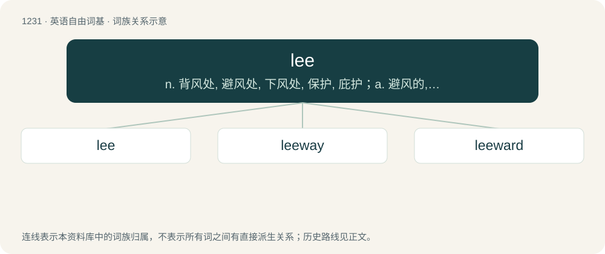

# 1311 · lee — n. 背风处, 避风处, 下风处, 保护, 庇护；a. 避风的, 背风的, 下风的, 保护的

[总目录](../00_总目录_按常用程度.md)

**类型**：英语自由词基　｜　**来源语言**：见词源记录

## 核心含义与来源

- 核心含义：n. 背风处, 避风处, 下风处, 保护, 庇护；a. 避风的, 背风的, 下风的, 保护的
- 英文含义：A protected cove or harbor, out of the wind.
- 词形：lee

**来源记录 1**（名词；A protected cove or harbor, out of the wind.）

From Middle English lee, from Old English hlēo, hlēow (“shelter, protection”), from Proto-West Germanic \*hlaiw (whence also Proto-Slavic \*xlěvъ), from Proto-Germanic \*hlaiwaz (compare German Lee (“lee”), Swedish lä, Danish læ, Norwegian le, Old Norse hlé, Dutch lij), from Proto-Indo-European \*ḱley- (compare Welsh clyd (“warm, cozy”), Latin calēre (“to warm up”), Lithuanian šiltas (“warm, pleasant”), Sanskrit शरद् (śarad, “autumn”)).

## 词族图

## 单词速览（常用到不常用）

| 单词 | 音标 | 释义 |
|---|---|---|
| [lee](#w-1) | /liː/ | n. 背风处, 避风处, 下风处, 保护, 庇护；a. 避风的, 背风的, 下风的, 保护的 |
| [leeway](#w-2) | /ˈliːwei/ | n. 风压差, 风压角, 可容许的误差, 余地 |
| [leeward](#w-3) | 英 /ˈliːwəd/；美 /ˈliwɚd/ | a. 下风的, 在下风的；adv. 在下风, 在下风方向；n. 下风, 背风 |

## 逐词详解

### 1. lee

**词性**：名词　｜　**音标**：/liː/

**中文释义**：n. 背风处, 避风处, 下风处, 保护, 庇护；a. 避风的, 背风的, 下风的, 保护的

**英文义项**：A protected cove or harbor, out of the wind. / The side of the ship away from the wind.

**词源与演化**：

From Middle English lee, from Old English hlēo, hlēow (“shelter, protection”), from Proto-West Germanic \*hlaiw (whence also Proto-Slavic \*xlěvъ), from Proto-Germanic \*hlaiwaz (compare German Lee (“lee”), Swedish lä, Danish læ, Norwegian le, Old Norse hlé, Dutch lij), from Proto-Indo-European \*ḱley- (compare Welsh clyd (“warm, cozy”), Latin calēre (“to warm up”), Lithuanian šiltas (“warm, pleasant”), Sanskrit शरद् (śarad, “autumn”)).

**用法示例／搭配（非完整句）**：

> the lee of a mountain, an island, or a ship

该用例对应义项：A sheltered place, especially a place protected from the wind by some object; the side sheltered from the wind (see also leeside); shelter; protection.

### 2. leeway

**词性**：名词　｜　**音标**：/ˈliːwei/

**中文释义**：n. 风压差, 风压角, 可容许的误差, 余地

**英文义项**：The drift of a ship or aeroplane in a leeward direction. / A varying degree or amount of freedom or flexibility.

**构词拆分**：lee (“side away from the wind”) + way

**词源与演化**：

From lee (“side away from the wind”) + way.

**例句**：

> I don't think we have a lot of leeway when it comes to proper formatting.

该用例对应义项：A varying degree or amount of freedom or flexibility.

### 3. leeward

**词性**：形容词　｜　**音标**：英 /ˈliːwəd/；美 /ˈliwɚd/

**中文释义**：a. 下风的, 在下风的；adv. 在下风, 在下风方向；n. 下风, 背风

**英文义项**：On the side sheltered from the wind; in that direction.

**构词拆分**：lee + -ward

**词源与演化**：

From lee (“side away from the wind”) + -ward (“direction”).

**例句**：

> On the leeward side of the island.

该用例对应义项：on the side away from the wind
