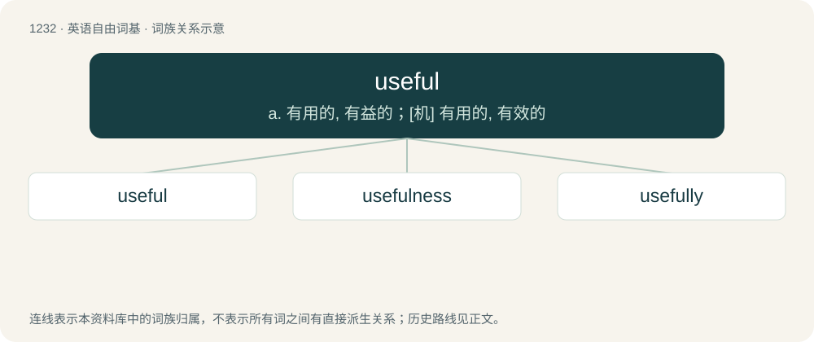

# 1314 · useful — a. 有用的, 有益的；\[机\] 有用的, 有效的

[总目录](../00_总目录_按常用程度.md)

**类型**：英语自由词基　｜　**来源语言**：见词源记录

## 核心含义与来源

- 核心含义：a. 有用的, 有益的；\[机\] 有用的, 有效的
- 英文含义：Having a practical or beneficial use.
- 词形：useful

**来源记录 1**（形容词；Having a practical or beneficial use.）

From use + -ful.

## 词族图

## 单词速览（常用到不常用）

| 单词 | 音标 | 释义 |
|---|---|---|
| [useful](#w-1) | 英 /ˈjuːsfəl/；美 /ˈjusfəl/ | a. 有用的, 有益的；\[机\] 有用的, 有效的 |
| [usefulness](#w-2) | /ˈjuːsfəlnəs/ | n. 有用, 有益；\[经\] 有用, 有用性 |
| [usefully](#w-3) |  | adv. 有效地, 有用地 |

## 逐词详解

### 1. useful

**词性**：形容词　｜　**音标**：英 /ˈjuːsfəl/；美 /ˈjusfəl/

**中文释义**：a. 有用的, 有益的；\[机\] 有用的, 有效的

**英文义项**：Having a practical or beneficial use.

**构词拆分**：use + -ful

**词源与演化**：

From use + -ful.

**例句**：

> She found the information extremely useful.

该用例对应义项：Having a practical or beneficial use.

### 2. usefulness

**词性**：名词　｜　**音标**：/ˈjuːsfəlnəs/

**中文释义**：n. 有用, 有益；\[经\] 有用, 有用性

**英文义项**：The quality or degree of being useful.

**构词拆分**：useful + -ness

**词源与演化**：

From useful + -ness.

**例句**：

> The usefulness of his latest reorganisation has been disputed.

该用例对应义项：The quality or degree of being useful.

### 3. usefully

**词性**：副词

**中文释义**：adv. 有效地, 有用地

**英文义项**：In a useful manner; in a way that achieves something

**构词拆分**：useful + -ly

**词源与演化**：

From useful + -ly.

**例句**：

> I would rather have it said, "He lived usefully," than, "He died rich."

该用例对应义项：In a useful manner; in a way that achieves something
