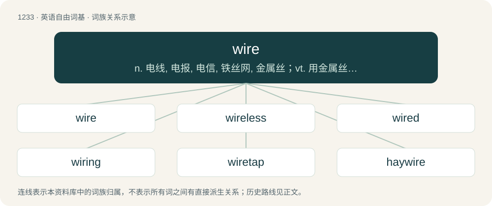

# 1316 · wire — n. 电线, 电报, 电信, 铁丝网, 金属丝；vt. 用金属丝捆扎, 拍电报；vi. 打电报

[总目录](../00_总目录_按常用程度.md)

**类型**：英语自由词基　｜　**来源语言**：见词源记录

## 核心含义与来源

- 核心含义：n. 电线, 电报, 电信, 铁丝网, 金属丝；vt. 用金属丝捆扎, 拍电报；vi. 打电报
- 英文含义：Metal formed into a thin, even thread, now usually by being drawn through a hole in a steel die.
- 词形：wire

**来源记录 1**（名词；Metal formed into a thin, even thread, now usually by being drawn through a hole in a steel die.）

From Middle English wir, wyr, from Old English wīr (“wire, metal thread, wire-ornament”), from Proto-Germanic \*wīraz (“wire”), from Proto-Indo-European \*weh₁iros (“a twist, thread, cord, wire”), from \*weh₁y- (“to turn, twist, weave, plait”).

## 词族图

## 单词速览（常用到不常用）

| 单词 | 音标 | 释义 |
|---|---|---|
| [wire](#w-1) | 英 /waɪə(ɹ)/；美 /ˈwaɪɚ/ | n. 电线, 电报, 电信, 铁丝网, 金属丝；vt. 用金属丝捆扎, 拍电报；vi. 打电报 |
| [wireless](#w-2) | 英 /ˈwaɪə.ləs/；美 /ˈwaɪ(jə)ɹ.ləs/ | n. 无线电；a. 无线的, 无线电的 |
| [wired](#w-3) | 英 /waɪəd/；美 /waɪɹd/ | a. 以金属丝加强的, 接有电线的, 以铁丝围起的 |
| [wiring](#w-4) | /ˈwaiəriŋ/ | n. 线路, 接线；\[计\] 布线 |
| [wiretap](#w-5) | 英 /ˈwaɪətæp/；美 /ˈwaɪɚtæp/ | v. 搭线窃听；n. 窃听 |
| [haywire](#w-6) | 英 /ˈheɪ.waɪ.ə(ɹ)/；美 /ˈheɪ.waɪɚ/ | \[计\] 临时的 |
| [newswire](#w-7) | /ˈnjuːzwaɪə(r)/ | 新闻专线 |
| [wiry](#w-8) | /ˈwaɪ(ə)ɹi/ | a. 金属线制的, 瘦长结实的；\[医\] 弦样的(指脉搏) |
| [rewire](#w-9) | /ɹiːˈwaɪə(ɹ)/ | vt. 换电线, 再打电报 |
| [wireline](#w-10) | /ˈwaiəlain/ | n. 钢丝绳；钢缆；铠装电缆；测井电缆 |
| [firewire](#w-11) |  | 【英文】A high-speed digital link standard covered by the IEEE 1394-1995 standard. |
| [underwire](#w-12) |  | 【英文】A semicircular wire placed in a bra to support the breasts. |
| [tripwire](#w-13) | /ˈtrip,waiə/ | 绊网 |

## 逐词详解

### 1. wire

**词性**：名词　｜　**音标**：英 /waɪə(ɹ)/；美 /ˈwaɪɚ/

**中文释义**：n. 电线, 电报, 电信, 铁丝网, 金属丝；vt. 用金属丝捆扎, 拍电报；vi. 打电报

**英文义项**：Metal formed into a thin, even thread, now usually by being drawn through a hole in a steel die. / A piece of such material; a thread or slender rod of metal, a cable.

**词源与演化**：

From Middle English wir, wyr, from Old English wīr (“wire, metal thread, wire-ornament”), from Proto-Germanic \*wīraz (“wire”), from Proto-Indo-European \*weh₁iros (“a twist, thread, cord, wire”), from \*weh₁y- (“to turn, twist, weave, plait”).

**例句**：

> That wire powers the lamp.

该用例对应义项：A metal conductor that carries electricity.

### 2. wireless

**词性**：形容词　｜　**音标**：英 /ˈwaɪə.ləs/；美 /ˈwaɪ(jə)ɹ.ləs/

**中文释义**：n. 无线电；a. 无线的, 无线电的

**英文义项**：Not having any wires. / Functioning without an external wired connection.

**构词拆分**：wire + -less

**词源与演化**：

From wire + -less.

**用法示例／搭配（非完整句）**：

> wireless headphones

该用例对应义项：Functioning without an external wired connection.

### 3. wired

**词性**：形容词　｜　**音标**：英 /waɪəd/；美 /waɪɹd/

**中文释义**：a. 以金属丝加强的, 接有电线的, 以铁丝围起的

**英文义项**：Equipped with wires, so as to connect to a power source or to other electric or electronic equipment; connected by wires. / Equipped with hidden electronic eavesdropping devices.

**构词拆分**：From wire + -ed.

**词源与演化**：

From wire + -ed.

**例句**：

> After three cups of coffee she was too wired to sleep.

该用例对应义项：Very excited, overstimulated; high-strung.

### 4. wiring

**词性**：名词　｜　**音标**：/ˈwaiəriŋ/

**中文释义**：n. 线路, 接线；\[计\] 布线

**英文义项**：A set of electric wires. / The act or process of installing such a set of wires.

**构词拆分**：From wire + -ing.

**词源与演化**：

From wire + -ing.

**例句**：

> The wiring of the American farm put power for countless tasks available at the flip of a switch.

该用例对应义项：The act or process of installing such a set of wires.

### 5. wiretap

**词性**：名词　｜　**音标**：英 /ˈwaɪətæp/；美 /ˈwaɪɚtæp/

**中文释义**：v. 搭线窃听；n. 窃听

**英文义项**：A connection installed on a telephone line or other communications system in order to allow a third party to conduct covert surveillance of conversations.

**构词拆分**：wire + tap

**词源与演化**：

Back-formation from wiretapper; or else wire + tap

### 6. haywire

**词性**：形容词　｜　**音标**：英 /ˈheɪ.waɪ.ə(ɹ)/；美 /ˈheɪ.waɪɚ/

**中文释义**：\[计\] 临时的

**英文义项**：Roughly-made, unsophisticated, decrepit (from the use of haywire for temporary repairs). / Behaviorally erratic or uncontrollable, especially of a machine or mechanical process.

**构词拆分**：hay + wire

**词源与演化**：

From hay + wire. The original meaning of “likely to become tangled unpredictably or unusably, or fall apart”, as though only bound with the kind of soft, springy wire used to bind hay bales comes from usage in New England lumber camps circa 1905 where haywire outfit became the common term to refer to slap-dash collections of logging tools. To go haywire has since evolved to represent the act of falling apart or behaving unpredictably, as would wire spooled under tension springing into an unmanageable tangle once a piece had been removed from the factory spool, e.g., “he took off the back of his watch, removed a gear and the whole works went haywire.”

**例句**：

> It was working fine until it went haywire and wouldn't stop printing blank sheets.

该用例对应义项：Behaviorally erratic or uncontrollable, especially of a machine or mechanical process.

### 7. newswire

**词性**：名词　｜　**音标**：/ˈnjuːzwaɪə(r)/

**中文释义**：新闻专线

**英文义项**：A service used for the transmission of breaking news to the media or to the public.

**构词拆分**：news + wire

**词源与演化**：

From news + wire.

### 8. wiry

**词性**：形容词　｜　**音标**：/ˈwaɪ(ə)ɹi/

**中文释义**：a. 金属线制的, 瘦长结实的；\[医\] 弦样的(指脉搏)

**英文义项**：Resembling wire. / Thin, muscular and flexible.

**构词拆分**：From wire + -y.

**词源与演化**：

From wire + -y.

**例句**：

> Don't fight him. He may be small, but he's wiry.

该用例对应义项：Thin, muscular and flexible.

### 9. rewire

**词性**：动词　｜　**音标**：/ɹiːˈwaɪə(ɹ)/

**中文释义**：vt. 换电线, 再打电报

**英文义项**：To replace or reconnect the wires of a device or installation. / To change the functionality of something by altering the parameters or logic.

**构词拆分**：re- + wire

**词源与演化**：

From re- + wire.

**例句**：

> Today we know now that learning literacy significantly rewires and restructures the brain.

该用例对应义项：To change the functionality of something by altering the parameters or logic.

### 10. wireline

**词性**：名词　｜　**音标**：/ˈwaiəlain/

**中文释义**：n. 钢丝绳；钢缆；铠装电缆；测井电缆

**英文义项**：A wire that runs from a drill rig down into the drill hole to support a dead load or other downhole tool. / Synonym of landline.

**构词拆分**：wire + line

**词源与演化**：

From wire + line.

### 11. firewire

**词性**：名词

**英文义项**：A high-speed digital link standard covered by the IEEE 1394-1995 standard. / A system of wires or tubes designed to detect fire and trigger automatic fire-extinguishers in an aircraft engine compartment for example.

**构词拆分**：fire + wire

**词源与演化**：

From fire + wire. In the first sense ("high-speed digital link standard"), the term was originally a trade name—capitalized FireWire—used by Apple Inc. as it developed the standard in the late 1980s and early 1990s.

### 12. underwire

**词性**：名词

**英文义项**：A semicircular wire placed in a bra to support the breasts. / A bra that includes such wires.

**构词拆分**：under- + wire

**词源与演化**：

From under- + wire.

### 13. tripwire

**词性**：名词　｜　**音标**：/ˈtrip,waiə/

**中文释义**：绊网

**英文义项**：A cord or wire arranged so that when snagged or pulled by an intruder, it will trigger a detector or trap or a device, such as a land mine. / Any means of detecting intruders or attackers.

**构词拆分**：trip + wire

**词源与演化**：

From trip + wire.

**例句**：

> Seeing the tripwire of a nearby bouncing Betty gave us cold chills, and we moved all the more slowly through the woods.

该用例对应义项：A cord or wire arranged so that when snagged or pulled by an intruder, it will trigger a detector or trap or a device, such as a land mine.
