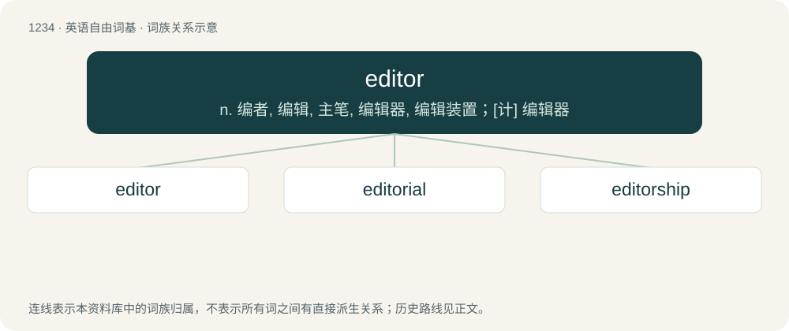

# 1317 · editor — n. 编者, 编辑, 主笔, 编辑器, 编辑装置；\[计\] 编辑器

[总目录](../00_总目录_按常用程度.md)

**类型**：英语自由词基　｜　**来源语言**：见词源记录

## 核心含义与来源

- 核心含义：n. 编者, 编辑, 主笔, 编辑器, 编辑装置；\[计\] 编辑器
- 英文含义：A person who edits or makes changes to documents.
- 词形：editor

**来源记录 1**（名词；A person who edits or makes changes to documents.）

From Medieval Latin ēditor, from Late Latin ēditor, from ēditus, perfect passive participle of ēdō (“give out, put forth, publish”).

## 词族图

## 单词速览（常用到不常用）

| 单词 | 音标 | 释义 |
|---|---|---|
| [editor](#w-1) | 英 /ˈɛd.ɪ.tə/；美 /ˈɛd.ɪ.təɹ/ | n. 编者, 编辑, 主笔, 编辑器, 编辑装置；\[计\] 编辑器 |
| [editorial](#w-2) | 英 /ˌɛdɪˈtɔːɹɪəl/；美 /ˌɛdɪˈtɔɹiəl/ | n. 社论, 评论；a. 编辑的, 主笔的, 社论的 |
| [editorship](#w-3) | /ˈeditəʃip/ | n. 编辑的职位, 编辑工作 |

## 逐词详解

### 1. editor

**词性**：名词　｜　**音标**：英 /ˈɛd.ɪ.tə/；美 /ˈɛd.ɪ.təɹ/

**中文释义**：n. 编者, 编辑, 主笔, 编辑器, 编辑装置；\[计\] 编辑器

**英文义项**：A person who edits or makes changes to documents. / A copy editor.

**词源与演化**：

From Medieval Latin ēditor, from Late Latin ēditor, from ēditus, perfect passive participle of ēdō (“give out, put forth, publish”).

**例句**：

> The TPU EVE editor is an excellent, extensible, programmable editor.

该用例对应义项：A program for creating and making changes to files, especially text files.

### 2. editorial

**词性**：形容词　｜　**音标**：英 /ˌɛdɪˈtɔːɹɪəl/；美 /ˌɛdɪˈtɔɹiəl/

**中文释义**：n. 社论, 评论；a. 编辑的, 主笔的, 社论的

**英文义项**：Of or relating to an editor, editing or an editorial. / Appropriate for high fashion magazines.

**构词拆分**：editor + -ial

**词源与演化**：

From editor + -ial.

**用法示例／搭配（非完整句）**：

> editorial labours; editorial remarks

该用例对应义项：Of or relating to an editor, editing or an editorial.

### 3. editorship

**词性**：名词　｜　**音标**：/ˈeditəʃip/

**中文释义**：n. 编辑的职位, 编辑工作

**英文义项**：The position or job of being an editor

**构词拆分**：editor + -ship

**词源与演化**：

From editor + -ship.
