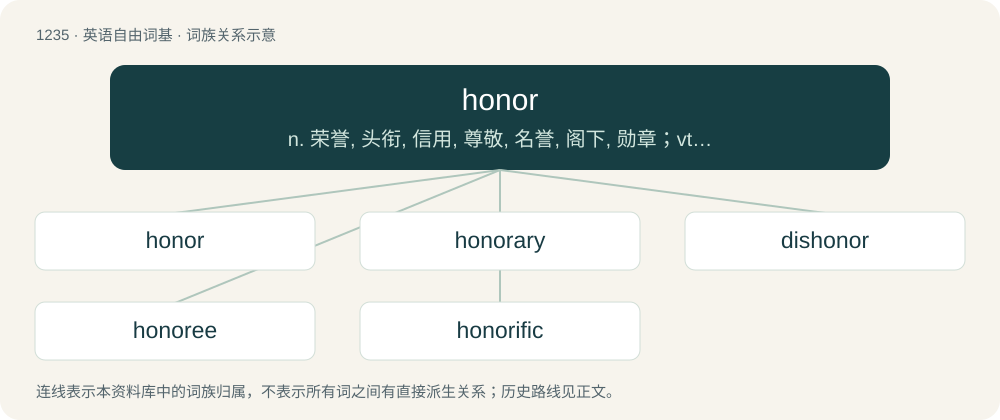

# 1318 · honor — n. 荣誉, 头衔, 信用, 尊敬, 名誉, 阁下, 勋章；vt. 尊敬, 授予荣誉, 承兑, 实践

[总目录](../00_总目录_按常用程度.md)

**类型**：英语自由词基　｜　**来源语言**：见词源记录

## 核心含义与来源

- 核心含义：n. 荣誉, 头衔, 信用, 尊敬, 名誉, 阁下, 勋章；vt. 尊敬, 授予荣誉, 承兑, 实践
- 英文含义：Recognition of importance or value; respect; veneration (of someone, usually for being morally upright or successful).
- 词形：honor

**来源记录 1**（名词；Recognition of importance or value; respect; veneration (of someone, usually for being morally upright or successful).）

From Middle English honour, honor, honur, from Anglo-Norman honour, honur, from Old French honor, from Latin honor. Displaced native Old English hād and Middle English menske (“honor, dignity among men”) (though survived in descendant mense (“property, civility, etc.”)), from Old Norse menskr (“honor”). The verb is from Middle English honouren, honuren (“to honor”).

## 词族图

## 单词速览（常用到不常用）

| 单词 | 音标 | 释义 |
|---|---|---|
| [honor](#w-1) | 英 /ˈɒn.ə/；美 /ˈɑ.nɚ/ | n. 荣誉, 头衔, 信用, 尊敬, 名誉, 阁下, 勋章；vt. 尊敬, 授予荣誉, 承兑, 实践 |
| [honorary](#w-2) | 美 /ˈɑn.əˌɹɛɹ.i/ | a. 荣誉的, 无报酬的, 道义上的；\[法\] 名誉的, 荣誉的 |
| [dishonor](#w-3) | 美 /dɪsˈɑnəɹ/ | n. 不名誉；vt. 玷辱, 使蒙羞 |
| [honoree](#w-4) | 英 /ˌɒn.əˈiː/；美 /ˌɑn.ɚˈi/ | n. 领奖人, 主宾 |
| [honorific](#w-5) | 英 /ˌɒnəˈɹɪfɪk/；美 /ˌɑːnəˈɹɪfɪk/ | a. 尊敬的, 表示敬意的, 敬称的；n. 敬语 |

## 逐词详解

### 1. honor

**词性**：名词　｜　**音标**：英 /ˈɒn.ə/；美 /ˈɑ.nɚ/

**中文释义**：n. 荣誉, 头衔, 信用, 尊敬, 名誉, 阁下, 勋章；vt. 尊敬, 授予荣誉, 承兑, 实践

**英文义项**：Recognition of importance or value; respect; veneration (of someone, usually for being morally upright or successful). / The state of being morally upright, honest, noble, virtuous, and magnanimous; excellence of character; the perception of such a state; favourable reputation; dignity.

**词源与演化**：

From Middle English honour, honor, honur, from Anglo-Norman honour, honur, from Old French honor, from Latin honor. Displaced native Old English hād and Middle English menske (“honor, dignity among men”) (though survived in descendant mense (“property, civility, etc.”)), from Old Norse menskr (“honor”). The verb is from Middle English honouren, honuren (“to honor”).

**例句**：

> Honors are normally awarded twice a year: on The Queen's Birthday in June and at the New Year.

该用例对应义项：A token of praise or respect; something that represents praiseworthiness or respect, such as a prize or award given by the state to a citizen.

### 2. honorary

**词性**：形容词　｜　**音标**：美 /ˈɑn.əˌɹɛɹ.i/

**中文释义**：a. 荣誉的, 无报酬的, 道义上的；\[法\] 名誉的, 荣誉的

**英文义项**：Given as an honor, with no duties attached, and without payment. / Voluntary.

**构词拆分**：honor + -ary

**词源与演化**：

From honor + -ary, modelled after French honoraire, from Latin honōrārius.

**例句**：

> I consider you an honorary member of our family because you've been with us for so long.

该用例对应义项：Unofficial; practically. Describes the holder of an unofficial position or title that is assigned as a special honor rather than by normal channels.

### 3. dishonor

**词性**：名词　｜　**音标**：美 /dɪsˈɑnəɹ/

**中文释义**：n. 不名誉；vt. 玷辱, 使蒙羞

**英文义项**：American standard spelling of dishonour.

**构词拆分**：dis- + honor

**词源与演化**：

From Old French deshonor, equivalent to dis- + honor.

**例句**：

> There's no dishonor in remaining silent when there's nothing to say.

### 4. honoree

**词性**：名词　｜　**音标**：英 /ˌɒn.əˈiː/；美 /ˌɑn.ɚˈi/

**中文释义**：n. 领奖人, 主宾

**英文义项**：One who receives an honor or award.

**构词拆分**：From honor + -ee.

**词源与演化**：

From honor + -ee.

### 5. honorific

**词性**：名词　｜　**音标**：英 /ˌɒnəˈɹɪfɪk/；美 /ˌɑːnəˈɹɪfɪk/

**中文释义**：a. 尊敬的, 表示敬意的, 敬称的；n. 敬语

**英文义项**：A person's title, such as "Mrs" or "Doctor". / A term of respect; respectful language.

**构词拆分**：honor + -ific

**词源与演化**：

From honor + -ific.

**例句**：

> I think honorific language is the hardest part of Japanese.
