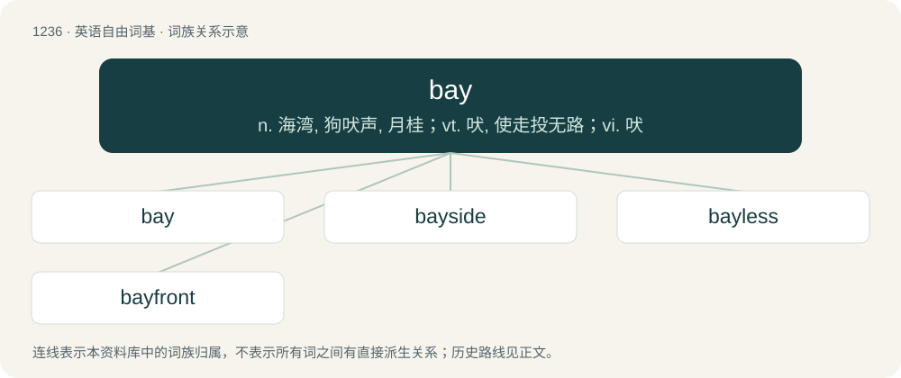

# 1319 · bay — n. 海湾, 狗吠声, 月桂；vt. 吠, 使走投无路；vi. 吠

[总目录](../00_总目录_按常用程度.md)

**类型**：英语自由词基　｜　**来源语言**：见词源记录

## 核心含义与来源

- 核心含义：n. 海湾, 狗吠声, 月桂；vt. 吠, 使走投无路；vi. 吠
- 英文含义：A body of water (especially the sea) contained by a concave shoreline.
- 词形：bay

**多个词源／构词路径**：同一拼写可能有不同来源；以下按词性和含义分别列出。

**来源记录 1**（名词；A body of water (especially the sea) contained by a concave shoreline.）

From French baie, from Late Latin baia, probably ultimately from Iberian or Basque badia. Partly displaced native Old English byht, whence bight.

**来源记录 2**（名词；A tree or shrub of species Laurus nobilis (family Lauraceae), having dark green leaves and berries.）

From Middle English baye, baie, from Old English beġ (“berry”), as in beġbēam (“berry-tree”), conflated with Old French baie, from Latin bāca (“berry”).

**来源记录 3**（名词；An opening in a wall, especially between two columns.）

From Middle English, from Old French baee, beee, from the verb beer (“gape open”), from Early Medieval Latin batāre. Compare Modern French baie. More at bevel, badinage.

**来源记录 4**（名词；The excited howling of dogs when hunting or being attacked.）

From the root \*bai, combined with aphetized form of abay; verbal form of baier, abaier.

**来源记录 5**（形容词；Of a reddish-brown colour with a black mane and tail.）

From Middle English bay, bai, from Old French bai, from Latin badius (“reddish brown, chestnut”).

## 词族图

## 单词速览（常用到不常用）

| 单词 | 音标 | 释义 |
|---|---|---|
| [bay](#w-1) | 英 /ˈbeɪ̯/；/ˈbeː/ | n. 海湾, 狗吠声, 月桂；vt. 吠, 使走投无路；vi. 吠 |
| [bayside](#w-2) |  | 贝赛德（美国地名） |
| [bayless](#w-3) |  | \[人名\] \[英格兰人姓氏\] 贝利斯 Bailey的变体 |
| [bayfront](#w-4) | 美 /ˈbeɪˌfɹʌnt/ | 【英文】Adjoining or fronting on a bay. |

## 逐词详解

### 1. bay

**词性**：名词　｜　**音标**：英 /ˈbeɪ̯/；/ˈbeː/

**中文释义**：n. 海湾, 狗吠声, 月桂；vt. 吠, 使走投无路；vi. 吠

**英文义项**：A body of water (especially the sea) contained by a concave shoreline. / A bank or dam to keep back water.

**词源与演化**：

From French baie, from Late Latin baia, probably ultimately from Iberian or Basque badia. Partly displaced native Old English byht, whence bight.

**例句**：

> This hotel has a great view across the bay.

该用例对应义项：A body of water (especially the sea) contained by a concave shoreline.

### 2. bayside

**词性**：形容词

**中文释义**：贝赛德（美国地名）

**英文义项**：Located along a bay

**构词拆分**：bay + side

**词源与演化**：

From bay + side.

### 3. bayless

**词性**：形容词

**中文释义**：\[人名\] \[英格兰人姓氏\] 贝利斯 Bailey的变体

**英文义项**：Of a coast or shore, without bays.

**构词拆分**：bay + -less

**词源与演化**：

From bay + -less.

### 4. bayfront

**词性**：形容词　｜　**音标**：美 /ˈbeɪˌfɹʌnt/

**英文义项**：Adjoining or fronting on a bay.

**构词拆分**：bay + front

**词源与演化**：

From bay + front.

**例句**：

> She ushered us into her spacious bayfront office.

该用例对应义项：Adjoining or fronting on a bay.
