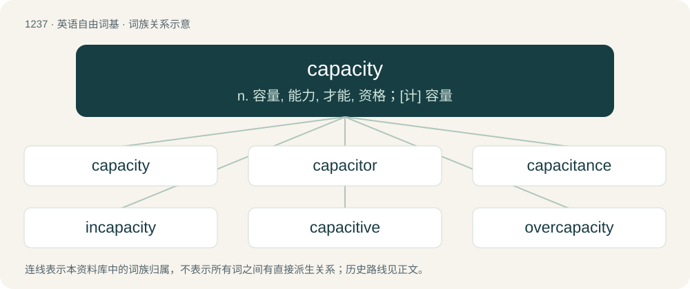

# 1320 · capacity — n. 容量, 能力, 才能, 资格；\[计\] 容量

[总目录](../00_总目录_按常用程度.md)

**类型**：英语自由词基　｜　**来源语言**：见词源记录

## 核心含义与来源

- 核心含义：n. 容量, 能力, 才能, 资格；\[计\] 容量
- 英文含义：The ability to hold, receive, or absorb.
- 词形：capacity

**来源记录 1**（名词；The ability to hold, receive, or absorb.）

From Middle English capacite, from Old French capacite, from Latin capācitās (whence -acity), from capāx (“able to hold much”), from capiō (“to hold, to contain, to take, to understand”).

## 词族图

## 单词速览（常用到不常用）

| 单词 | 音标 | 释义 |
|---|---|---|
| [capacity](#w-1) | 英 /kəˈpæsɪti/；美 /kəˈpæsɪti/ | n. 容量, 能力, 才能, 资格；\[计\] 容量 |
| [capacitor](#w-2) | 英 /kəˈpæ.sɪ.tə/；美 /kəˈpæ.sə.tɚ/ | n. 电容器；\[化\] 电容器 |
| [capacitance](#w-3) | /kəˈpæsitəns/ | n. 电容；\[化\] 电容 |
| [incapacity](#w-4) | /ˌɪnkəˈpæsɪti/ | n. 无能力, 不适当；\[医\] 无能力, 机能不全 |
| [capacitive](#w-5) | /kəˈpæsitiv/ | \[电\] 电容的 |
| [overcapacity](#w-6) | /.əuvəkəˈpæsəti/ | n. 生产能力过剩；\[经\] 生产能力过利, 设备过利 |

## 逐词详解

### 1. capacity

**词性**：名词　｜　**音标**：英 /kəˈpæsɪti/；美 /kəˈpæsɪti/

**中文释义**：n. 容量, 能力, 才能, 资格；\[计\] 容量

**英文义项**：The ability to hold, receive, or absorb. / A measure of such ability; volume.

**词源与演化**：

From Middle English capacite, from Old French capacite, from Latin capācitās (whence -acity), from capāx (“able to hold much”), from capiō (“to hold, to contain, to take, to understand”).

**例句**：

> Its capacity rating was 150 tons per hour, but its actual maximum capacity was 200 tons per hour.

该用例对应义项：The maximum that can be produced on a machine or in a facility or group.

### 2. capacitor

**词性**：名词　｜　**音标**：英 /kəˈpæ.sɪ.tə/；美 /kəˈpæ.sə.tɚ/

**中文释义**：n. 电容器；\[化\] 电容器

**英文义项**：An electronic component capable of storing electrical energy in an electric field; especially one consisting of two conductors separated by a dielectric.

**构词拆分**：capacity + -or

**词源与演化**：

From capacity + -or. Capacitor replaced the term condenser (coined by Alessandro Volta in 1782) to disambiguate it from steam condenser. The coiner is unknown but the change was recommended in 1926 by British Standard Glossary of Terms in Electrical Engineering.

**例句**：

> How does one calculate the capacitance of a capacitor?

### 3. capacitance

**词性**：名词　｜　**音标**：/kəˈpæsitəns/

**中文释义**：n. 电容；\[化\] 电容

**英文义项**：The property of an electric circuit or its element that permits it to store charge, defined as the ratio of stored charge to potential over that element or circuit (Q/V); SI unit: farad (F). / An element of an electrical circuit exhibiting capacitance.

**构词拆分**：capacity + -ance

**词源与演化**：

From capacity + -ance.

**例句**：

> How does one calculate the capacitance of a capacitor?

### 4. incapacity

**词性**：名词　｜　**音标**：/ˌɪnkəˈpæsɪti/

**中文释义**：n. 无能力, 不适当；\[医\] 无能力, 机能不全

**英文义项**：The lack of a capacity; an inability. / Legal disqualification.

**构词拆分**：in- + capacity

**词源与演化**：

From in- (“negative”) + capacity.

**例句**：

> Angst is the fear of our own incapacity for peace.

### 5. capacitive

**词性**：形容词　｜　**音标**：/kəˈpæsitiv/

**中文释义**：\[电\] 电容的

**英文义项**：Of or pertaining to electrostatic capacitance.

**构词拆分**：capacity + -ive

**词源与演化**：

From capacity + -ive.

**例句**：

> Capacitive touchscreens are all glass and designed for use in ATMs and similar kiosk-type applications.

该用例对应义项：Of or pertaining to electrostatic capacitance.

### 6. overcapacity

**词性**：名词　｜　**音标**：/.əuvəkəˈpæsəti/

**中文释义**：n. 生产能力过剩；\[经\] 生产能力过利, 设备过利

**英文义项**：A capacity for the production of a commodity or product that is in excess of what is needed.

**构词拆分**：over- + capacity

**词源与演化**：

From over- + capacity.
