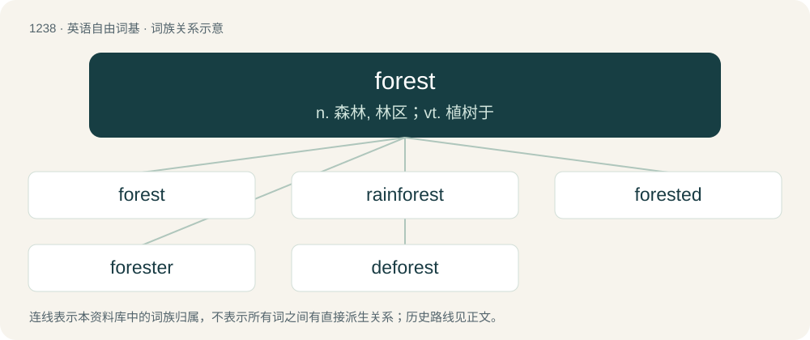

# 1321 · forest — n. 森林, 林区；vt. 植树于

[总目录](../00_总目录_按常用程度.md)

**类型**：英语自由词基　｜　**来源语言**：见词源记录

## 核心含义与来源

- 核心含义：n. 森林, 林区；vt. 植树于
- 英文含义：A dense uncultivated tract of trees and undergrowth, larger than woods.
- 词形：forest

**来源记录 1**（名词；A dense uncultivated tract of trees and undergrowth, larger than woods.）

Inherited from Middle English forest, from Old French forest, from Early Medieval Latin forestis. The Latin could be: \* from foris (“outside”), as in forestis (silva) "(wood) outside," \* or from Frankish or Proto-West Germanic \*furhisti (“forest, fir-grove, wooded land”), equivalent to fir + hurst. In which case, related to Old English fyrhþe (“forested land”), Old High German forst, forsti (“forest”), Old Norse fýri (“pine forest”). Doublet of frith. Cognate with Dutch vorst (“copse, grove, woodland”), German Forst (“forest”). In this sense, mostly displaced the native Middle English wode, from Old English wudu (modern English wood) and Middle English wald, wold, wæld, from Old English wald, weald (modern English wald, weald, wold).

## 词族图

## 单词速览（常用到不常用）

| 单词 | 音标 | 释义 |
|---|---|---|
| [forest](#w-1) | 英 /ˈfɒɹɪst/；美 /ˈfɔɹəst/ | n. 森林, 林区；vt. 植树于 |
| [rainforest](#w-2) | 英 /ˈɹeɪn.fɒɹ.ɪst/；美 /ˈɹeɪn.fɔɹ.ɪst/ | \[生态\]雨林 |
| [forested](#w-3) |  | a. 草木丛生的 |
| [forester](#w-4) | /ˈfɔristə/ | n. 林务员, 森林动物, 森林居民, 森林管理人 |
| [deforest](#w-5) | 英 /dɪˈfɒɹɪst/ | vt. 滥伐森林, 砍掉...上的树林 |

## 逐词详解

### 1. forest

**词性**：名词　｜　**音标**：英 /ˈfɒɹɪst/；美 /ˈfɔɹəst/

**中文释义**：n. 森林, 林区；vt. 植树于

**英文义项**：A dense uncultivated tract of trees and undergrowth, larger than woods. / Any dense collection or amount.

**构词拆分**：fir + hurst

**词源与演化**：

Inherited from Middle English forest, from Old French forest, from Early Medieval Latin forestis. The Latin could be: \* from foris (“outside”), as in forestis (silva) "(wood) outside," \* or from Frankish or Proto-West Germanic \*furhisti (“forest, fir-grove, wooded land”), equivalent to fir + hurst. In which case, related to Old English fyrhþe (“forested land”), Old High German forst, forsti (“forest”), Old Norse fýri (“pine forest”). Doublet of frith. Cognate with Dutch vorst (“copse, grove, woodland”), German Forst (“forest”). In this sense, mostly displaced the native Middle English wode, from Old English wudu (modern English wood) and Middle English wald, wold, wæld, from Old English wald, weald (modern English wald, weald, wold).

**用法示例／搭配（非完整句）**：

> a forest of criticism

该用例对应义项：Any dense collection or amount.

### 2. rainforest

**词性**：名词　｜　**音标**：英 /ˈɹeɪn.fɒɹ.ɪst/；美 /ˈɹeɪn.fɔɹ.ɪst/

**中文释义**：\[生态\]雨林

**英文义项**：A forest in a climate with high annual rainfall and no dry season.

**构词拆分**：rain + forest

**词源与演化**：

From rain + forest, a calque of German Regenwald.

**例句**：

> Most accidents, after all, happen around the corner, not in the rainforest.

### 3. forested

**词性**：形容词

**中文释义**：a. 草木丛生的

**英文义项**：Covered in forest.

**构词拆分**：forest + -ed

**词源与演化**：

From forest + -ed.

**例句**：

> Efforts to protect forested lands of the northwest.

该用例对应义项：covered with forest

### 4. forester

**词性**：名词　｜　**音标**：/ˈfɔristə/

**中文释义**：n. 林务员, 森林动物, 森林居民, 森林管理人

**英文义项**：A person who practices forestry. / Any of various species of kangaroo that inhabit bushland, especially the eastern grey kangaroo.

**构词拆分**：forest + -er

**词源与演化**：

Inherited from Middle English forester, a borrowing from Old French forestier, from forest + -ier; equivalent to forest + -er. Displaced native Old English wuduweard.

**例句**：

> I want to be a forester.

### 5. deforest

**词性**：动词　｜　**音标**：英 /dɪˈfɒɹɪst/

**中文释义**：vt. 滥伐森林, 砍掉...上的树林

**英文义项**：To clear (an area) of forest.

**构词拆分**：de- + forest

**词源与演化**：

From de- + forest.
