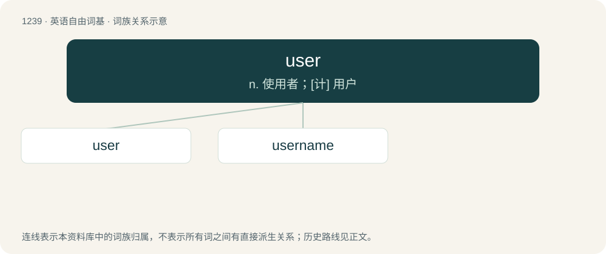

# 1322 · user — n. 使用者；\[计\] 用户

[总目录](../00_总目录_按常用程度.md)

**类型**：英语自由词基　｜　**来源语言**：见词源记录

## 核心含义与来源

- 核心含义：n. 使用者；\[计\] 用户
- 英文含义：One who uses or makes use of something, a consumer or client or an express or implied licensee (free user) or a trespasser.
- 词形：user

**来源记录 1**（名词；One who uses or makes use of something, a consumer or client or an express or implied licensee (free user) or a trespasser.）

From Middle English usere, equivalent to use + -er. Cognate with Scots usar, uiser (“user”).

## 词族图

## 单词速览（常用到不常用）

| 单词 | 音标 | 释义 |
|---|---|---|
| [user](#w-1) | 英 /ˈjuːzə/；美 /ˈjuzɚ/ | n. 使用者；\[计\] 用户 |
| [username](#w-2) |  | n. \[计\]由字母或数字组成的用户名称, 以标明用户的身份 |

## 逐词详解

### 1. user

**词性**：名词　｜　**音标**：英 /ˈjuːzə/；美 /ˈjuzɚ/

**中文释义**：n. 使用者；\[计\] 用户

**英文义项**：One who uses or makes use of something, a consumer or client or an express or implied licensee (free user) or a trespasser. / A person who uses drugs, especially illegal drugs.

**构词拆分**：use + -er

**词源与演化**：

From Middle English usere, equivalent to use + -er. Cognate with Scots usar, uiser (“user”).

**例句**：

> My friend is designing a user interface for the new operating system.

### 2. username

**词性**：名词

**中文释义**：n. \[计\]由字母或数字组成的用户名称, 以标明用户的身份

**英文义项**：A name or string of characters used as a person's identification on an individual computer system.

**构词拆分**：user + name

**词源与演化**：

From user + name.

**例句**：

> His username and password on his Apple PC is VolvestarcXXX.

该用例对应义项：A name or string of characters used as a person's identification on an individual computer system.
