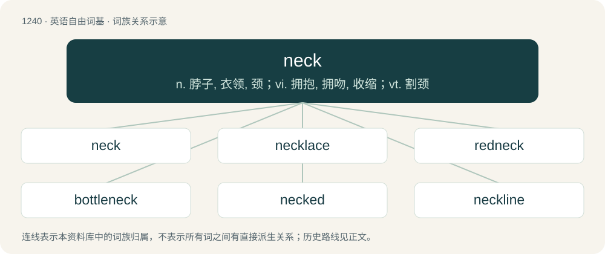

# 1323 · neck — n. 脖子, 衣领, 颈；vi. 拥抱, 拥吻, 收缩；vt. 割颈

[总目录](../00_总目录_按常用程度.md)

**类型**：英语自由词基　｜　**来源语言**：见词源记录

## 核心含义与来源

- 核心含义：n. 脖子, 衣领, 颈；vi. 拥抱, 拥吻, 收缩；vt. 割颈
- 英文含义：The part of the body connecting the head and the trunk found in humans and some animals.
- 词形：neck

**多个词源／构词路径**：同一拼写可能有不同来源；以下按词性和含义分别列出。

**来源记录 1**（名词；The part of the body connecting the head and the trunk found in humans and some animals.）

From Middle English nekke, nakke, from Old English hnecca, \*hnæcca (“neck, nape”), from Proto-West Germanic \*hnakkō, from Proto-Germanic \*hnakkô (“nape, neck”), from Proto-Indo-European \*knog-, \*kneg- (“back of the head, nape, neck”). Cognate with Scots nek (“neck”), North Frisian neek, neeke, Nak (“neck”), Saterland Frisian Näkke (“neck”), West Frisian nekke (“neck”), Dutch nek (“neck”), German Low German Nack (“neck”), German Nacken (“nape of the neck”), Danish nakke (“neck”), Swedish nacke (“nape of the neck”), Icelandic hnakki (“neck”), Tocharian A kñuk (“neck, nape”). Possibly a mutated variant of \*kneug/k (compare Old English hnocc (“hook, penis”), Welsh cnwch (“joint, knob”), Latvian knaūķis (“dwarf”). Doublet of nek. More at nook. Displaced halse (“neck, throat”) and swire (“neck”).

**来源记录 2**（名词；A shapeshifting water spirit in Germanic mythology and folklore; a nix.）

From Danish nøkke, Swedish näck.

## 词族图

## 单词速览（常用到不常用）

| 单词 | 音标 | 释义 |
|---|---|---|
| [neck](#w-1) | /ˈnɛk/ | n. 脖子, 衣领, 颈；vi. 拥抱, 拥吻, 收缩；vt. 割颈 |
| [necklace](#w-2) | 英 /ˈnɛklɪs/；美 /ˈnɛkləs/ | n. 项链 |
| [redneck](#w-3) | /ˈɹɛdnɛk/ | n. 红脖子（指美国南方保守的露天劳动者）；乡下人 |
| [bottleneck](#w-4) | /ˈbɒtlnek/ | n. 瓶颈；\[经\] 瓶颈, 增产障碍 |
| [necked](#w-5) | /nɛkt/ | a. (衣服)有...式样的领圈的 |
| [neckline](#w-6) | /ˈnɛkˌlaɪn/ | n. 领口, 领圈 |
| [turtleneck](#w-7) | /ˈtəːtlnek/ | n. 圆翻领, 高翻领毛衣 |
| [necktie](#w-8) | /ˈnɛk.taɪ/ | n. 领带 |
| [breakneck](#w-9) | 英 /ˈbɹeɪkˌnɛk/ | a. 要使颈骨折断似的, 非常危险的 |
| [necker](#w-10) |  | 【英文】Someone who kisses primarily in the neck; a neck kisser. |

## 逐词详解

### 1. neck

**词性**：名词　｜　**音标**：/ˈnɛk/

**中文释义**：n. 脖子, 衣领, 颈；vi. 拥抱, 拥吻, 收缩；vt. 割颈

**英文义项**：The part of the body connecting the head and the trunk found in humans and some animals. / The corresponding part in some other anatomical contexts.

**词源与演化**：

From Middle English nekke, nakke, from Old English hnecca, \*hnæcca (“neck, nape”), from Proto-West Germanic \*hnakkō, from Proto-Germanic \*hnakkô (“nape, neck”), from Proto-Indo-European \*knog-, \*kneg- (“back of the head, nape, neck”). Cognate with Scots nek (“neck”), North Frisian neek, neeke, Nak (“neck”), Saterland Frisian Näkke (“neck”), West Frisian nekke (“neck”), Dutch nek (“neck”), German Low German Nack (“neck”), German Nacken (“nape of the neck”), Danish nakke (“neck”), Swedish nacke (“nape of the neck”), Icelandic hnakki (“neck”), Tocharian A kñuk (“neck, nape”). Possibly a mutated variant of \*kneug/k (compare Old English hnocc (“hook, penis”), Welsh cnwch (“joint, knob”), Latvian knaūķis (“dwarf”). Doublet of nek. More at nook. Displaced halse (“neck, throat”) and swire (“neck”).

**例句**：

> Giraffes have long necks.

该用例对应义项：The part of the body connecting the head and the trunk found in humans and some animals.

### 2. necklace

**词性**：名词　｜　**音标**：英 /ˈnɛklɪs/；美 /ˈnɛkləs/

**中文释义**：n. 项链

**英文义项**：An article of jewelry that is worn around the neck, most often made of a string of precious metal, pearls, gems, beads or shells, and sometimes having a pendant attached. / Anything resembling a necklace in shape.

**构词拆分**：neck + lace

**词源与演化**：

From neck + lace.

**用法示例／搭配（非完整句）**：

> a necklace of coral islands

该用例对应义项：Anything resembling a necklace in shape.

### 3. redneck

**词性**：名词　｜　**音标**：/ˈɹɛdnɛk/

**中文释义**：n. 红脖子（指美国南方保守的露天劳动者）；乡下人

**英文义项**：A poor, rural, usually white, person from the Southern United States or parts of the Midwest and Northeast, especially one whose beliefs are seen as unsophisticated and backward; sometimes with additional connotations of being bigoted. / yokel, hick, country bumpkin

**构词拆分**：Bahuvrīhi compound of red + neck

**词源与演化**：

Bahuvrīhi compound of red + neck. Compare rooinek. The term originally characterized farmers that had a red neck, caused by sunburn from long hours working in the fields.

**例句**：

> The way he talks and acts, you can tell he's a redneck.

### 4. bottleneck

**词性**：名词　｜　**音标**：/ˈbɒtlnek/

**中文释义**：n. 瓶颈；\[经\] 瓶颈, 增产障碍

**英文义项**：The narrow portion that forms the pouring spout of a bottle; the neck of a bottle. / A portion of a bottleneck placed on the finger and used as a guitar slide.

**构词拆分**：bottle + neck

**词源与演化**：

From bottle + neck.

**例句**：

> It is easy to create entries; processing the paperwork is the bottleneck.

该用例对应义项：The part of a process that is too slow or cumbersome due to the lessening of available throughput.

### 5. necked

**词性**：形容词　｜　**音标**：/nɛkt/

**中文释义**：a. (衣服)有...式样的领圈的

**英文义项**：Having some specific type of neck or neckline.

**构词拆分**：neck + -ed

**词源与演化**：

From neck + -ed.

### 6. neckline

**词性**：名词　｜　**音标**：/ˈnɛkˌlaɪn/

**中文释义**：n. 领口, 领圈

**英文义项**：The line formed by the edge of an article of clothing that surrounds the neck, especially as seen at the front.

**构词拆分**：neck + line

**词源与演化**：

From neck + line.

**例句**：

> I didn't think Mary's neckline was too revealing.

### 7. turtleneck

**词性**：名词　｜　**音标**：/ˈtəːtlnek/

**中文释义**：n. 圆翻领, 高翻领毛衣

**英文义项**：A high, close-fitting collar, turned back on itself and covering all or most of the neck, on a sweater or similar garment. / The foreskin.

**构词拆分**：turtle + neck

**词源与演化**：

From turtle + neck.

**例句**：

> If the large maroon turtleneck is too big, do you have it in medium?

### 8. necktie

**词性**：名词　｜　**音标**：/ˈnɛk.taɪ/

**中文释义**：n. 领带

**英文义项**：A strip of cloth worn around the neck and tied in the front.

**构词拆分**：neck + tie

**词源与演化**：

From neck + tie.

**例句**：

> He stood in front of the mirror tightening his necktie.

该用例对应义项：neckwear consisting of a long narrow piece of material worn (mostly by men) under a collar and tied in knot at the front

### 9. breakneck

**词性**：形容词　｜　**音标**：英 /ˈbɹeɪkˌnɛk/

**中文释义**：a. 要使颈骨折断似的, 非常危险的

**英文义项**：Dangerously fast; hell-for-leather.

**构词拆分**：break + neck

**词源与演化**：

From break + neck.

**例句**：

> He came running around the corner at a breakneck pace and couldn't stop in time to avoid hitting the fruit stand.

该用例对应义项：Dangerously fast; hell-for-leather.

### 10. necker

**词性**：名词

**英文义项**：Someone who kisses primarily in the neck; a neck kisser.

**构词拆分**：neck + -er

**词源与演化**：

From neck + -er, from the verb.
