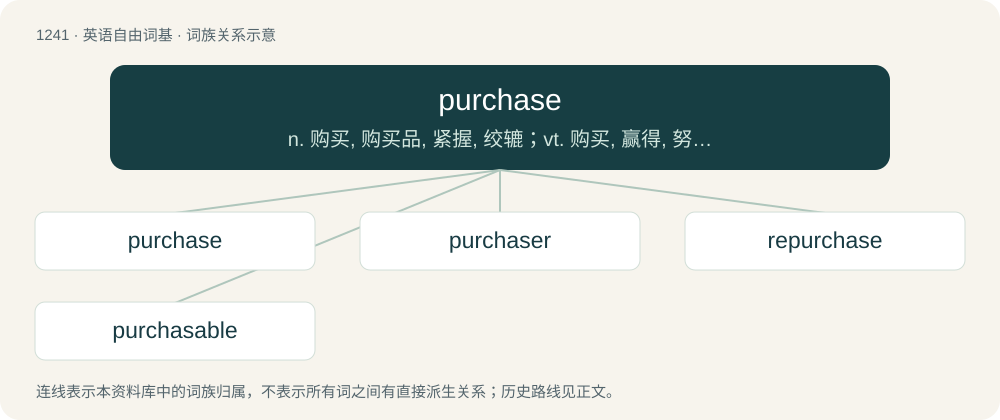

# 1325 · purchase — n. 购买, 购买品, 紧握, 绞辘；vt. 购买, 赢得, 努力取得, 用滑轮起(锚等)

[总目录](../00_总目录_按常用程度.md)

**类型**：英语自由词基　｜　**来源语言**：见词源记录

## 核心含义与来源

- 核心含义：n. 购买, 购买品, 紧握, 绞辘；vt. 购买, 赢得, 努力取得, 用滑轮起(锚等)
- 英文含义：The acquisition of title to, or property in, anything for a price; buying for money or its equivalent.
- 词形：purchase

**来源记录 1**（名词；The acquisition of title to, or property in, anything for a price; buying for money or its equivalent.）

From Middle English purchasen, from Anglo-Norman purchacer (“seek to obtain”) from pur- (from Latin pro-) + chac(i)er (“to chase, pursue”). Compare Old French porchacier (“to follow, to chase”), which has given French pourchasser (“to chase without relent”).

## 词族图

## 单词速览（常用到不常用）

| 单词 | 音标 | 释义 |
|---|---|---|
| [purchase](#w-1) | 英 /ˈpɜːtʃɪs/；美 /ˈpɜɹ.tʃəs/ | n. 购买, 购买品, 紧握, 绞辘；vt. 购买, 赢得, 努力取得, 用滑轮起(锚等) |
| [purchaser](#w-2) | /ˈpəːtʃəsə/ | n. 买方, 购买者；\[经\] 买主, 购买人 |
| [repurchase](#w-3) | /riːˈpəːtʃəs/ | vt. 再买, 买回；n. 买回 |
| [purchasable](#w-4) | /ˈpəːtʃəsəbl/ | a. 可买的, 可收买的 |

## 逐词详解

### 1. purchase

**词性**：名词　｜　**音标**：英 /ˈpɜːtʃɪs/；美 /ˈpɜɹ.tʃəs/

**中文释义**：n. 购买, 购买品, 紧握, 绞辘；vt. 购买, 赢得, 努力取得, 用滑轮起(锚等)

**英文义项**：The acquisition of title to, or property in, anything for a price; buying for money or its equivalent. / That which is obtained for a price in money or its equivalent.

**词源与演化**：

From Middle English purchasen, from Anglo-Norman purchacer (“seek to obtain”) from pur- (from Latin pro-) + chac(i)er (“to chase, pursue”). Compare Old French porchacier (“to follow, to chase”), which has given French pourchasser (“to chase without relent”).

**例句**：

> It is hard to get purchase on a nail without a pry bar or hammer.

该用例对应义项：Any mechanical hold or advantage, applied to the raising or removing of heavy bodies, as by a lever, a tackle or capstan.

### 2. purchaser

**词性**：名词　｜　**音标**：/ˈpəːtʃəsə/

**中文释义**：n. 买方, 购买者；\[经\] 买主, 购买人

**英文义项**：One who purchases.

**构词拆分**：From purchase + -er.

**词源与演化**：

From purchase + -er.

**例句**：

> The locomotive was offered for sale but it was later scrapped, as no purchaser was found.

### 3. repurchase

**词性**：动词　｜　**音标**：/riːˈpəːtʃəs/

**中文释义**：vt. 再买, 买回；n. 买回

**英文义项**：To buy back or again; to regain by purchase.

**构词拆分**：re- + purchase

**词源与演化**：

From re- + purchase.

### 4. purchasable

**词性**：形容词　｜　**音标**：/ˈpəːtʃəsəbl/

**中文释义**：a. 可买的, 可收买的

**英文义项**：Able to be purchased; available for purchase. / Affordable.

**构词拆分**：purchase + -able

**词源与演化**：

From purchase + -able.
