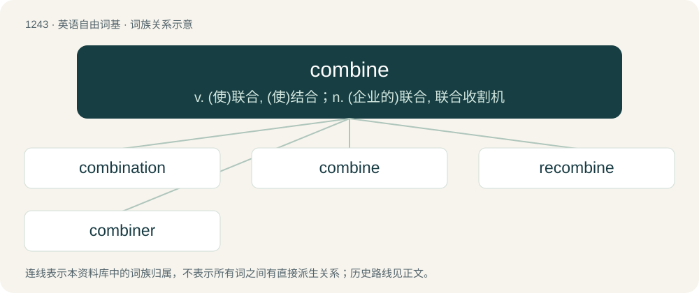

# 1327 · combine — v. (使)联合, (使)结合；n. (企业的)联合, 联合收割机

[总目录](../00_总目录_按常用程度.md)

**类型**：英语自由词基　｜　**来源语言**：见词源记录

## 核心含义与来源

- 核心含义：v. (使)联合, (使)结合；n. (企业的)联合, 联合收割机
- 英文含义：To bring (two or more things or activities) together; to unite.
- 词形：combine

**来源记录 1**（动词；To bring (two or more things or activities) together; to unite.）

From Middle English combynyn, from Middle French combiner, from Late Latin combīnāre (“unite, yoke together”), from Latin con- (“together”) + bīnī (“two by two”).

## 词族图

## 单词速览（常用到不常用）

| 单词 | 音标 | 释义 |
|---|---|---|
| [combination](#w-1) | 英 /ˌkɒmbɪˈneɪʃən/；美 /ˌkɑmbɪˈneɪʃən/ | n. 组合, 合并, 联合；\[计\] 组合图 |
| [combine](#w-2) | /kəmˈbaɪn/ | v. (使)联合, (使)结合；n. (企业的)联合, 联合收割机 |
| [recombine](#w-3) | /.riːkəmˈbain/ | vt. 再结合, 重组 |
| [combiner](#w-4) | /kəmˈbainə/ | \[计\] 组合器, 组合部件；\[化\] 层布贴合机 |

## 逐词详解

### 1. combination

**词性**：名词　｜　**音标**：英 /ˌkɒmbɪˈneɪʃən/；美 /ˌkɑmbɪˈneɪʃən/

**中文释义**：n. 组合, 合并, 联合；\[计\] 组合图

**英文义项**：The act of combining, the state of being combined or the result of combining. / An object formed by combining.

**构词拆分**：combine + -ation

**词源与演化**：

From Middle English combinacioun, combynacyoun, from Old French combination, from Late Latin combīnātiō. Morphologically combine + -ation.

**例句**：

> These guidelines should be followed in combination with those given last week.

该用例对应义项：The act of combining, the state of being combined or the result of combining.

### 2. combine

**词性**：动词　｜　**音标**：/kəmˈbaɪn/

**中文释义**：v. (使)联合, (使)结合；n. (企业的)联合, 联合收割机

**英文义项**：To bring (two or more things or activities) together; to unite. / To have two or more things or properties that function together.

**词源与演化**：

From Middle English combynyn, from Middle French combiner, from Late Latin combīnāre (“unite, yoke together”), from Latin con- (“together”) + bīnī (“two by two”).

**例句**：

> Joe combines the intelligence of a rock with the honesty of a politician.

该用例对应义项：To have two or more things or properties that function together.

### 3. recombine

**词性**：动词　｜　**音标**：/.riːkəmˈbain/

**中文释义**：vt. 再结合, 重组

**英文义项**：To combine again, especially to reassemble the parts of something previously taken apart in a different manner. / To undergo recombination.

**构词拆分**：re- + combine

**词源与演化**：

From re- + combine.

**例句**：

> The DNA can recombine.

该用例对应义项：undergo genetic recombination

### 4. combiner

**词性**：名词　｜　**音标**：/kəmˈbainə/

**中文释义**：\[计\] 组合器, 组合部件；\[化\] 层布贴合机

**英文义项**：A person who or a thing that combines.

**构词拆分**：combine + -er

**词源与演化**：

From combine + -er.
