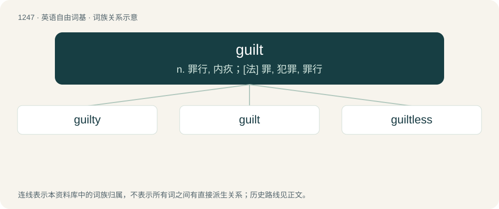

# 1330 · guilt — n. 罪行, 内疚；\[法\] 罪, 犯罪, 罪行

[总目录](../00_总目录_按常用程度.md)

**类型**：英语自由词基　｜　**来源语言**：见词源记录

## 核心含义与来源

- 核心含义：n. 罪行, 内疚；\[法\] 罪, 犯罪, 罪行
- 英文含义：Responsibility for wrongdoing.
- 词形：guilt

**多个词源／构词路径**：同一拼写可能有不同来源；以下按词性和含义分别列出。

**来源记录 1**（名词；Responsibility for wrongdoing.）

From Middle English gilt, gult, from Old English gylt (“guilt, sin, offense, crime, fault”), of obscure origin. Possibly related with Old English ġieldan (“to pay, requite, punish”) (whence yield), from Proto-West Germanic \*guldijā (whence Middle High German gülte (“debt, fee, financial duty”), Middle Low German gülde, German Gülte), from Proto-West Germanic \*geldan (“to pay for”), from Proto-Germanic \*geldaną (“to pay”). However, neither the Old English stem form nor its ending -t (instead of -d) fit the continental form.

**来源记录 2**（动词；To cause someone to feel guilt, particularly in order to influence their behaviour.）

From Etymology 1.

## 词族图

## 单词速览（常用到不常用）

| 单词 | 音标 | 释义 |
|---|---|---|
| [guilty](#w-1) | /ˈɡɪl.ti/ | a. 犯罪的, 有过失的, 自觉有错的, 心虚的；\[法\] 有罪的, 犯罪的, 自觉有罪的 |
| [guilt](#w-2) | 英 /ɡɪlt/ | n. 罪行, 内疚；\[法\] 罪, 犯罪, 罪行 |
| [guiltless](#w-3) | /ˈɡɪltləs/ | a. 无罪的, 无辜的, 没有...经验的, 不熟悉...的, 没有...的；\[法\] 无辜的, 无罪的, 无知的 |

## 逐词详解

### 1. guilty

**词性**：形容词　｜　**音标**：/ˈɡɪl.ti/

**中文释义**：a. 犯罪的, 有过失的, 自觉有错的, 心虚的；\[法\] 有罪的, 犯罪的, 自觉有罪的

**英文义项**：Responsible for a dishonest act. / Judged to have committed a crime.

**构词拆分**：guilt + -y

**词源与演化**：

From Middle English gilty, gulty, from Old English gyltiġ (“offending, guilty”); equivalent to guilt + -y.

**例句**：

> I still feel guilty about having forgotten his bday.

该用例对应义项：Responsible for a dishonest act.

### 2. guilt

**词性**：名词　｜　**音标**：英 /ɡɪlt/

**中文释义**：n. 罪行, 内疚；\[法\] 罪, 犯罪, 罪行

**英文义项**：Responsibility for wrongdoing. / The state of having been found guilty or admitted guilt in legal proceedings.

**词源与演化**：

From Middle English gilt, gult, from Old English gylt (“guilt, sin, offense, crime, fault”), of obscure origin. Possibly related with Old English ġieldan (“to pay, requite, punish”) (whence yield), from Proto-West Germanic \*guldijā (whence Middle High German gülte (“debt, fee, financial duty”), Middle Low German gülde, German Gülte), from Proto-West Germanic \*geldan (“to pay for”), from Proto-Germanic \*geldaną (“to pay”). However, neither the Old English stem form nor its ending -t (instead of -d) fit the continental form.

**例句**：

> The police had to retrieve the murder weapon to prove Dan's guilt.

### 3. guiltless

**词性**：形容词　｜　**音标**：/ˈɡɪltləs/

**中文释义**：a. 无罪的, 无辜的, 没有...经验的, 不熟悉...的, 没有...的；\[法\] 无辜的, 无罪的, 无知的

**英文义项**：Free from guilt; innocent. / Without experience or trial; unacquainted (with).

**构词拆分**：guilt + -less

**词源与演化**：

From Middle English giltles, gultles, gyltles, from Old English \*gyltlēas, equivalent to guilt + -less. Compare Old English sċyldlēas (“guiltless”).

**例句**：

> Those little yogurts may be guiltless, but do they really taste like key lime pie?
