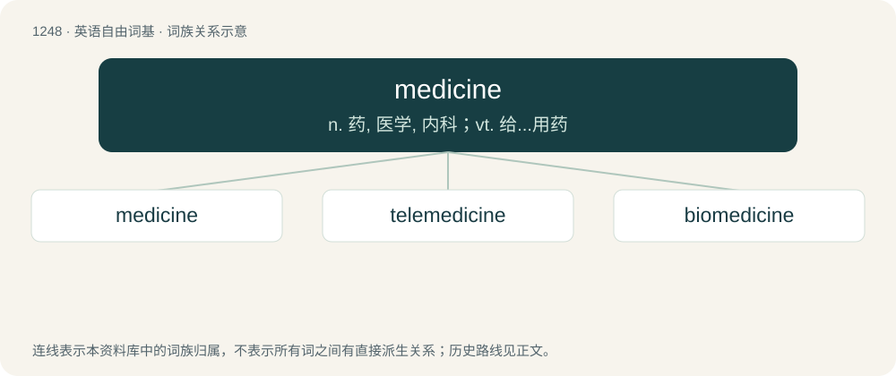

# 1331 · medicine — n. 药, 医学, 内科；vt. 给...用药

[总目录](../00_总目录_按常用程度.md)

**类型**：英语自由词基　｜　**来源语言**：见词源记录

## 核心含义与来源

- 核心含义：n. 药, 医学, 内科；vt. 给...用药
- 英文含义：A substance which specifically promotes healing when ingested or consumed in some way; a pharmaceutical drug.
- 词形：medicine

**来源记录 1**（名词；A substance which specifically promotes healing when ingested or consumed in some way; a pharmaceutical drug.）

From Middle English medicin, from Middle French medicine, from Old French medecine, from Latin medicīna (“the healing art, medicine, a physician's shop, a remedy, medicine”), feminine of medicīnus (“of or belonging to physic or surgery, or to a physician or surgeon”), from medicus (“a physician, surgeon”). The extended sense of "Indigenous magic" is a calque of Ojibwe mashkiki (“medicine”) or mide (or cognates in related languages) when used in compounds such as Grand Medicine Society, medicine lodge, medicine dance, medicine bag, medicine wheel, medicine man, Medicine Line, and bad medicine or place names such as Medicine Hat, Medicine Creek, etc. Displaced native Old English lybb (“drug, medicine”).

## 词族图

## 单词速览（常用到不常用）

| 单词 | 音标 | 释义 |
|---|---|---|
| [medicine](#w-1) | 英 /ˈmɛd.ɪ.s(ɪ)n/；美 /ˈmɛd.ɪ.sɪn/ | n. 药, 医学, 内科；vt. 给...用药 |
| [telemedicine](#w-2) | 英 /ˌtɛl.ɪˈmɛd.ɪ.sɪn/；美 /ˈtɛlə(ˌ)mɛdɪsɪn/ | n. (通过遥测、电话、电视等手段求诊的)远距离医学 |
| [biomedicine](#w-3) | /,baiəuˈmedisn/ | n. 生物医学；\[医\] 生物医学 |

## 逐词详解

### 1. medicine

**词性**：名词　｜　**音标**：英 /ˈmɛd.ɪ.s(ɪ)n/；美 /ˈmɛd.ɪ.sɪn/

**中文释义**：n. 药, 医学, 内科；vt. 给...用药

**英文义项**：A substance which specifically promotes healing when ingested or consumed in some way; a pharmaceutical drug. / Any treatment or cure.

**词源与演化**：

From Middle English medicin, from Middle French medicine, from Old French medecine, from Latin medicīna (“the healing art, medicine, a physician's shop, a remedy, medicine”), feminine of medicīnus (“of or belonging to physic or surgery, or to a physician or surgeon”), from medicus (“a physician, surgeon”). The extended sense of "Indigenous magic" is a calque of Ojibwe mashkiki (“medicine”) or mide (or cognates in related languages) when used in compounds such as Grand Medicine Society, medicine lodge, medicine dance, medicine bag, medicine wheel, medicine man, Medicine Line, and bad medicine or place names such as Medicine Hat, Medicine Creek, etc. Displaced native Old English lybb (“drug, medicine”).

**例句**：

> She's studying medicine at university because she wants to be a doctor in the future.

该用例对应义项：The study of the cause, diagnosis, prognosis and treatment of disease or illness.

### 2. telemedicine

**词性**：名词　｜　**音标**：英 /ˌtɛl.ɪˈmɛd.ɪ.sɪn/；美 /ˈtɛlə(ˌ)mɛdɪsɪn/

**中文释义**：n. (通过遥测、电话、电视等手段求诊的)远距离医学

**英文义项**：The transfer of medical information by means of telecommunication technologies for the purpose of consulting or for remote medical procedures or examinations.

**构词拆分**：tele- + medicine

**词源与演化**：

From tele- + medicine. First attested in 1968.

### 3. biomedicine

**词性**：名词　｜　**音标**：/,baiəuˈmedisn/

**中文释义**：n. 生物医学；\[医\] 生物医学

**英文义项**：The application of biology and physiology to clinical medicine. / The branch of medicine that studies the effects of environmental stress on organisms (most often in space travel).

**构词拆分**：bio- + medicine

**词源与演化**：

From bio- + medicine.
