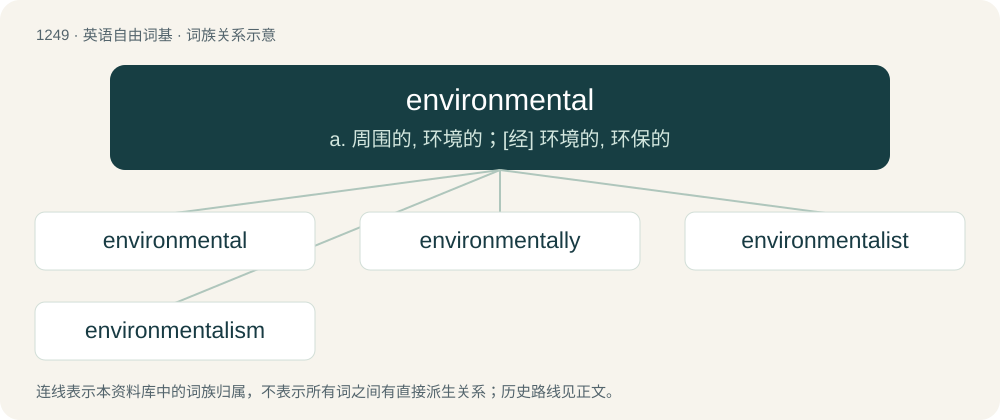

# 1332 · environmental — a. 周围的, 环境的；\[经\] 环境的, 环保的

[总目录](../00_总目录_按常用程度.md)

**类型**：英语自由词基　｜　**来源语言**：见词源记录

## 核心含义与来源

- 核心含义：a. 周围的, 环境的；\[经\] 环境的, 环保的
- 英文含义：Pertaining to the environment.
- 词形：environmental

**来源记录 1**（形容词；Pertaining to the environment.）

From environment + -al.

## 词族图

## 单词速览（常用到不常用）

| 单词 | 音标 | 释义 |
|---|---|---|
| [environmental](#w-1) | 英 /ɪnˌvaɪ.ɹə(n)ˈmɛn.təl/；美 /ənˌvaɪ.ɚnˈmɛn.təl/ | a. 周围的, 环境的；\[经\] 环境的, 环保的 |
| [environmentally](#w-2) |  | adv. 有关环境方面 |
| [environmentalist](#w-3) | /in,vaiərənˈmentlist/ | n. 环保人士 |
| [environmentalism](#w-4) | /in,vaiərənˈmentlizm/ | n. 环境保护论, 环境论 |

## 逐词详解

### 1. environmental

**词性**：形容词　｜　**音标**：英 /ɪnˌvaɪ.ɹə(n)ˈmɛn.təl/；美 /ənˌvaɪ.ɚnˈmɛn.təl/

**中文释义**：a. 周围的, 环境的；\[经\] 环境的, 环保的

**英文义项**：Pertaining to the environment. / Environmentally friendly.

**构词拆分**：environment + -al

**词源与演化**：

From environment + -al.

**例句**：

> Not a day goes by without our hearing of an environmental problem.

### 2. environmentally

**词性**：副词

**中文释义**：adv. 有关环境方面

**英文义项**：In a manner affecting the environment.

**构词拆分**：environmental + -ly

**词源与演化**：

From environmental + -ly.

**例句**：

> The new recycling policy is environmentally safe.

该用例对应义项：for the environment

### 3. environmentalist

**词性**：名词　｜　**音标**：/in,vaiərənˈmentlist/

**中文释义**：n. 环保人士

**英文义项**：One who advocates for the protection of the environment and biosphere from misuse from human activity through such measures as ecosystem protection, waste reduction and pollution prevention. / One who holds the view that environment, rather than heredity or culture, is the primary factor in the development of an individual or group.

**构词拆分**：environmental + -ist

**词源与演化**：

From environmental + -ist.

**例句**：

> Environmentalist parties generally use the color green in their symbols and names.

### 4. environmentalism

**词性**：名词　｜　**音标**：/in,vaiərənˈmentlizm/

**中文释义**：n. 环境保护论, 环境论

**英文义项**：A theory that views environment, rather than heredity or culture, as the important factor in the development of an individual or group. / A political and social ideology that seeks to prevent the environment from degradation by human activity.

**构词拆分**：environmental + -ism

**词源与演化**：

From environmental + -ism.

**例句**：

> The color green is often associated with environmentalism.
