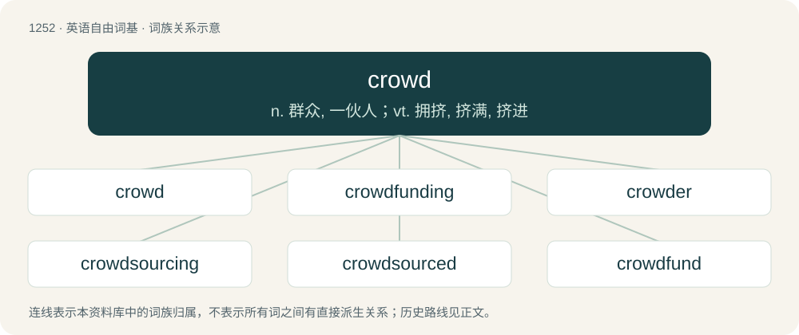

# 1338 · crowd — n. 群众, 一伙人；vt. 拥挤, 挤满, 挤进

[总目录](../00_总目录_按常用程度.md)

**类型**：英语自由词基　｜　**来源语言**：见词源记录

## 核心含义与来源

- 核心含义：n. 群众, 一伙人；vt. 拥挤, 挤满, 挤进
- 英文含义：To press forward; to advance by pushing.
- 词形：crowd

**多个词源／构词路径**：同一拼写可能有不同来源；以下按词性和含义分别列出。

**来源记录 1**（动词；To press forward; to advance by pushing.）

From Middle English crouden, from Old English crūdan, from Proto-West Germanic \*krūdan, from Proto-Germanic \*krūdaną, \*kreudaną, ultimately from Proto-Indo-European \*grewt- (“to push; press”). Cognate with German Low German kroden (“to push, shove”), Dutch kruien (“to push, shove”). (group of people, mob): Compare typologically throng (&lt;&lt;~ Proto-Germanic \*þrinhwaną); Czech dav (akin to Russian дави́ть (davítʹ), да́вка (dávka)); Polish ciżba, ścisk (&lt;~ ciskać, akin to ти́скать (tískatʹ)); Polish tłok, Russian толчея́ (tolčejá) (akin to толка́ть (tolkátʹ)).

**来源记录 2**（名词；A fiddle.）

Inherited from Middle English crowde, from Welsh crwth or a Celtic cognate.

## 词族图

## 单词速览（常用到不常用）

| 单词 | 音标 | 释义 |
|---|---|---|
| [crowd](#w-1) | 英 /ˈkɹaʊ̯d/；/ˈkɹæʊ̯d/ | n. 群众, 一伙人；vt. 拥挤, 挤满, 挤进 |
| [crowdfunding](#w-2) |  | 【英文】Funding by many individuals pooling their money together for a common goal, usually via the Internet. |
| [crowder](#w-3) | /ˈkɹaʊdə(ɹ)/ | n. 沟渠扫污机 |
| [crowdsourcing](#w-4) |  | 【英文】The delegation of a task to a large diffuse group in order to introduce new or more developed skill sets and improve efficiency. There is usually no substantial monetary compensation involved. |
| [crowdsourced](#w-5) |  | 【英文】Obtained by crowdsourcing. |
| [crowdfund](#w-6) |  | 【英文】To fund (a project) by having many individuals pool their money together, usually via the Internet. |
| [crowdsource](#w-7) |  | 【英文】To delegate a task to a large, diffuse group. |

## 逐词详解

### 1. crowd

**词性**：动词　｜　**音标**：英 /ˈkɹaʊ̯d/；/ˈkɹæʊ̯d/

**中文释义**：n. 群众, 一伙人；vt. 拥挤, 挤满, 挤进

**英文义项**：To press forward; to advance by pushing. / To press together or collect in numbers.

**词源与演化**：

From Middle English crouden, from Old English crūdan, from Proto-West Germanic \*krūdan, from Proto-Germanic \*krūdaną, \*kreudaną, ultimately from Proto-Indo-European \*grewt- (“to push; press”). Cognate with German Low German kroden (“to push, shove”), Dutch kruien (“to push, shove”). (group of people, mob): Compare typologically throng (&lt;&lt;~ Proto-Germanic \*þrinhwaną); Czech dav (akin to Russian дави́ть (davítʹ), да́вка (dávka)); Polish ciżba, ścisk (&lt;~ ciskać, akin to ти́скать (tískatʹ)); Polish tłok, Russian толчея́ (tolčejá) (akin to толка́ть (tolkátʹ)).

**例句**：

> They crowded through the archway and into the park.

该用例对应义项：To press together or collect in numbers.

### 2. crowdfunding

**词性**：名词

**英文义项**：Funding by many individuals pooling their money together for a common goal, usually via the Internet.

**构词拆分**：crowd + funding

**词源与演化**：

From crowd + funding.

**例句**：

> In March of last year, the company raised $25,000 through the online crowdfunding website Kickstarter.

### 3. crowder

**词性**：名词　｜　**音标**：/ˈkɹaʊdə(ɹ)/

**中文释义**：n. 沟渠扫污机

**英文义项**：One who crowds or pushes.

**构词拆分**：crowd + -er

**词源与演化**：

From crowd + -er.

**例句**：

> After being divorced for being an abusive narcissist, Steven Crowder blamed divorce laws.

### 4. crowdsourcing

**词性**：名词

**英文义项**：The delegation of a task to a large diffuse group in order to introduce new or more developed skill sets and improve efficiency. There is usually no substantial monetary compensation involved.

**构词拆分**：crowd + sourcing

**词源与演化**：

Coined by American journalist Jeff Howe in 2006, see quotations. From crowd + sourcing, by analogy with outsourcing.

**例句**：

> The fun thing about crowdsourcing is letting other people do the work for us.

### 5. crowdsourced

**词性**：形容词

**英文义项**：Obtained by crowdsourcing.

**构词拆分**：crowd + sourced

**词源与演化**：

From crowd + sourced.

### 6. crowdfund

**词性**：动词

**英文义项**：To fund (a project) by having many individuals pool their money together, usually via the Internet.

**构词拆分**：crowd + fund

**词源与演化**：

From crowd + fund.

### 7. crowdsource

**词性**：动词

**英文义项**：To delegate a task to a large, diffuse group.

**构词拆分**：crowd + source

**词源与演化**：

From crowd + source; more at crowdsourcing.
