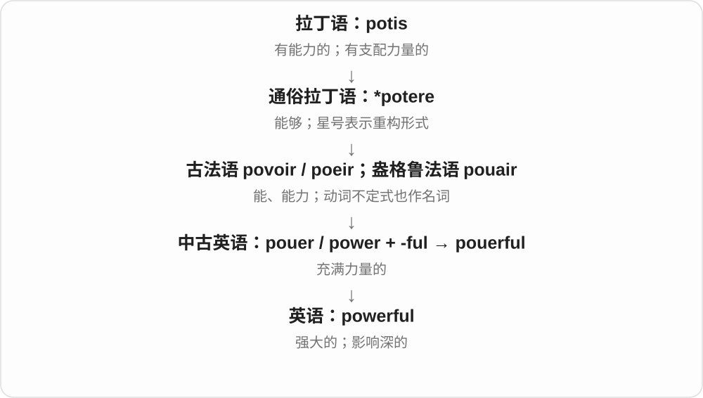
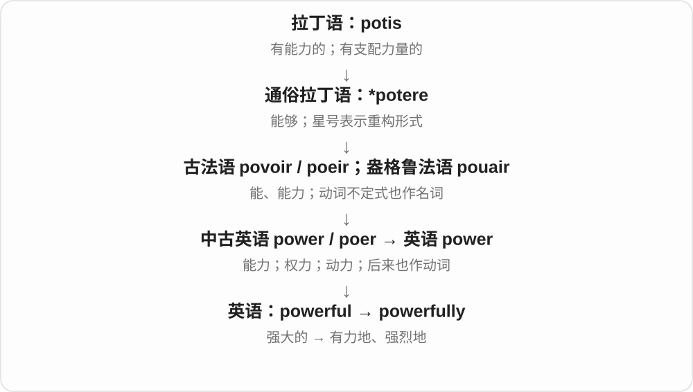

# 1338 · powerful — 强大；有力；影响大

[逐词精讲目录](../00_逐词精讲目录.md) · [总目录](../00_总目录_按常用程度.md)

## 核心词根与来源

powerful 由 power 与 -ful 形成，意义是具有力量或影响。powerfully 是相关副词，说明作用、表达或感受的方式。

**POWERFUL：能产生明显效果或施加影响**

可以是发动机的动力，也可以是证据、声音或组织的影响力。

- **强度和影响**：powerful · powerfully

## 词形与演化规律

power + -ful → powerful；powerful + -ly → powerfully。-ful 词尾只有一个 l。

## 单词速览（按词族由简到繁）

同一基础词的相关扩展放在一起，先读基础形式，再读扩展；各组之间优先读常用的。具体词源关系见各词讲解。

| 单词 | 音标 | 核心意思 |
|---|---|---|
| [powerful](#w-1) | 英 /ˈpaʊəfəl/；美 /ˈpaʊərfəl/ | 强大的；有影响力的；效果强烈的 |
| [powerfully](#w-2) | 英 /ˈpaʊəfəli/；美 /ˈpaʊərfəli/ | 有力地；强烈地；深刻地 |

## 逐词讲解

### 1. powerful — 强大的；有影响力的；效果强烈的

**音标**：英 /ˈpaʊəfəl/；美 /ˈpaʊərfəl/

**先抓住这个画面**

powerful 是力量足以推动局面：可以是推动车的马力，也可以是让人久久忘不了的一句话。

**怎么拆**

中古英语已有 pouerful 等形式，由当时的 power 加 -ful；现代仍可直接按 power + -ful 理解。

**怎么变成今天的意思**

a powerful engine 有强劲动力；a powerful speech 能打动人或改变想法。它不只说身体强壮，也能评价证据、情绪、机构和工具。

**常见搭配与例句**

a powerful engine；a powerful argument；a powerful influence on。

> The small boat has a surprisingly powerful engine.

这艘小船的发动机动力强得出人意料。

> Her final sentence had a powerful effect on the audience.

她最后一句话给听众带来了强烈触动。

**别混淆**

strong 更宽泛、更日常；powerful 常让人想到力量已经足以造成明显影响。

### 2. powerfully — 有力地；强烈地；深刻地

**音标**：英 /ˈpaʊəfəli/；美 /ˈpaʊərfəli/

**先抓住这个画面**

powerfully 描写力量是怎样表现出来的：一脚踢得有力，一段回忆也能强烈牵动人。

**怎么拆**

powerful + -ly，表示方式或程度。

**怎么变成今天的意思**

argue powerfully 是论证很有说服力；be powerfully affected 是受到强烈影响。它不要求声音大，轻声讲述也可能 powerfully convey an emotion。

**常见搭配与例句**

argue powerfully；powerfully express；be powerfully affected。

> She argued powerfully for keeping the public library open.

她有力地论证了让公共图书馆继续开放的必要性。

> The smell powerfully reminded him of home.

这个气味强烈地勾起了他的乡愁。

**别混淆**

loudly 说音量大；powerfully 说力量或影响强，二者并不等同。

## 这一组要分清什么

powerful evidence 是有说服力的证据，powerful engine 是动力强的发动机；具体力量不能都译成权力。

## 串起来练习

The speaker used a powerful example and argued powerfully.

演讲者用了一个有力的例子，论述很有说服力。
