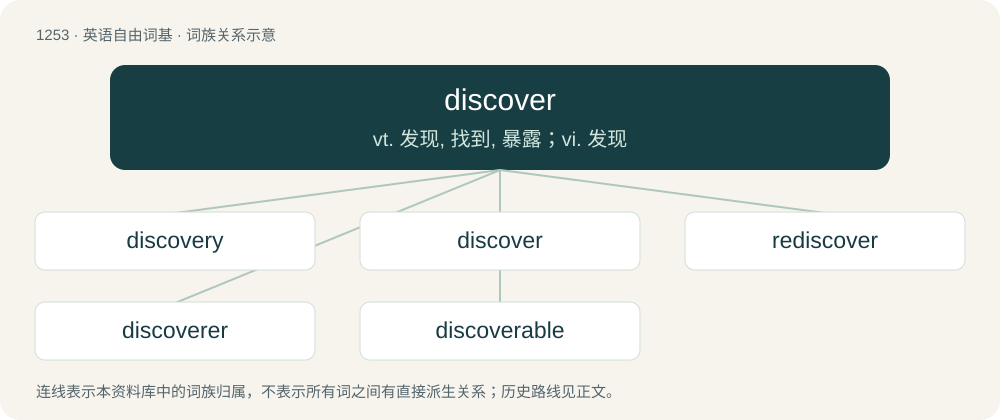

# 1339 · discover — vt. 发现, 找到, 暴露；vi. 发现

[总目录](../00_总目录_按常用程度.md)

**类型**：英语自由词基　｜　**来源语言**：见词源记录

## 核心含义与来源

- 核心含义：vt. 发现, 找到, 暴露；vi. 发现
- 英文含义：To find or learn something for the first time.
- 词形：discover

**来源记录 1**（动词；To find or learn something for the first time.）

From Middle English discoveren, from Old French descovrir, from Late Latin discoperīre &lt; discooperiō, discooperīre, from Latin dis- + cooperiō. Displaced native Old English onfindan.

## 词族图

## 单词速览（常用到不常用）

| 单词 | 音标 | 释义 |
|---|---|---|
| [discovery](#w-1) | 英 /dɪˈskʌv.ɹi/ | n. 发现, 被发现的事物；\[法\] 要求告知, 发现, 发觉 |
| [discover](#w-2) | 英 /dɪˈskʌvə/；美 /dɪˈskʌvɚ/ | vt. 发现, 找到, 暴露；vi. 发现 |
| [rediscover](#w-3) | /.riːdisˈkʌvə/ | vt. 重新发现 |
| [discoverer](#w-4) | 美 /dɪˈskʌvəɹəɹ/ | n. 发现者 |
| [discoverable](#w-5) | 英 /dɪsˈkʌvɹəbəɫ/ | a. 发现的, 显露的 |

## 逐词详解

### 1. discovery

**词性**：名词　｜　**音标**：英 /dɪˈskʌv.ɹi/

**中文释义**：n. 发现, 被发现的事物；\[法\] 要求告知, 发现, 发觉

**英文义项**：Something discovered. / The discovering of new things.

**构词拆分**：discover + -ery

**词源与演化**：

from discover + -ery, on the pattern of the pair recover, recovery. Displaced native Old English onfundennes.

**例句**：

> This latest discovery should eventually lead to much better treatments for disease.

该用例对应义项：Something discovered.

### 2. discover

**词性**：动词　｜　**音标**：英 /dɪˈskʌvə/；美 /dɪˈskʌvɚ/

**中文释义**：vt. 发现, 找到, 暴露；vi. 发现

**英文义项**：To find or learn something for the first time. / To create by moving a piece out of another piece's line of attack.

**词源与演化**：

From Middle English discoveren, from Old French descovrir, from Late Latin discoperīre &lt; discooperiō, discooperīre, from Latin dis- + cooperiō. Displaced native Old English onfindan.

**例句**：

> Turning the corner, I discovered a lovely little shop. I discovered that they sold widgets.

该用例对应义项：To find or learn something for the first time.

### 3. rediscover

**词性**：动词　｜　**音标**：/.riːdisˈkʌvə/

**中文释义**：vt. 重新发现

**英文义项**：To discover again; especially something previously lost or forgotten.

**构词拆分**：re- + discover

**词源与演化**：

From re- + discover.

**例句**：

> She rediscovered her faith in religion.

该用例对应义项：To discover again; especially something previously lost or forgotten.

### 4. discoverer

**词性**：名词　｜　**音标**：美 /dɪˈskʌvəɹəɹ/

**中文释义**：n. 发现者

**英文义项**：One who discovers: a person who has discovered something.

**构词拆分**：discover + -er

**词源与演化**：

From Middle English discoverour, dyscowerer, partly from Middle French descouvreur and partly equivalent to discover + -er.

**例句**：

> Monday is Columbus Day in the U.S., a federal holiday that celebrates the so-called discoverer of the Americas—the Italian explorer Christopher Columbus.

### 5. discoverable

**词性**：形容词　｜　**音标**：英 /dɪsˈkʌvɹəbəɫ/

**中文释义**：a. 发现的, 显露的

**英文义项**：Able to be discovered. / Subject to legal discovery; able to be requested by an opposing party through a legal process such as a subpoena.

**构词拆分**：discover + -able

**词源与演化**：

From discover + -able.
