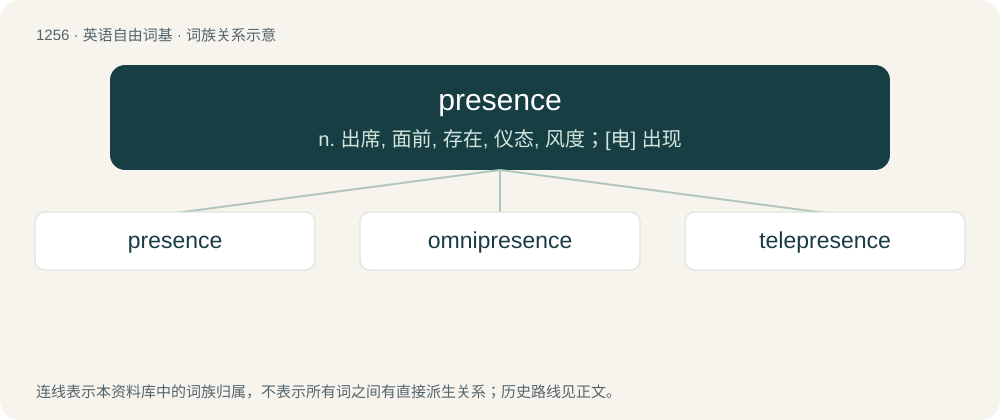

# 1342 · presence — n. 出席, 面前, 存在, 仪态, 风度；\[电\] 出现

[总目录](../00_总目录_按常用程度.md)

**类型**：英语自由词基　｜　**来源语言**：见词源记录

## 核心含义与来源

- 核心含义：n. 出席, 面前, 存在, 仪态, 风度；\[电\] 出现
- 英文含义：The fact or condition of being present, or of being within sight or call, or at hand.
- 词形：presence

**来源记录 1**（名词；The fact or condition of being present, or of being within sight or call, or at hand.）

Through Old French presence, from Latin praesentia (“a being present”), from praesentem. Displaced native Old English andweardnes.

## 词族图

## 单词速览（常用到不常用）

| 单词 | 音标 | 释义 |
|---|---|---|
| [presence](#w-1) | 英 /ˈpɹɛzəns/ | n. 出席, 面前, 存在, 仪态, 风度；\[电\] 出现 |
| [omnipresence](#w-2) | 美 /ɑmniˈprɛz(ə)ns/ | n. 遍在, 无所不在 |
| [telepresence](#w-3) | /ˈteliprezns/ | n. 远程监控 |

## 逐词详解

### 1. presence

**词性**：名词　｜　**音标**：英 /ˈpɹɛzəns/

**中文释义**：n. 出席, 面前, 存在, 仪态, 风度；\[电\] 出现

**英文义项**：The fact or condition of being present, or of being within sight or call, or at hand. / The part of space within one's immediate vicinity.

**词源与演化**：

Through Old French presence, from Latin praesentia (“a being present”), from praesentem. Displaced native Old English andweardnes.

**例句**：

> Despite being less than five foot, she filled up the theatre with her stage presence.

该用例对应义项：A quality that sets an individual out from others; a quality that makes them noticed and/or admired even if they are not speaking or performing.

### 2. omnipresence

**词性**：名词　｜　**音标**：美 /ɑmniˈprɛz(ə)ns/

**中文释义**：n. 遍在, 无所不在

**英文义项**：The ability to be, or the characteristic of being, at all places at the same time (usually only attributed to God).

**构词拆分**：omni- + presence

**词源与演化**：

From omni- + presence.

**例句**：

> The Bible also states that he has all the exclusive attributes of a divine being, omnipotence, omniscience, omnipresence, eternity, sovereignty, and immortality.

### 3. telepresence

**词性**：名词　｜　**音标**：/ˈteliprezns/

**中文释义**：n. 远程监控

**英文义项**：Virtual presence in another physical location by means of telecommunication technology.

**构词拆分**：tele- + presence

**词源与演化**：

From tele- + presence.
