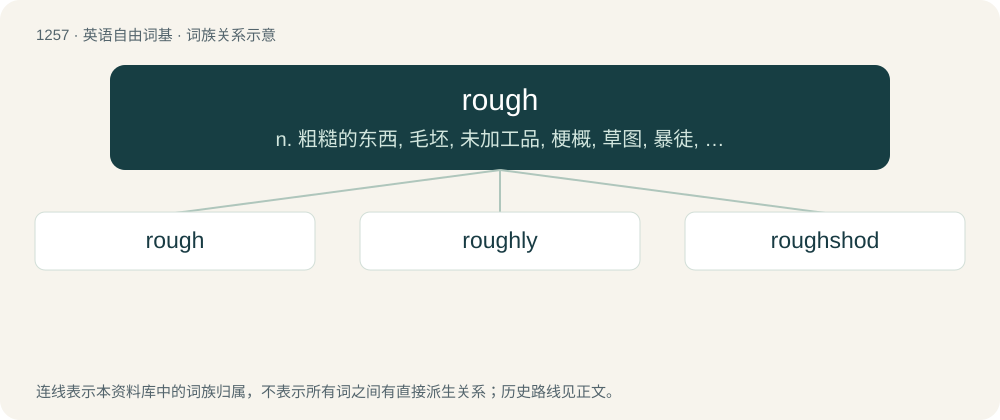

# 1343 · rough — n. 粗糙的东西, 毛坯, 未加工品, 梗概, 草图, 暴徒, 艰难；a. 粗糙的, 粗暴的, 蓬乱的, 草率的, 大致的, 简陋的, 暴风雨的, 艰难的；vt. 使粗糙, 使不平, 使蓬乱, 粗制, 草拟, 粗暴对待, 对...动粗

[总目录](../00_总目录_按常用程度.md)

**类型**：英语自由词基　｜　**来源语言**：见词源记录

## 核心含义与来源

- 核心含义：n. 粗糙的东西, 毛坯, 未加工品, 梗概, 草图, 暴徒, 艰难；a. 粗糙的, 粗暴的, 蓬乱的, 草率的, 大致的, 简陋的, 暴风雨的, 艰难的；vt. 使粗糙, 使不平, 使蓬乱, 粗制, 草拟, 粗暴对待, 对...动粗
- 英文含义：Not smooth; uneven.
- 词形：rough

**来源记录 1**（形容词；Not smooth; uneven.）

From Middle English rough, roughe, roȝe, row, rou, ru, ruȝ, ruh, from Old English rūg, rūh, from Proto-Germanic \*rūhaz. Cognate with Scots ruch, rouch (“rough”), Saterland Frisian ruuch, rouch (“rough”), West Frisian rûch (“rough”), Low German ruuch (“rough”), Dutch ruig (“rough”), German rau(h) (“rough”), Danish ru (“uneven on the surface, "rough", "rugged"”).

## 词族图

## 单词速览（常用到不常用）

| 单词 | 音标 | 释义 |
|---|---|---|
| [rough](#w-1) | 英 /ɹʌf/ | n. 粗糙的东西, 毛坯, 未加工品, 梗概, 草图, 暴徒, 艰难；a. 粗糙的, 粗暴的, 蓬乱的, 草率的, 大致的, 简陋的, 暴风雨的, 艰难的；vt. 使粗糙, 使不平, 使蓬乱, 粗制, 草拟, 粗暴对待, 对...动粗 |
| [roughly](#w-2) | 英 /ˈɹʌf.li/ | adv. 概略地, 粗糙地, 粗暴地 |
| [roughshod](#w-3) | 英 /ˈɹʌfʃɒd/；美 /ˈɹʌfʃɑd/ | a. 马蹄上装有防滑钉的 |

## 逐词详解

### 1. rough

**词性**：形容词　｜　**音标**：英 /ɹʌf/

**中文释义**：n. 粗糙的东西, 毛坯, 未加工品, 梗概, 草图, 暴徒, 艰难；a. 粗糙的, 粗暴的, 蓬乱的, 草率的, 大致的, 简陋的, 暴风雨的, 艰难的；vt. 使粗糙, 使不平, 使蓬乱, 粗制, 草拟, 粗暴对待, 对...动粗

**英文义项**：Not smooth; uneven. / Approximate; hasty or careless; not finished.

**词源与演化**：

From Middle English rough, roughe, roȝe, row, rou, ru, ruȝ, ruh, from Old English rūg, rūh, from Proto-Germanic \*rūhaz. Cognate with Scots ruch, rouch (“rough”), Saterland Frisian ruuch, rouch (“rough”), West Frisian rûch (“rough”), Low German ruuch (“rough”), Dutch ruig (“rough”), German rau(h) (“rough”), Danish ru (“uneven on the surface, "rough", "rugged"”).

**例句**：

> His manners are a bit rough, but he means well.

该用例对应义项：Crude; unrefined.

### 2. roughly

**词性**：副词　｜　**音标**：英 /ˈɹʌf.li/

**中文释义**：adv. 概略地, 粗糙地, 粗暴地

**英文义项**：In a rough manner; without kindness, softness, or gentleness. / Unevenly or irregularly.

**构词拆分**：rough + -ly

**词源与演化**：

From rough + -ly.

**例句**：

> He was pushed roughly aside.

该用例对应义项：with roughness or violence (`rough' is an informal variant for `roughly')

### 3. roughshod

**词性**：形容词　｜　**音标**：英 /ˈɹʌfʃɒd/；美 /ˈɹʌfʃɑd/

**中文释义**：a. 马蹄上装有防滑钉的

**英文义项**：Of a horse: having hooves shod with horseshoes that have calks or projecting parts to prevent slipping. / Brutal or domineering.

**构词拆分**：rough + shod

**词源与演化**：

From rough + shod.

**例句**：

> A manager who rode roughshod over all opposition.

该用例对应义项：unjustly domineering
