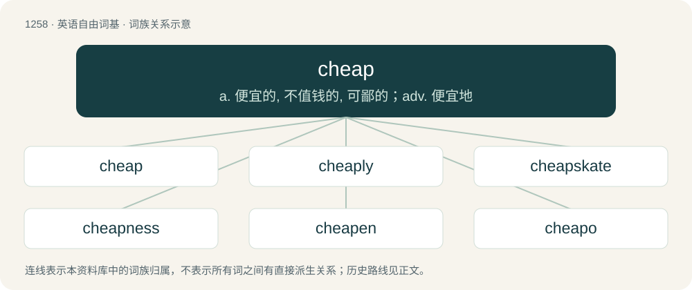

# 1344 · cheap — a. 便宜的, 不值钱的, 可鄙的；adv. 便宜地

[总目录](../00_总目录_按常用程度.md)

**类型**：英语自由词基　｜　**来源语言**：见词源记录

## 核心含义与来源

- 核心含义：a. 便宜的, 不值钱的, 可鄙的；adv. 便宜地
- 英文含义：Low or reduced in price.
- 词形：cheap

**来源记录 1**（形容词；Low or reduced in price.）

As a noun, from Middle English chep, from Old English cēap (“trade, market, value”), from Proto-West Germanic \*kaup. As a verb, from Middle English chepen, from Old English ċēapian (“to buy, bargain, trade”), from Proto-West Germanic \*kaupōn, from Proto-Germanic \*kaupōną, a verbal derivative of \*kaupô (“trader”), from Latin caupō. The adjective originated as a shortening of Middle and Early Modern English good cheap, literally “good purchase” (as in “that was good cheap”, i.e. “that was \[a\] good purchase”). Compare Dutch goedkoop, French bon marché. Cognates Cognate with Scots chepe (“to sell”), chape (“sale price”), North Frisian keap (“purchase”), West Frisian keap (“purchase, buy, acquisition”), Dutch koop (“buy, purchase, deal”), kopen (“to buy, purchase, shop”), Low German kopen (“to buy”), German Kauf (“trade, traffic, bargain, purchase, buy”), kaufen (“to buy”), Swedish köp (“bargain, purchase”), köpa (“to buy, purchase”), Norwegian Nynorsk kjøpa (“to buy, purchase”), Icelandic kaup (“purchase, bargain”), kaupa (“to purchase”); also borrowed as Finnish kauppa (“shop, trade”), Russian купить (kupitʹ, “to purchase”), Old Church Slavonic коупити (kupiti, “to purchase”), Bulgarian ку́пя (kúpja, “to purchase”), Serbo-Croatian купити (“to purchase”), Czech koupit (“to purchase”), Polish kupić (“to purchase”).

## 词族图

## 单词速览（常用到不常用）

| 单词 | 音标 | 释义 |
|---|---|---|
| [cheap](#w-1) | /ˈt͡ʃiːp/ | a. 便宜的, 不值钱的, 可鄙的；adv. 便宜地 |
| [cheaply](#w-2) | /ˈt͡ʃiːpli/ | adv. 便宜地 |
| [cheapskate](#w-3) | 美 /ˈt͡ʃipˌskeɪt/ | n. &lt;美俚&gt;守财奴,吝啬鬼 |
| [cheapness](#w-4) | 英 /ˈtʃiːpnəs/ | n. 廉价 |
| [cheapen](#w-5) | /ˈtʃiːpən/ | v. 减价, 跌价 |
| [cheapo](#w-6) | /ˈtʃiːpəj/ | a. 便宜的, 不值钱的 |

## 逐词详解

### 1. cheap

**词性**：形容词　｜　**音标**：/ˈt͡ʃiːp/

**中文释义**：a. 便宜的, 不值钱的, 可鄙的；adv. 便宜地

**英文义项**：Low or reduced in price. / Of poor quality.

**词源与演化**：

As a noun, from Middle English chep, from Old English cēap (“trade, market, value”), from Proto-West Germanic \*kaup. As a verb, from Middle English chepen, from Old English ċēapian (“to buy, bargain, trade”), from Proto-West Germanic \*kaupōn, from Proto-Germanic \*kaupōną, a verbal derivative of \*kaupô (“trader”), from Latin caupō. The adjective originated as a shortening of Middle and Early Modern English good cheap, literally “good purchase” (as in “that was good cheap”, i.e. “that was \[a\] good purchase”). Compare Dutch goedkoop, French bon marché. Cognates Cognate with Scots chepe (“to sell”), chape (“sale price”), North Frisian keap (“purchase”), West Frisian keap (“purchase, buy, acquisition”), Dutch koop (“buy, purchase, deal”), kopen (“to buy, purchase, shop”), Low German kopen (“to buy”), German Kauf (“trade, traffic, bargain, purchase, buy”), kaufen (“to buy”), Swedish köp (“bargain, purchase”), köpa (“to buy, purchase”), Norwegian Nynorsk kjøpa (“to buy, purchase”), Icelandic kaup (“purchase, bargain”), kaupa (“to purchase”); also borrowed as Finnish kauppa (“shop, trade”), Russian купить (kupitʹ, “to purchase”), Old Church Slavonic коупити (kupiti, “to purchase”), Bulgarian ку́пя (kúpja, “to purchase”), Serbo-Croatian купити (“to purchase”), Czech koupit (“to purchase”), Polish kupić (“to purchase”).

**例句**：

> Insurance is expensive, but don't be so cheap that you risk losing your home because of a fire.

该用例对应义项：Stingy; mean; excessively frugal.

### 2. cheaply

**词性**：副词　｜　**音标**：/ˈt͡ʃiːpli/

**中文释义**：adv. 便宜地

**英文义项**：In a cheap manner; without expending much money. / For a low score.

**构词拆分**：cheap + -ly

**词源与演化**：

From cheap + -ly.

**例句**：

> A cheaply dressed woman approached him in the bar.

该用例对应义项：in a cheap manner

### 3. cheapskate

**词性**：名词　｜　**音标**：美 /ˈt͡ʃipˌskeɪt/

**中文释义**：n. &lt;美俚&gt;守财奴,吝啬鬼

**英文义项**：Someone who stingily avoids spending money. / Someone who does not give freely.

**构词拆分**：cheap + skite (“contemptible person”)

**词源与演化**：

From cheap + skite (“contemptible person”). Compare blatherskite.

**例句**：

> My mum is such a cheapskate that she didn't lend me money to go shopping.

该用例对应义项：Someone who does not give freely.

### 4. cheapness

**词性**：名词　｜　**音标**：英 /ˈtʃiːpnəs/

**中文释义**：n. 廉价

**英文义项**：The state or character trait of being cheap (stingy). / The state or characteristic of being cheap (whether inexpensive, poorly made, or both).

**构词拆分**：cheap + -ness

**词源与演化**：

From cheap + -ness.

**例句**：

> His cheapness was legendary; he refused to use candles or lamps, not to reduce the risk of fire but rather to save a penny.

该用例对应义项：The state or character trait of being cheap (stingy).

### 5. cheapen

**词性**：动词　｜　**音标**：/ˈtʃiːpən/

**中文释义**：v. 减价, 跌价

**英文义项**：To decrease the value or price of; to make cheaper. / To make vulgar.

**构词拆分**：From cheap + -en.

**词源与演化**：

From cheap + -en.

**例句**：

> My parents say that YouTube and streaming services cheapen the magic of film.

### 6. cheapo

**词性**：形容词　｜　**音标**：/ˈtʃiːpəj/

**中文释义**：a. 便宜的, 不值钱的

**英文义项**：Inexpensive and of poor quality.

**构词拆分**：cheap + -o

**词源与演化**：

From cheap + -o (“person with characteristic”, colloquialising suffix).

**例句**：

> They wanted crystal champagne glasses for the party but the caterers provided cheapo plastic cups instead.

该用例对应义项：Inexpensive and of poor quality.
