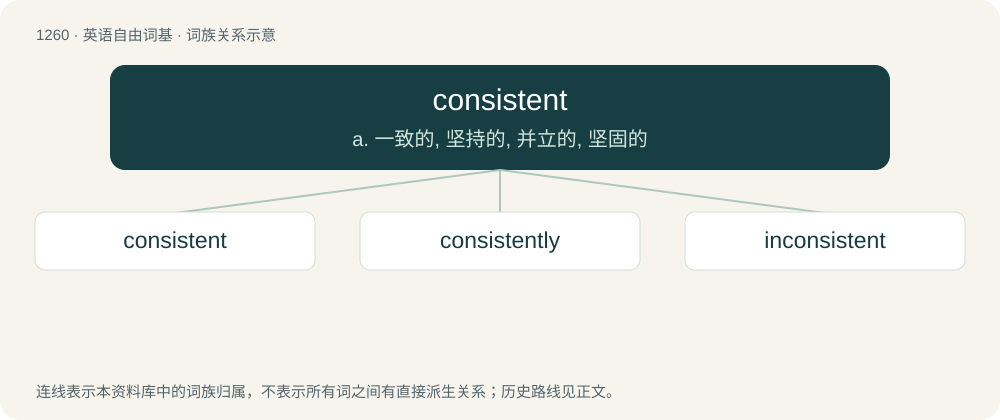

# 1346 · consistent — a. 一致的, 坚持的, 并立的, 坚固的

[总目录](../00_总目录_按常用程度.md)

**类型**：英语自由词基　｜　**来源语言**：见词源记录

## 核心含义与来源

- 核心含义：a. 一致的, 坚持的, 并立的, 坚固的
- 英文含义：Of a regularly occurring, dependable nature.
- 词形：consistent

**来源记录 1**（形容词；Of a regularly occurring, dependable nature.）

Borrowed from Latin cōnsistēntem, present participle of cōnsistō (“to agree with; to continue”), from con- (prefix indicating a being or bringing together of several objects) (ultimately from Proto-Indo-European \*ḱóm (“beside, by, near, with”)) + sistō (“to cause to stand; to place, set”) (ultimately from Proto-Indo-European \*stísteh₂ti (“to be standing up; to be getting up”), from the root \*steh₂- (“to stand (up)”)). By surface analysis, consist + -ent.

## 词族图

## 单词速览（常用到不常用）

| 单词 | 音标 | 释义 |
|---|---|---|
| [consistent](#w-1) | /kənˈsɪs.tənt/ | a. 一致的, 坚持的, 并立的, 坚固的 |
| [consistently](#w-2) | /kənˈsɪstəntli/ | adv. 坚固, 坚实, 一致, 始终如一, 连贯；\[计\] 相容地 |
| [inconsistent](#w-3) | /ˌɪnkənˈsɪstənt/ | a. 不一致的, 易变的, 前后矛盾的；\[法\] 矛盾的, 不一致的, 不协调的 |

## 逐词详解

### 1. consistent

**词性**：形容词　｜　**音标**：/kənˈsɪs.tənt/

**中文释义**：a. 一致的, 坚持的, 并立的, 坚固的

**英文义项**：Of a regularly occurring, dependable nature. / Compatible, accordant.

**词源与演化**：

Borrowed from Latin cōnsistēntem, present participle of cōnsistō (“to agree with; to continue”), from con- (prefix indicating a being or bringing together of several objects) (ultimately from Proto-Indo-European \*ḱóm (“beside, by, near, with”)) + sistō (“to cause to stand; to place, set”) (ultimately from Proto-Indo-European \*stísteh₂ti (“to be standing up; to be getting up”), from the root \*steh₂- (“to stand (up)”)). By surface analysis, consist + -ent.

**例句**：

> He is very consistent in his political choices: economy good or bad, he always votes Labour!

该用例对应义项：Of a regularly occurring, dependable nature.

### 2. consistently

**词性**：副词　｜　**音标**：/kənˈsɪstəntli/

**中文释义**：adv. 坚固, 坚实, 一致, 始终如一, 连贯；\[计\] 相容地

**英文义项**：In a consistent manner. / constantly; always.

**构词拆分**：consistent + -ly

**词源与演化**：

From consistent + -ly.

**例句**：

> As recent research shows, the life expectancy in Japan is consistently increasing.

### 3. inconsistent

**词性**：形容词　｜　**音标**：/ˌɪnkənˈsɪstənt/

**中文释义**：a. 不一致的, 易变的, 前后矛盾的；\[法\] 矛盾的, 不一致的, 不协调的

**英文义项**：Not compatible (with another thing); incompatible, discrepant, at odds. / Lacking internal consistency; self-contradicting; not compatible with itself.

**构词拆分**：in- + consistent

**词源与演化**：

From in- + consistent.

**例句**：

> His account of the evening was inconsistent with the security-camera footage.

该用例对应义项：Not compatible (with another thing); incompatible, discrepant, at odds.
