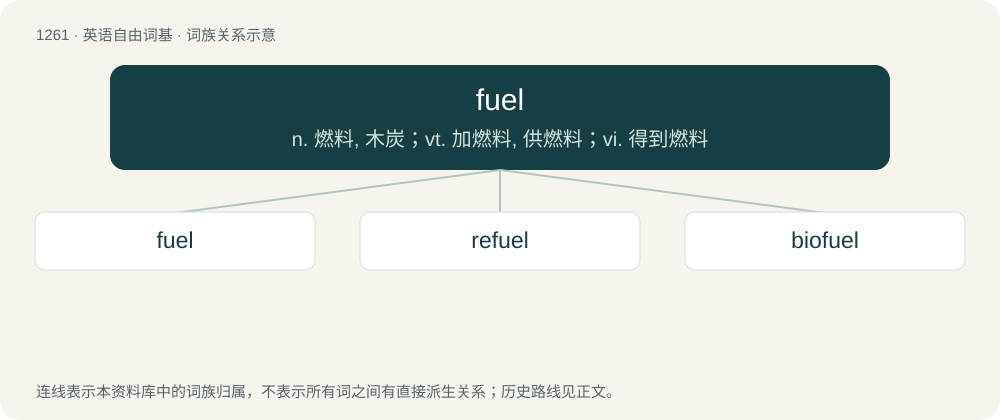

# 1348 · fuel — n. 燃料, 木炭；vt. 加燃料, 供燃料；vi. 得到燃料

[总目录](../00_总目录_按常用程度.md)

**类型**：英语自由词基　｜　**来源语言**：见词源记录

## 核心含义与来源

- 核心含义：n. 燃料, 木炭；vt. 加燃料, 供燃料；vi. 得到燃料
- 英文含义：Substance consumed to provide energy through combustion, or through chemical or nuclear reaction.
- 词形：fuel

**来源记录 1**（名词；Substance consumed to provide energy through combustion, or through chemical or nuclear reaction.）

From Middle English fuayle, from Old French fouaille, feuaille (“firewood, kindling”), from feu (“fire”), from Late Latin focus (“fire”), from Latin focus (“hearth”), whence English focus. Cognate with Spanish fuego (“fire”), and Portuguese fogo (“fire”).

## 词族图

## 单词速览（常用到不常用）

| 单词 | 音标 | 释义 |
|---|---|---|
| [fuel](#w-1) | /ˈfjuːəl/ | n. 燃料, 木炭；vt. 加燃料, 供燃料；vi. 得到燃料 |
| [refuel](#w-2) | /ɹiːˈfjuːəl/ | v. 补给燃料 |
| [biofuel](#w-3) | 英 /ˈbaɪ.əʊˌfjʊ(.ə)l/ | \[机\] 生物燃料 |

## 逐词详解

### 1. fuel

**词性**：名词　｜　**音标**：/ˈfjuːəl/

**中文释义**：n. 燃料, 木炭；vt. 加燃料, 供燃料；vi. 得到燃料

**英文义项**：Substance consumed to provide energy through combustion, or through chemical or nuclear reaction. / Substance that provides nourishment for a living organism; food.

**词源与演化**：

From Middle English fuayle, from Old French fouaille, feuaille (“firewood, kindling”), from feu (“fire”), from Late Latin focus (“fire”), from Latin focus (“hearth”), whence English focus. Cognate with Spanish fuego (“fire”), and Portuguese fogo (“fire”).

**例句**：

> His books were fuel for the revolution.

该用例对应义项：Something that stimulates, encourages or maintains an action.

### 2. refuel

**词性**：动词　｜　**音标**：/ɹiːˈfjuːəl/

**中文释义**：v. 补给燃料

**英文义项**：To refill with fuel.

**构词拆分**：re- + fuel

**词源与演化**：

From re- + fuel.

**例句**：

> We have to refuel in order to have sufficient petrol for the journey.

### 3. biofuel

**词性**：名词　｜　**音标**：英 /ˈbaɪ.əʊˌfjʊ(.ə)l/

**中文释义**：\[机\] 生物燃料

**英文义项**：Any fuel that is obtained from a renewable biological resource, especially from biomass.

**构词拆分**：bio- + fuel

**词源与演化**：

From bio- + fuel.

**例句**：

> He says the whisky-based biofuel provides more power than bioethanol, a fuel made from plants like corn or sugar cane.
