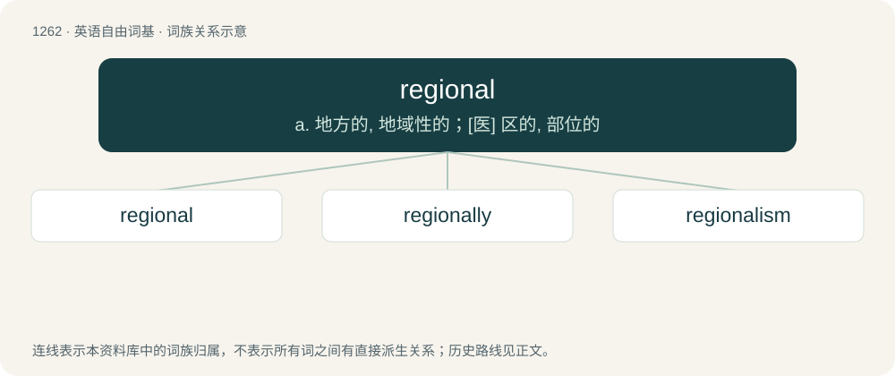

# 1349 · regional — a. 地方的, 地域性的；\[医\] 区的, 部位的

[总目录](../00_总目录_按常用程度.md)

**类型**：英语自由词基　｜　**来源语言**：见词源记录

## 核心含义与来源

- 核心含义：a. 地方的, 地域性的；\[医\] 区的, 部位的
- 英文含义：Of, or pertaining to, a specific region or district.
- 词形：regional

**来源记录 1**（形容词；Of, or pertaining to, a specific region or district.）

From Middle French régional, from Latin regiōnālis.

## 词族图

## 单词速览（常用到不常用）

| 单词 | 音标 | 释义 |
|---|---|---|
| [regional](#w-1) | 英 /ˈɹiː.d͡ʒə.nəl/；美 /ˈɹi.d͡ʒə.nəl/ | a. 地方的, 地域性的；\[医\] 区的, 部位的 |
| [regionally](#w-2) | /ˈɹiːd͡ʒənəli/ | adv. 在地区范围内, 地区性地 |
| [regionalism](#w-3) | /ˈriːdʒənə,lizəm/ | n. 行政区的划分, 地方主义, 地方色彩, 地区性, 地区特征 |

## 逐词详解

### 1. regional

**词性**：形容词　｜　**音标**：英 /ˈɹiː.d͡ʒə.nəl/；美 /ˈɹi.d͡ʒə.nəl/

**中文释义**：a. 地方的, 地域性的；\[医\] 区的, 部位的

**英文义项**：Of, or pertaining to, a specific region or district. / Of, or pertaining to, a large geographic region.

**词源与演化**：

From Middle French régional, from Latin regiōnālis.

**用法示例／搭配（非完整句）**：

> regional language variation

该用例对应义项：Of, or pertaining to, a large geographic region.

### 2. regionally

**词性**：副词　｜　**音标**：/ˈɹiːd͡ʒənəli/

**中文释义**：adv. 在地区范围内, 地区性地

**英文义项**：In a large but limited area, more than local but smaller than entirety. (Generally smaller than a nation.)

**构词拆分**：regional + -ly

**词源与演化**：

From regional + -ly.

**例句**：

> Northern Berber dialects are mutually intelligible but regionally different varieties of the same language.

### 3. regionalism

**词性**：名词　｜　**音标**：/ˈriːdʒənə,lizəm/

**中文释义**：n. 行政区的划分, 地方主义, 地方色彩, 地区性, 地区特征

**英文义项**：Affection, often excessive, for one's own region and to everything related to it. / The belief that most or nearly all political power should be decentralized to regional governments.

**构词拆分**：regional + -ism

**词源与演化**：

From regional + -ism.

**例句**：

> I try to avoid this regionalism when speaking to an international audience.
