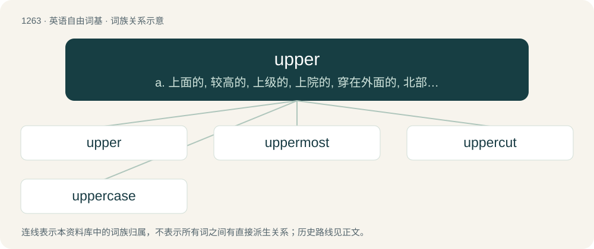

# 1350 · upper — a. 上面的, 较高的, 上级的, 上院的, 穿在外面的, 北部的, 地表的, 后期的；n. 鞋帮, 上齿

[总目录](../00_总目录_按常用程度.md)

**类型**：英语自由词基　｜　**来源语言**：见词源记录

## 核心含义与来源

- 核心含义：a. 上面的, 较高的, 上级的, 上院的, 穿在外面的, 北部的, 地表的, 后期的；n. 鞋帮, 上齿
- 英文含义：At a higher physical position, level, rank or order.
- 词形：upper

**来源记录 1**（形容词；At a higher physical position, level, rank or order.）

Inherited from Middle English upper. By surface analysis, up + -er.

## 词族图

## 单词速览（常用到不常用）

| 单词 | 音标 | 释义 |
|---|---|---|
| [upper](#w-1) | 英 /ˈʌpə/；美 /ˈʌpɚ/ | a. 上面的, 较高的, 上级的, 上院的, 穿在外面的, 北部的, 地表的, 后期的；n. 鞋帮, 上齿 |
| [uppermost](#w-2) | 英 /ˈʌpəməʊst/；美 /ˈʌpɚˌmoʊst/ | a. 最高的, 最上面的；adv. 在最上面, 在最高处 |
| [uppercut](#w-3) | /ˈʌpəkʌt/ | n. 上钩拳；v. 用上钩拳击 |
| [uppercase](#w-4) | /ˈʌpəkeis/ | a. 大写字母的；vt. 用大写字母写, 以大写字母印刷 |

## 逐词详解

### 1. upper

**词性**：名词　｜　**音标**：英 /ˈʌpə/；美 /ˈʌpɚ/

**中文释义**：a. 上面的, 较高的, 上级的, 上院的, 穿在外面的, 北部的, 地表的, 后期的；n. 鞋帮, 上齿

**英文义项**：A stimulant, such as amphetamine, that increases energy and decreases appetite. / Anything that cheers one up.

**词源与演化**：

Inherited from Middle English upper. By surface analysis, up + -er.

**用法示例／搭配（非完整句）**：

> genuine leather upper / balance manmade \[label on a shoe\]

该用例对应义项：The piece of material that forms the top part of a shoe or boot above the sole.

### 2. uppermost

**词性**：形容词　｜　**音标**：英 /ˈʌpəməʊst/；美 /ˈʌpɚˌmoʊst/

**中文释义**：a. 最高的, 最上面的；adv. 在最上面, 在最高处

**英文义项**：At or nearest the top of something. / Of top rank, importance, etc.

**构词拆分**：upper + -most

**词源与演化**：

From Middle English upper-moste; equivalent to upper + -most.

**例句**：

> She couldn't reach the bowls on the uppermost shelf, so she made do with a mug.

该用例对应义项：At or nearest the top of something.

### 3. uppercut

**词性**：动词　｜　**音标**：/ˈʌpəkʌt/

**中文释义**：n. 上钩拳；v. 用上钩拳击

**英文义项**：To strike with an uppercut.

**构词拆分**：upper + cut

**词源与演化**：

From upper + cut.

**例句**：

> The bowler was bowling a bouncer so he uppercut the ball for six.

该用例对应义项：To strike with an uppercut.

### 4. uppercase

**词性**：形容词　｜　**音标**：/ˈʌpəkeis/

**中文释义**：a. 大写字母的；vt. 用大写字母写, 以大写字母印刷

**英文义项**：Written in upper case; capital.

**构词拆分**：upper + case

**词源与演化**：

From upper + case.

**例句**：

> Uppercase letters; X and Y and Z etc.

该用例对应义项：relating to capital letters which were kept in the top half of a compositor's type case
