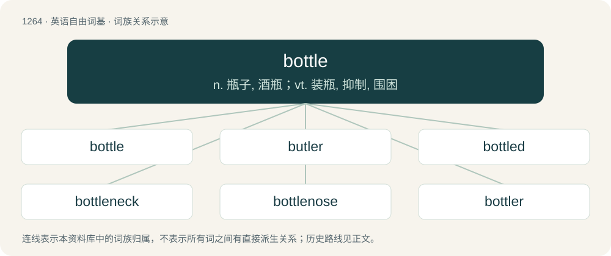

# 1351 · bottle — n. 瓶子, 酒瓶；vt. 装瓶, 抑制, 围困

[总目录](../00_总目录_按常用程度.md)

**类型**：英语自由词基　｜　**来源语言**：见词源记录

## 核心含义与来源

- 核心含义：n. 瓶子, 酒瓶；vt. 装瓶, 抑制, 围困
- 英文含义：A container, typically made of glass or plastic and having a tapered neck, used primarily for holding liquids.
- 词形：bottle

**多个词源／构词路径**：同一拼写可能有不同来源；以下按词性和含义分别列出。

**来源记录 1**（名词；A container, typically made of glass or plastic and having a tapered neck, used primarily for holding liquids.）

From Middle English botel (“bottle, flask, wineskin”), from Old French boteille, from Late Latin butticula, diminutive of buttis (“cask”). Doublet of botija. Displaced native pinne and non-native Old English ampella. Partially displaced Old English flasce.

**来源记录 2**（名词；A building; house.）

From Middle English bottle, botel, buttle, from Old English botl (“building, house”), from Proto-West Germanic \*bōþl, from Proto-Germanic \*budlą, \*buþlą, \*bōþlą (“house, dwelling, farm”), from Proto-Indo-European \*bʰōw- (literally “to swell, grow, thrive, be, live, dwell”). Cognate with North Frisian budel, bodel, bol, boel (“dwelling, inheritable property”), Dutch boedel, boel (“inheritance, estate”), Danish bol (“farm”), Icelandic ból (“dwelling, abode, farm, lair”). Related to Old English bytlan (“to build”). More at build.

## 词族图

## 单词速览（常用到不常用）

| 单词 | 音标 | 释义 |
|---|---|---|
| [bottle](#w-1) | 英 /ˈbɒtəl/；美 /ˈbɑtəl/ | n. 瓶子, 酒瓶；vt. 装瓶, 抑制, 围困 |
| [butler](#w-2) | 英 /ˈbʌt.lə(ɹ)/；美 /ˈbʌt.lɚ/ | n. 男管家, 司膳总管 |
| [bottled](#w-3) | /ˈbɒtəld/ | a. 瓶装的 |
| [bottleneck](#w-4) | /ˈbɒtlnek/ | n. 瓶颈；\[经\] 瓶颈, 增产障碍 |
| [bottlenose](#w-5) | /ˈbɒtəlnəʊz/ | n. \[动\]宽吻海豚 |
| [bottler](#w-6) | 美 /ˈbɑtəlɚ/ | n. 装瓶机；装瓶工 |

## 逐词详解

### 1. bottle

**词性**：名词　｜　**音标**：英 /ˈbɒtəl/；美 /ˈbɑtəl/

**中文释义**：n. 瓶子, 酒瓶；vt. 装瓶, 抑制, 围困

**英文义项**：A container, typically made of glass or plastic and having a tapered neck, used primarily for holding liquids. / The contents of such a container.

**词源与演化**：

From Middle English botel (“bottle, flask, wineskin”), from Old French boteille, from Late Latin butticula, diminutive of buttis (“cask”). Doublet of botija. Displaced native pinne and non-native Old English ampella. Partially displaced Old English flasce.

**例句**：

> Did you know he’s a bottle brunette? His natural hair color is strawberry blonde.

该用例对应义项：A container of hair dye, hence with one’s hair color produced by dyeing.

### 2. butler

**词性**：名词　｜　**音标**：英 /ˈbʌt.lə(ɹ)/；美 /ˈbʌt.lɚ/

**中文释义**：n. 男管家, 司膳总管

**英文义项**：A manservant having charge of wines and liquors. / The chief male servant of a household who has charge of other employees, receives guests, directs the serving of meals, and performs various personal services.

**构词拆分**：bottle + -er

**词源与演化**：

From Middle English butler, butlere, boteler, botelere, from Old French buttiler, butiller, boteillier (“officer in charge of wine”), from Medieval Latin botellārius, equivalent to bottle + -er. Piecewise doublet of bottler.

**例句**：

> But the chief butler, when things prospered with him, forgot his interpreter.

### 3. bottled

**词性**：形容词　｜　**音标**：/ˈbɒtəld/

**中文释义**：a. 瓶装的

**英文义项**：Packaged in a bottle. / drunk

**构词拆分**：bottle + -ed

**词源与演化**：

From bottle + -ed.

**例句**：

> If you keep your emotions bottled up you'll only end up hurting yourself.

### 4. bottleneck

**词性**：名词　｜　**音标**：/ˈbɒtlnek/

**中文释义**：n. 瓶颈；\[经\] 瓶颈, 增产障碍

**英文义项**：The narrow portion that forms the pouring spout of a bottle; the neck of a bottle. / A portion of a bottleneck placed on the finger and used as a guitar slide.

**构词拆分**：bottle + neck

**词源与演化**：

From bottle + neck.

**例句**：

> It is easy to create entries; processing the paperwork is the bottleneck.

该用例对应义项：The part of a process that is too slow or cumbersome due to the lessening of available throughput.

### 5. bottlenose

**词性**：名词　｜　**音标**：/ˈbɒtəlnəʊz/

**中文释义**：n. \[动\]宽吻海豚

**英文义项**：bottlenose dolphin. / bottlenose whale.

**构词拆分**：bottle + nose

**词源与演化**：

From bottle + nose. The creatures have a bottle-shaped nose.

**例句**：

> We were boating on the Gulf of Mexico and saw bottlenose dolphins.

### 6. bottler

**词性**：名词　｜　**音标**：美 /ˈbɑtəlɚ/

**中文释义**：n. 装瓶机；装瓶工

**英文义项**：A person, company, or thing who bottles, especially in bulk. / A truck used for transporting bottled goods in crates.

**构词拆分**：bottle + -er

**词源与演化**：

From Middle English boteller, botullere, equivalent to bottle + -er. Piecewise doublet of butler.
