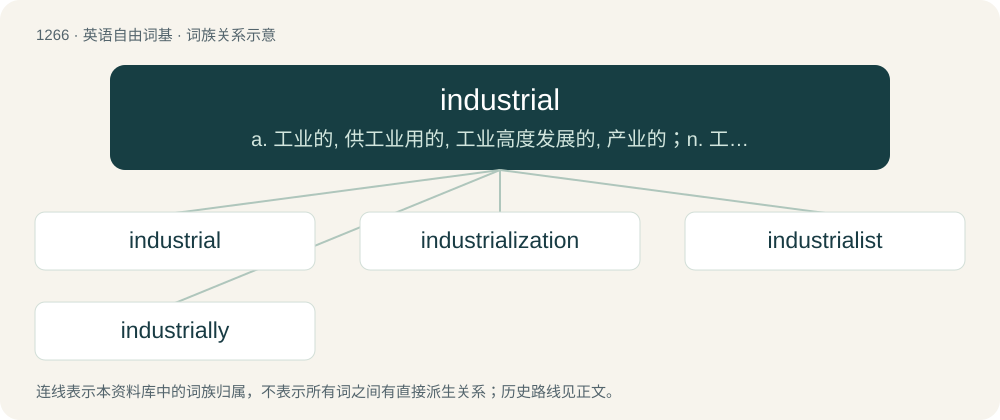

# 1353 · industrial — a. 工业的, 供工业用的, 工业高度发展的, 产业的；n. 工业工人, 工业股票

[总目录](../00_总目录_按常用程度.md)

**类型**：英语自由词基　｜　**来源语言**：见词源记录

## 核心含义与来源

- 核心含义：a. 工业的, 供工业用的, 工业高度发展的, 产业的；n. 工业工人, 工业股票
- 英文含义：Of or relating to industry, notably manufacturing.
- 词形：industrial

**来源记录 1**（形容词；Of or relating to industry, notably manufacturing.）

From French industriel. By surface analysis, industry + -al.

## 词族图

## 单词速览（常用到不常用）

| 单词 | 音标 | 释义 |
|---|---|---|
| [industrial](#w-1) | 英 /ɪnˈdʌs.tɹi.əl/ | a. 工业的, 供工业用的, 工业高度发展的, 产业的；n. 工业工人, 工业股票 |
| [industrialization](#w-2) | 英 /ɪnˌdʌstɹɪəlaɪˈzeɪʃən/；美 /ɪnˌdʌstɹɪəlɪˈzeɪʃən/ | n. 工业化, 产业化；\[经\] 工业化 |
| [industrialist](#w-3) | /inˈdʌstriəlist/ | n. 企业家, 实业家；\[经\] 实业家, 工业主义者 |
| [industrially](#w-4) | /ɪnˈdʌs.tɹɪ.ə.li/ | adv. 企业（工业）地 |

## 逐词详解

### 1. industrial

**词性**：形容词　｜　**音标**：英 /ɪnˈdʌs.tɹi.əl/

**中文释义**：a. 工业的, 供工业用的, 工业高度发展的, 产业的；n. 工业工人, 工业股票

**英文义项**：Of or relating to industry, notably manufacturing. / Produced by such industry.

**词源与演化**：

From French industriel. By surface analysis, industry + -al.

**例句**：

> Handicraft is less standardized then industrial products, hence less artistic or rather flawless.

该用例对应义项：Produced by such industry.

### 2. industrialization

**词性**：名词　｜　**音标**：英 /ɪnˌdʌstɹɪəlaɪˈzeɪʃən/；美 /ɪnˌdʌstɹɪəlɪˈzeɪʃən/

**中文释义**：n. 工业化, 产业化；\[经\] 工业化

**英文义项**：A process of social and economic change whereby a human society is transformed from a preindustrial to an industrial state.

**构词拆分**：industrial + -ization；industrialize + -ation

**词源与演化**：

From French industrialisation. Analyzable as industrial + -ization or industrialize + -ation.

**例句**：

> Industrialization had a great influence on the development of the economy in Japan.

### 3. industrialist

**词性**：名词　｜　**音标**：/inˈdʌstriəlist/

**中文释义**：n. 企业家, 实业家；\[经\] 实业家, 工业主义者

**英文义项**：A person involved in the ownership or management of an industrial enterprise. / One who performs or enjoys industrial music.

**构词拆分**：industrial + -ist

**词源与演化**：

From industrial + -ist.

**例句**：

> The industrialist of today is more powerful than the emperor of yesterday.

### 4. industrially

**词性**：副词　｜　**音标**：/ɪnˈdʌs.tɹɪ.ə.li/

**中文释义**：adv. 企业（工业）地

**英文义项**：Concerning industry. / In an industrial manner.

**构词拆分**：industrial + -ly

**词源与演化**：

From industrial + -ly.

**例句**：

> This reaction is used industrially to convert toluene to phenol.
