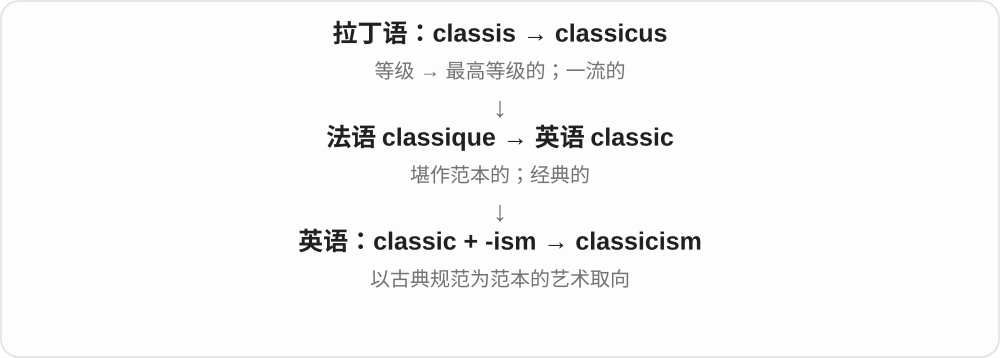
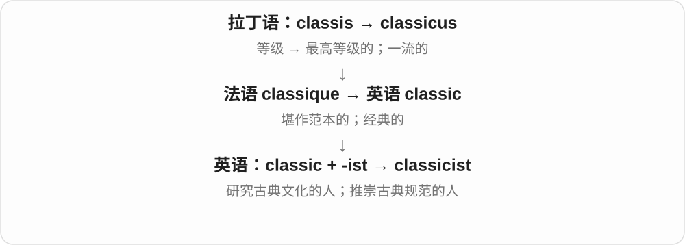

# 1354 · classic — 经典；古典；典型

[逐词精讲目录](../00_逐词精讲目录.md) · [总目录](../00_总目录_按常用程度.md)

## 核心词根与来源

classic、classical 的来源联系拉丁 classicus 的等级、典范一支。classicism 是古典主义，classicist 是研究古典或持古典主义的人，具体由语境判断。

**CLASSIC：有代表性并经得起时间，或属于古典传统**

一部经典小说与一段古典音乐，各自有不同的分类习惯。

- **经典与古典**：classic · classical
- **风格与研究者**：classicism · classicist

## 词形与演化规律

classic 可作名词或形容词；classical 在艺术、学术和科学中有固定分类义；-ism、-ist 分别形成思想或风格名称、相关人名。

## 单词速览（按词族由简到繁）

同一基础词的相关扩展放在一起，先读基础形式，再读扩展；各组之间优先读常用的。具体词源关系见各词讲解。

| 单词 | 音标 | 核心意思 |
|---|---|---|
| [classic](#w-1) | 英、美 /ˈklæsɪk/ | 经典的、典范的；典型的；经典作品 |
| [classical](#w-2) | 英、美 /ˈklæsɪkəl/ | 古典的；古希腊罗马的；传统体系的 |
| [classicism](#w-3) | 英、美 /ˈklæsɪsɪzəm/ | 古典主义；遵循古典规范的风格 |
| [classicist](#w-4) | 英、美 /ˈklæsɪsɪst/ | 古典学者；古典主义者 |

## 逐词讲解

### 1. classic — 经典的、典范的；典型的；经典作品

**音标**：英、美 /ˈklæsɪk/

**先抓住这个画面**

本来是“排在最高等级”，后来成为“值得当范本”。但 a classic mistake 只是“典型错误”，不是夸错误好。

**怎么拆**

历史上是拉丁语 classicus 经法语 classique 借入。今天能看成 class + -ic，不能因此抹掉借词路线。

**怎么变成今天的意思**

a classic novel 通常是经得住时间考验的作品；a classic example 则是非常典型、很能说明问题的例子。名词 a classic 可以指电影、书或其他经典。

**常见搭配与例句**

a classic novel；a classic example of；an instant classic。

> The film became a classic that several generations grew up watching.

这部电影成了几代人从小看到大的经典。

> Leaving the key inside is a classic mistake.

把钥匙落在里面是个典型错误。

**别混淆**

classic 常强调经典或典型；classical 常指古希腊罗马、古典音乐或某种传统体系。

### 2. classical — 古典的；古希腊罗马的；传统体系的

**音标**：英、美 /ˈklæsɪkəl/

**先抓住这个画面**

它常给事物标出所属传统：古希腊罗马文化、古典音乐，或相对现代新理论而言的传统方法。

**怎么拆**

以拉丁语 classicus 的词干形成 -al 形容词；现代可联系 classic + -al。不同词典对英语早期造词细节有不同处理，不必假设现代 classic 一定先出现。

**怎么变成今天的意思**

classical music 日常可统称西方古典音乐，也可在音乐史中特指古典主义时期。classical physics 通常与量子物理相对；谈 classical mechanics 时常指牛顿力学体系，具体范围看语境。

**常见搭配与例句**

classical music；classical architecture；classical mechanics。

> She plays classical music but also enjoys jazz.

她演奏古典音乐，也喜欢爵士乐。

> The museum has a gallery devoted to classical sculpture.

博物馆有一间专门展示古希腊罗马雕塑的展厅。

**别混淆**

a classic song 是一首经典歌曲，可能是摇滚；classical music 才是古典音乐这一传统。

### 3. classicism — 古典主义；遵循古典规范的风格

**音标**：英、美 /ˈklæsɪsɪzəm/

**先抓住这个画面**

创作时把古典范本当尺子，重视秩序、比例、节制与清楚的形式。

**怎么拆**

classic + -ism。

**怎么变成今天的意思**

可以讨论文学、建筑、绘画等领域的 classicism。它是一种审美取向，不是“所有年代很久的艺术”的总称。

**常见搭配与例句**

classicism in architecture；the ideals of classicism；a return to classicism。

> The façade reflects the symmetry associated with classicism.

建筑正面体现了古典主义重视的对称性。

> Her essay compares classicism with more experimental styles.

她的文章比较了古典主义与更富实验性的风格。

**别混淆**

classics 是经典作品或古典学；classicism 是古典主义这一取向。

### 4. classicist — 古典学者；古典主义者

**音标**：英、美 /ˈklæsɪsɪst/

**先抓住这个画面**

可以是专门研究古希腊罗马的人，也可以是创作上坚持古典形式的人。

**怎么拆**

classic + -ist，表示相关研究者或追随者。

**怎么变成今天的意思**

研究古希腊碑文的学者可叫 classicist；评价建筑师时，这个词也可能说明其风格。由上下文决定是职业研究还是艺术取向。

**常见搭配与例句**

a distinguished classicist；a trained classicist；a committed classicist。

> A classicist helped the museum translate the inscription.

一位古典学者帮助博物馆翻译了这段铭文。

> As an architect, he remained a classicist throughout his career.

作为建筑师，他整个职业生涯都坚持古典主义风格。

**别混淆**

classicist 是古典学或古典主义相关；classist 是带阶层偏见的，拼写少一个 ic。

## 这一组要分清什么

a classic film 是经典电影，classical music 是古典音乐；不是给 classic 加 -al 就在所有搭配中完全同义。

## 串起来练习

The classicist discussed classicism before recommending a classic translation.

古典学者讨论了古典主义，然后推荐了一部经典译作。
