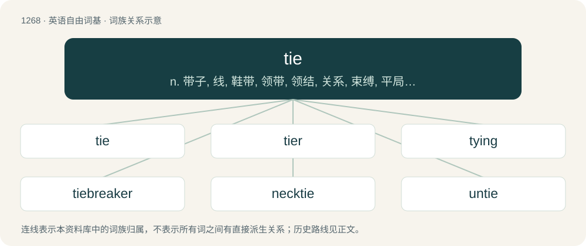

# 1354 · tie — n. 带子, 线, 鞋带, 领带, 领结, 关系, 束缚, 平局, 不分胜负；vt. 系, 打结, 扎, 约束, 与...成平局；vi. 结合, 打结, 不分胜负

[总目录](../00_总目录_按常用程度.md)

**类型**：英语自由词基　｜　**来源语言**：见词源记录

## 核心含义与来源

- 核心含义：n. 带子, 线, 鞋带, 领带, 领结, 关系, 束缚, 平局, 不分胜负；vt. 系, 打结, 扎, 约束, 与...成平局；vi. 结合, 打结, 不分胜负
- 英文含义：A knot; a fastening.
- 词形：tie

**多个词源／构词路径**：同一拼写可能有不同来源；以下按词性和含义分别列出。

**来源记录 1**（名词；A knot; a fastening.）

From Middle English teye (“cord, chain”), from Old English tēag, tēah (“cord, chain”), from Proto-West Germanic \*taugu, from Proto-Germanic \*taugō, ultimately from Proto-Indo-European \*dewk-. Compare Danish tov, Icelandic taug.

**来源记录 2**（动词；To twist (a string, rope, or the like) around itself securely.）

From Middle English teien, teiȝen, from Old English tīġan, tīeġan, from Proto-West Germanic \*taugijan, from Proto-Germanic \*taugijaną, from Proto-Indo-European \*dewk- (“to tug, draw”). Cognate with Icelandic teygja.

## 词族图

## 单词速览（常用到不常用）

| 单词 | 音标 | 释义 |
|---|---|---|
| [tie](#w-1) | /taɪ/ | n. 带子, 线, 鞋带, 领带, 领结, 关系, 束缚, 平局, 不分胜负；vt. 系, 打结, 扎, 约束, 与...成平局；vi. 结合, 打结, 不分胜负 |
| [tier](#w-2) | 英 /ˈtaɪ.ə/；美 /ˈtaɪ.ɚ/ | n. 排, 层, 等级 |
| [tying](#w-3) | /ˈtaɪ.ɪŋ/ | tie的现在分词 |
| [tiebreaker](#w-4) | 美 /ˈtaɪˌbɹeɪkɚ/ | n. 抢7决胜局； 线路中断器 |
| [necktie](#w-5) | /ˈnɛk.taɪ/ | n. 领带 |
| [untie](#w-6) | /ʌnˈtaɪ/ | vt. 解开；vi. 松开 |
| [bowtie](#w-7) | 英 /bəʊˈtaɪ/；美 /ˈboʊˌtaɪ/ | n. 领结 |
| [tiebreak](#w-8) |  | 平分决胜局；抢七局 |

## 逐词详解

### 1. tie

**词性**：名词　｜　**音标**：/taɪ/

**中文释义**：n. 带子, 线, 鞋带, 领带, 领结, 关系, 束缚, 平局, 不分胜负；vt. 系, 打结, 扎, 约束, 与...成平局；vi. 结合, 打结, 不分胜负

**英文义项**：A knot; a fastening. / A knot of hair, as at the back of a wig.

**词源与演化**：

From Middle English teye (“cord, chain”), from Old English tēag, tēah (“cord, chain”), from Proto-West Germanic \*taugu, from Proto-Germanic \*taugō, ultimately from Proto-Indo-European \*dewk-. Compare Danish tov, Icelandic taug.

**例句**：

> Ties work to maintain structural integrity in windstorms and earthquakes.

该用例对应义项：A structural member firmly holding two pieces together.

### 2. tier

**词性**：名词　｜　**音标**：英 /ˈtaɪ.ə/；美 /ˈtaɪ.ɚ/

**中文释义**：n. 排, 层, 等级

**英文义项**：One who ties (knots, etc.). / Something that ties.

**构词拆分**：tie + -er

**词源与演化**：

From tie + -er.

**例句**：

> Tier upon tier of huge casks.

该用例对应义项：one of two or more layers one atop another

### 3. tying

**词性**：名词　｜　**音标**：/ˈtaɪ.ɪŋ/

**中文释义**：tie的现在分词

**英文义项**：Action of the verb to tie; ligature. / The act or process of washing ores in a buddle.

**构词拆分**：tie + -ing

**词源与演化**：

From Middle English tiȝing, teing, from Old English \*tīgung, tīging (“connection”), from Proto-Germanic \*taugungō, from \*taugijaną from Proto-Indo-European \*dewk- (“to tug, draw”). Equivalent to tie + -ing. Present participle from Old English tīgende, from tīgan, tīegan.

**例句**：

> Tom bent down and pretended to be tying one of his shoes.

### 4. tiebreaker

**词性**：名词　｜　**音标**：美 /ˈtaɪˌbɹeɪkɚ/

**中文释义**：n. 抢7决胜局； 线路中断器

**英文义项**：Something that is used to pick a winner from a tied situation.

**构词拆分**：tie + breaker

**词源与演化**：

From tie + breaker.

**例句**：

> In the first set, both players scored the same number of points and the decision went to the tiebreaker.

### 5. necktie

**词性**：名词　｜　**音标**：/ˈnɛk.taɪ/

**中文释义**：n. 领带

**英文义项**：A strip of cloth worn around the neck and tied in the front.

**构词拆分**：neck + tie

**词源与演化**：

From neck + tie.

**例句**：

> He stood in front of the mirror tightening his necktie.

该用例对应义项：neckwear consisting of a long narrow piece of material worn (mostly by men) under a collar and tied in knot at the front

### 6. untie

**词性**：动词　｜　**音标**：/ʌnˈtaɪ/

**中文释义**：vt. 解开；vi. 松开

**英文义项**：To loosen, as something interlaced or knotted; to disengage the parts of. / To free from fastening or from restraint; to let loose; to unbind.

**构词拆分**：un- + tie

**词源与演化**：

From Middle English untien, unteyen, untyȝen, untiȝen, from Old English untīġan (“to untie”), equivalent to un- + tie.

**用法示例／搭配（非完整句）**：

> to untie a knot

该用例对应义项：To loosen, as something interlaced or knotted; to disengage the parts of.

### 7. bowtie

**词性**：形容词　｜　**音标**：英 /bəʊˈtaɪ/；美 /ˈboʊˌtaɪ/

**中文释义**：n. 领结

**英文义项**：Having the shape that the displayed part of a bowtie does when the latter is tied.

**构词拆分**：bow + tie

**词源与演化**：

From bow + tie.

**例句**：

> The corkscrew pasta holds the cheese sauce better, but all I had in the cupboard was bowtie pasta.

该用例对应义项：Having the shape that the displayed part of a bowtie does when the latter is tied.

### 8. tiebreak

**词性**：名词

**中文释义**：平分决胜局；抢七局

**英文义项**：A tiebreaker, a game or an extension to a game played to resolve a tied score.

**构词拆分**：tie + break

**词源与演化**：

From tie + break.

**例句**：

> I'd never seen someone lose a tiebreak where their opponent double faulted four times, until now. What a crazy choke!
