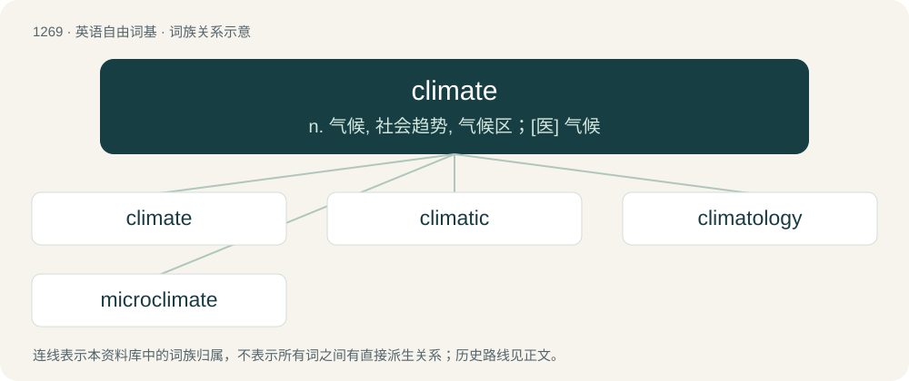

# 1355 · climate — n. 气候, 社会趋势, 气候区；\[医\] 气候

[总目录](../00_总目录_按常用程度.md)

**类型**：英语自由词基　｜　**来源语言**：见词源记录

## 核心含义与来源

- 核心含义：n. 气候, 社会趋势, 气候区；\[医\] 气候
- 英文含义：The long-term manifestations of weather and other atmospheric conditions in a given area or country, now usually represented by the statistical summary of its weather conditions during a period long enough to ensure that representative values are obtained (generally 30 years).
- 词形：climate

**来源记录 1**（名词；The long-term manifestations of weather and other atmospheric conditions in a given area or country, now usually represented by the statistical summary of its weather conditions during a period long enough to ensure that representative values are obtained (generally 30 years).）

From Middle English climat, from Old French climat, from Latin clima, from Ancient Greek κλίμα (klíma, “latitude”, literally “inclination”).

## 词族图

## 单词速览（常用到不常用）

| 单词 | 音标 | 释义 |
|---|---|---|
| [climate](#w-1) | /ˈklaɪ.mɪt/ | n. 气候, 社会趋势, 气候区；\[医\] 气候 |
| [climatic](#w-2) | /klaɪˈmæt.ɪk/ | a. 气候的 |
| [climatology](#w-3) | 英 /klaɪ.mɪˈtɒ.lə.d͡ʒi/；美 /klaɪ.mɪˈtɑ.lə.d͡ʒi/ | n. 气候学；\[医\] 气候学, 风土学 |
| [microclimate](#w-4) | /ˈmaikrəu.klaimit/ | n. 小气候；\[医\] 微气候, 小气候 |

## 逐词详解

### 1. climate

**词性**：名词　｜　**音标**：/ˈklaɪ.mɪt/

**中文释义**：n. 气候, 社会趋势, 气候区；\[医\] 气候

**英文义项**：The long-term manifestations of weather and other atmospheric conditions in a given area or country, now usually represented by the statistical summary of its weather conditions during a period long enough to ensure that representative values are obtained (generally 30 years). / The context in general of a particular political, moral, etc., situation.

**词源与演化**：

From Middle English climat, from Old French climat, from Latin clima, from Ancient Greek κλίμα (klíma, “latitude”, literally “inclination”).

**例句**：

> Industries that require a lot of fossil fuels are unlikely to be popular in the current political climate.

该用例对应义项：The context in general of a particular political, moral, etc., situation.

### 2. climatic

**词性**：形容词　｜　**音标**：/klaɪˈmæt.ɪk/

**中文释义**：a. 气候的

**英文义项**：Of, relating to, or influenced by climate.

**构词拆分**：climate + -ic

**词源与演化**：

From climate + -ic.

**例句**：

> Global climatic changes may have been responsible for the extinction of the dinosaurs.

### 3. climatology

**词性**：名词　｜　**音标**：英 /klaɪ.mɪˈtɒ.lə.d͡ʒi/；美 /klaɪ.mɪˈtɑ.lə.d͡ʒi/

**中文释义**：n. 气候学；\[医\] 气候学, 风土学

**英文义项**：The science that deals with climates, and investigates their phenomena and causes.

**构词拆分**：climate + -ology

**词源与演化**：

From climate + -ology.

**例句**：

> Meteorologists are people who know a tremendous amount about geophysics, thermodynamics and climatology, and almost nothing about tomorrow's weather.

### 4. microclimate

**词性**：名词　｜　**音标**：/ˈmaikrəu.klaimit/

**中文释义**：n. 小气候；\[医\] 微气候, 小气候

**英文义项**：A small, local region having a unique pattern of weather or weather effects that differ from the local climate.

**构词拆分**：From micro- + climate.

**词源与演化**：

From micro- + climate.

**例句**：

> The coastal hills are home to many different microclimates.

该用例对应义项：A small, local region having a unique pattern of weather or weather effects that differ from the local climate.
