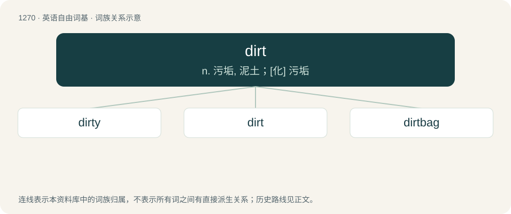

# 1356 · dirt — n. 污垢, 泥土；\[化\] 污垢

[总目录](../00_总目录_按常用程度.md)

**类型**：英语自由词基　｜　**来源语言**：见词源记录

## 核心含义与来源

- 核心含义：n. 污垢, 泥土；\[化\] 污垢
- 英文含义：Soil or earth.
- 词形：dirt

**来源记录 1**（名词；Soil or earth.）

From Middle English drit (“excrement”), from Old Norse drit (“excrement”), from Proto-Germanic \*dritą, \*dritō (“excrement”), from Proto-Indo-European \*dʰreyd-, \*treydʰ- (“to have diarrhea”). Cognate with dialectal Danish and Norn drit (“excrement”), Norwegian dritt (“excrement”), dialectal Swedish dret (“shit”), Faroese and Icelandic drit (“bird excrement”), Dutch drijten (“to defecate”), drits (“dirt, mud, filth”), drijt and dreet (“excrement”), Low German drieten (“to defecate”), Driet (“shit”), regional German Driss (“shit”), Old English ġedrītan (“to defecate”). The word originally referred to excrement before shifting to the current sense of "soil". For a semantic parallel, see Norwegian skitt (“dirt, filth, grime, mud”), from Old Norse skítr (“shit”), which is cognate with English shit.

## 词族图

## 单词速览（常用到不常用）

| 单词 | 音标 | 释义 |
|---|---|---|
| [dirty](#w-1) | 英 /ˈdɜːti/；美 /ˈdɝti/ | a. 肮脏的, 卑鄙的；vt. 弄脏；vi. 变脏 |
| [dirt](#w-2) | 英 /dɜːt/；美 /dɝt/ | n. 污垢, 泥土；\[化\] 污垢 |
| [dirtbag](#w-3) | /ˈdɜɹtbaɡ/ | n. 人渣 |

## 逐词详解

### 1. dirty

**词性**：形容词　｜　**音标**：英 /ˈdɜːti/；美 /ˈdɝti/

**中文释义**：a. 肮脏的, 卑鄙的；vt. 弄脏；vi. 变脏

**英文义项**：Unclean; covered with or containing unpleasant substances such as dirt or grime. / That makes one unclean; corrupting, infecting.

**构词拆分**：dirt + -y

**词源与演化**：

From Middle English dirti, alteration of earlier dritti, equivalent to dirt + -y. Cognate with Middle Low German drēterich (“dirty”). See also drite.

**例句**：

> At the reception, Uncle Nick got drunk and told dirty jokes to the bridesmaids.

该用例对应义项：Morally unclean; obscene or indecent, especially sexually.

### 2. dirt

**词性**：名词　｜　**音标**：英 /dɜːt/；美 /dɝt/

**中文释义**：n. 污垢, 泥土；\[化\] 污垢

**英文义项**：Soil or earth. / A stain or spot (on clothes etc); any foreign substance that worsens appearance.

**词源与演化**：

From Middle English drit (“excrement”), from Old Norse drit (“excrement”), from Proto-Germanic \*dritą, \*dritō (“excrement”), from Proto-Indo-European \*dʰreyd-, \*treydʰ- (“to have diarrhea”). Cognate with dialectal Danish and Norn drit (“excrement”), Norwegian dritt (“excrement”), dialectal Swedish dret (“shit”), Faroese and Icelandic drit (“bird excrement”), Dutch drijten (“to defecate”), drits (“dirt, mud, filth”), drijt and dreet (“excrement”), Low German drieten (“to defecate”), Driet (“shit”), regional German Driss (“shit”), Old English ġedrītan (“to defecate”). The word originally referred to excrement before shifting to the current sense of "soil". For a semantic parallel, see Norwegian skitt (“dirt, filth, grime, mud”), from Old Norse skítr (“shit”), which is cognate with English shit.

**例句**：

> The reporter uncovered the dirt on the businessman by going undercover.

该用例对应义项：Previously unknown facts or rumors about a person.

### 3. dirtbag

**词性**：名词　｜　**音标**：/ˈdɜɹtbaɡ/

**中文释义**：n. 人渣

**英文义项**：A dirty, grimy, sleazy, or disreputable person. / A poor climber, alpinist, skier or other outdoorsman who lives cheaply, without normal employment, and with few amenities in order to spend as much time on their sport as possible.

**构词拆分**：dirt + bag

**词源与演化**：

From dirt + bag.
