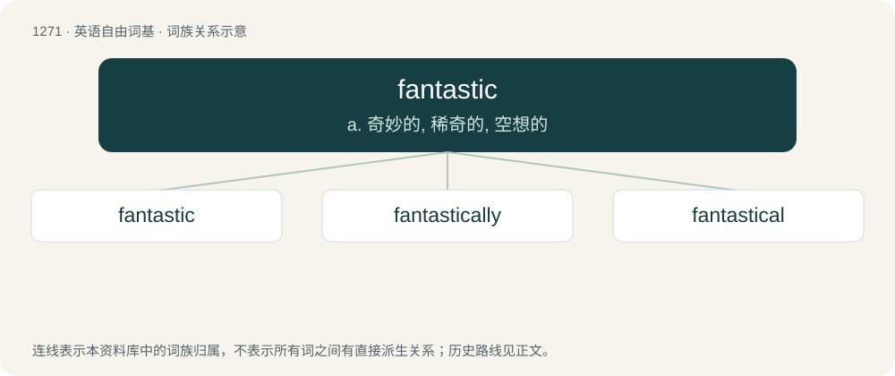

# 1357 · fantastic — a. 奇妙的, 稀奇的, 空想的

[总目录](../00_总目录_按常用程度.md)

**类型**：英语自由词基　｜　**来源语言**：见词源记录

## 核心含义与来源

- 核心含义：a. 奇妙的, 稀奇的, 空想的
- 英文含义：Wonderful; marvelous; excellent; extraordinarily good or great (used especially as an intensifier).
- 词形：fantastic

**来源记录 1**（形容词；Wonderful; marvelous; excellent; extraordinarily good or great (used especially as an intensifier).）

Borrowed from Middle French fantastique, borrowed from Late Latin phantasticus, borrowed from Ancient Greek φᾰντᾰστῐκός (phăntăstĭkós, “imaginary, fantastic; fictional”), ultimately from Proto-Indo-European \*bʰeh₂- (“to shine”). Equivalent to fantasy + -tic. Doublet of fantastique.

## 词族图

## 单词速览（常用到不常用）

| 单词 | 音标 | 释义 |
|---|---|---|
| [fantastic](#w-1) | /fænˈtæs.tɪk/ | a. 奇妙的, 稀奇的, 空想的 |
| [fantastically](#w-2) | /fænˈtæstɪklɪ/ | adv. 空想地, 捕风捉影地 |
| [fantastical](#w-3) | /fænˈtæstɪkəl/ | a. 空想的；捕风捉影的 |

## 逐词详解

### 1. fantastic

**词性**：形容词　｜　**音标**：/fænˈtæs.tɪk/

**中文释义**：a. 奇妙的, 稀奇的, 空想的

**英文义项**：Wonderful; marvelous; excellent; extraordinarily good or great (used especially as an intensifier). / Existing in or constructed from fantasy; of or relating to fantasy; fanciful.

**构词拆分**：fantasy + -tic

**词源与演化**：

Borrowed from Middle French fantastique, borrowed from Late Latin phantasticus, borrowed from Ancient Greek φᾰντᾰστῐκός (phăntăstĭkós, “imaginary, fantastic; fictional”), ultimately from Proto-Indo-European \*bʰeh₂- (“to shine”). Equivalent to fantasy + -tic. Doublet of fantastique.

**例句**：

> She had a fantastic view of her own importance that none of her colleagues shared.

该用例对应义项：Existing in or constructed from fantasy; of or relating to fantasy; fanciful.

### 2. fantastically

**词性**：副词　｜　**音标**：/fænˈtæstɪklɪ/

**中文释义**：adv. 空想地, 捕风捉影地

**英文义项**：In a fantastic manner. / To an extent only in fantasy; outrageously; ridiculously.

**构词拆分**：fantastic + -ally

**词源与演化**：

From fantastic + -ally.

**例句**：

> He painted fantastically with everything as if in a dream.

该用例对应义项：In a fantastic manner.

### 3. fantastical

**词性**：形容词　｜　**音标**：/fænˈtæstɪkəl/

**中文释义**：a. 空想的；捕风捉影的

**英文义项**：Of or pertaining to fantasy. / Fanciful or whimsical.

**构词拆分**：fantastic + -al

**词源与演化**：

From fantastic + -al.

**例句**：

> Rowan loves building miniature figurines of fantastical creatures and machines.
