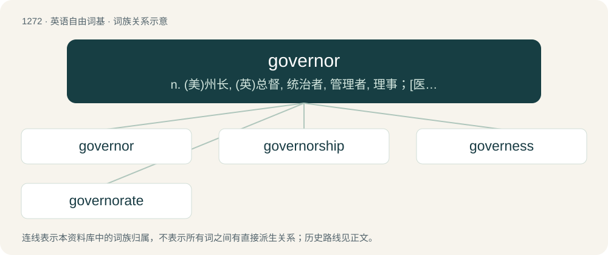

# 1358 · governor — n. (美)州长, (英)总督, 统治者, 管理者, 理事；\[医\] 节制器, 调节器

[总目录](../00_总目录_按常用程度.md)

**类型**：英语自由词基　｜　**来源语言**：见词源记录

## 核心含义与来源

- 核心含义：n. (美)州长, (英)总督, 统治者, 管理者, 理事；\[医\] 节制器, 调节器
- 英文含义：The chief executive officer of a first-level administrative division of a country.
- 词形：governor

**来源记录 1**（名词；The chief executive officer of a first-level administrative division of a country.）

From Middle English governour, from Old French gouvreneur, from Latin gubernator, from Ancient Greek κυβερνήτης (kubernḗtēs, “steersman, pilot, guide”), from κυβερνάω (kubernáō, “to steer, to drive, to guide, to act as a pilot”), of disputed origin. By surface analysis, govern + -or. Doublet of gubernator.

## 词族图

## 单词速览（常用到不常用）

| 单词 | 音标 | 释义 |
|---|---|---|
| [governor](#w-1) | /ˈɡʌv(ə)nə/ | n. (美)州长, (英)总督, 统治者, 管理者, 理事；\[医\] 节制器, 调节器 |
| [governorship](#w-2) | /ˈ^ʌvənəʃip/ | n. 统治者的职位/任期 |
| [governess](#w-3) | 英 /ˈɡʌvənəs/；美 /ˈɡʌvɚnəs/ | n. 女家庭教师 |
| [governorate](#w-4) | /ˈɡʌvə(ɹ)nəɹət/ | n. 省 |

## 逐词详解

### 1. governor

**词性**：名词　｜　**音标**：/ˈɡʌv(ə)nə/

**中文释义**：n. (美)州长, (英)总督, 统治者, 管理者, 理事；\[医\] 节制器, 调节器

**英文义项**：The chief executive officer of a first-level administrative division of a country. / A device which regulates or controls some action of a machine through automatic feedback.

**词源与演化**：

From Middle English governour, from Old French gouvreneur, from Latin gubernator, from Ancient Greek κυβερνήτης (kubernḗtēs, “steersman, pilot, guide”), from κυβερνάω (kubernáō, “to steer, to drive, to guide, to act as a pilot”), of disputed origin. By surface analysis, govern + -or. Doublet of gubernator.

**例句**：

> Fatally, the city’s governor allowed public festivities and mass gatherings to continue.

### 2. governorship

**词性**：名词　｜　**音标**：/ˈ^ʌvənəʃip/

**中文释义**：n. 统治者的职位/任期

**英文义项**：The office or term of a governor; the state or condition of being a governor.

**构词拆分**：governor + -ship

**词源与演化**：

From governor + -ship.

**例句**：

> The governorship is an elected office.

### 3. governess

**词性**：名词　｜　**音标**：英 /ˈɡʌvənəs/；美 /ˈɡʌvɚnəs/

**中文释义**：n. 女家庭教师

**英文义项**：A woman paid to educate children in their own home. / A female governor.

**构词拆分**：govern(or) + -ess

**词源与演化**：

From Middle English governesse, a contracted form of governeresse, from Old French governeresse (“female ruler or administrator”). In later senses, equivalent to govern(or) + -ess.

**例句**：

> Old rich families used to employ a governess to look after their children.

### 4. governorate

**词性**：名词　｜　**音标**：/ˈɡʌvə(ɹ)nəɹət/

**中文释义**：n. 省

**英文义项**：The territory governed by a governor; a province.

**构词拆分**：governor + -ate

**词源与演化**：

From governor + -ate (forms nouns denoting rank or office, the concrete charge of it).

**例句**：

> In 1781, Catherine II granted Yekaterinburg the status of a district city of Perm Governorate.
