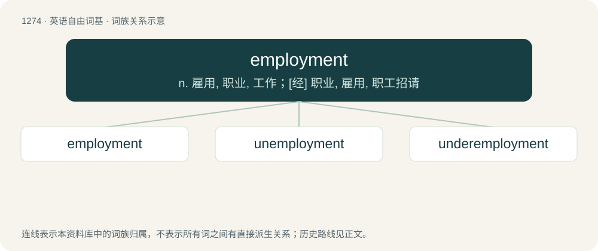

# 1360 · employment — n. 雇用, 职业, 工作；\[经\] 职业, 雇用, 职工招请

[总目录](../00_总目录_按常用程度.md)

**类型**：英语自由词基　｜　**来源语言**：见词源记录

## 核心含义与来源

- 核心含义：n. 雇用, 职业, 工作；\[经\] 职业, 雇用, 职工招请
- 英文含义：The occupation or work for which one is used, and often paid.
- 词形：employment

**来源记录 1**（名词；The occupation or work for which one is used, and often paid.）

From employ (itself from Middle French employer, from Middle French empleier, from Latin implicō (“enfold, involve, be connected with”), itself from in- + plicō (“fold”)) + -ment.

## 词族图

## 单词速览（常用到不常用）

| 单词 | 音标 | 释义 |
|---|---|---|
| [employment](#w-1) | /ɪmˈplɔɪmənt/ | n. 雇用, 职业, 工作；\[经\] 职业, 雇用, 职工招请 |
| [unemployment](#w-2) | /ʌn.ɪmˈplɔɪ.mənt/ | n. 失业, 失业人数；\[经\] 失业 |
| [underemployment](#w-3) | /,ʌndərimˈplɔimənt/ | n. 不充分就业, 部分时间被雇用, 才能和技术未充分利用 |

## 逐词详解

### 1. employment

**词性**：名词　｜　**音标**：/ɪmˈplɔɪmənt/

**中文释义**：n. 雇用, 职业, 工作；\[经\] 职业, 雇用, 职工招请

**英文义项**：The occupation or work for which one is used, and often paid. / The act of employing.

**词源与演化**：

From employ (itself from Middle French employer, from Middle French empleier, from Latin implicō (“enfold, involve, be connected with”), itself from in- + plicō (“fold”)) + -ment.

**例句**：

> The percentage of a country's population in employment used to be called "participation rate".

该用例对应义项：The state of being employed.

### 2. unemployment

**词性**：名词　｜　**音标**：/ʌn.ɪmˈplɔɪ.mənt/

**中文释义**：n. 失业, 失业人数；\[经\] 失业

**英文义项**：The state of having no job; joblessness. / The phenomenon of joblessness in an economy.

**构词拆分**：un- + employment

**词源与演化**：

From un- + employment.

**例句**：

> Until then his life had consisted of low-paying jobs, numerous unemployments, and drug use.

该用例对应义项：An instance or period of joblessness.

### 3. underemployment

**词性**：名词　｜　**音标**：/,ʌndərimˈplɔimənt/

**中文释义**：n. 不充分就业, 部分时间被雇用, 才能和技术未充分利用

**英文义项**：The condition of being underemployed.

**构词拆分**：under- + employment

**词源与演化**：

From under- + employment.
