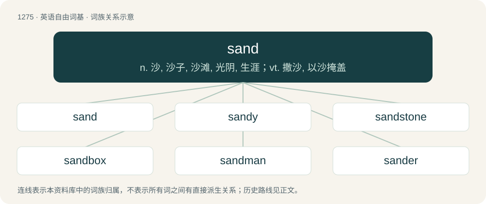

# 1361 · sand — n. 沙, 沙子, 沙滩, 光阴, 生涯；vt. 撒沙, 以沙掩盖

[总目录](../00_总目录_按常用程度.md)

**类型**：英语自由词基　｜　**来源语言**：见词源记录

## 核心含义与来源

- 核心含义：n. 沙, 沙子, 沙滩, 光阴, 生涯；vt. 撒沙, 以沙掩盖
- 英文含义：Rock that is ground more finely than gravel, but is not as fine as silt (more formally, see grain sizes chart), forming beaches and deserts and also used in construction.
- 词形：sand

**多个词源／构词路径**：同一拼写可能有不同来源；以下按词性和含义分别列出。

**来源记录 1**（名词；Rock that is ground more finely than gravel, but is not as fine as silt (more formally, see grain sizes chart), forming beaches and deserts and also used in construction.）

Inherited from Middle English sond, sand, from Old English sand, from Proto-West Germanic \*samd, from Proto-Germanic \*samdaz. See also North Frisian sun, Sön, sönj (“sand”), Saterland Frisian Sound (“sand”), West Frisian sân (“sand”), Dutch zand (“sand”), German and Luxembourgish Sand (“sand”), Yiddish זאַמד (zamd, “sand”), Danish, Norwegian Bokmål, Norwegian Nynorsk, and Swedish sand (“sand”), Faroese and Icelandic sandur (“sand”), Latin sabulum (“sand, gravel”), Ancient Greek ἄμαθος (ámathos, “sand”), English dialectal samel (“sand bottom”), Old Irish do·essim (“to pour out”), Latin sentina (“bilge water”), Lithuanian sémti (“to scoop”), Ancient Greek ἀμάω (amáō, “to gather”), ἄμη (ámē, “water bucket”).

**来源记录 2**（动词；To abrade the surface of (something) with sand or sandpaper in order to smooth or clean it.）

From Middle English sanden, from the noun (see above).

## 词族图

## 单词速览（常用到不常用）

| 单词 | 音标 | 释义 |
|---|---|---|
| [sand](#w-1) | 英 /sænd/ | n. 沙, 沙子, 沙滩, 光阴, 生涯；vt. 撒沙, 以沙掩盖 |
| [sandy](#w-2) | /ˈsændi/ | a. 沙的, 沙地的, 多沙的 |
| [sandstone](#w-3) | 英 /ˈsændˌstəʊn/；美 /ˈsændˌstoʊn/ | n. 沙岩；\[化\] 砂岩 |
| [sandbox](#w-4) | 英 /ˈsænd.bɒks/；美 /ˈsæn(d).bɑks/ | n. 沙箱, 沙盒 |
| [sandman](#w-5) | 英 /ˈsænd.mæn/ | n. 睡魔 |
| [sander](#w-6) | 美 /ˈsændɚ/ | \[电\] 散沙 |
| [sandpaper](#w-7) | 美 /ˈsændˌpeɪpɚ/ | n. 砂纸；\[机\] 砂纸 |
| [sandstorm](#w-8) | /ˈsændstɒːm/ | n. (沙漠地带的)沙暴 |
| [sanding](#w-9) | /ˈsændiŋ/ | \[化\] 打磨 |
| [quicksand](#w-10) | 美 /ˈkwɪkˌsænd/ | n. 流沙, 流沙区, 危险状态 |
| [sandpiper](#w-11) | 英 /ˈsænd.paɪpə/；美 /ˈsænd.paɪpɚ/ | n. 鹬 |
| [sandbag](#w-12) | 美 /ˈsændˌbæɡ/ | n. 沙袋；vt. 堆沙袋于, 用沙袋打 |
| [sandbar](#w-13) | 美 /ˈsændˌbɑɹ/ | n. 沙洲, 河堤 |
| [sandcastle](#w-14) | 美 /ˈsæn(d)ˌkæsəl/ | n. 沙堡 |
| [sandhill](#w-15) | /ˈsændhil/ | crane\[鸟\]沙丘鹤 |
| [sandlot](#w-16) | /ˈsændlɔt/ | n. 沙地, 小孩们的运动用空地 |
| [sandbank](#w-17) | /ˈsændˌbæŋk/ | n. 沙洲, 沙滩, 沙坝 |
| [sandpit](#w-18) | /ˈsænd.pɪt/ | n. 采沙场, 沙坑 |

## 逐词详解

### 1. sand

**词性**：名词　｜　**音标**：英 /sænd/

**中文释义**：n. 沙, 沙子, 沙滩, 光阴, 生涯；vt. 撒沙, 以沙掩盖

**英文义项**：Rock that is ground more finely than gravel, but is not as fine as silt (more formally, see grain sizes chart), forming beaches and deserts and also used in construction. / A specific grade, type, or composition of sand.

**词源与演化**：

Inherited from Middle English sond, sand, from Old English sand, from Proto-West Germanic \*samd, from Proto-Germanic \*samdaz. See also North Frisian sun, Sön, sönj (“sand”), Saterland Frisian Sound (“sand”), West Frisian sân (“sand”), Dutch zand (“sand”), German and Luxembourgish Sand (“sand”), Yiddish זאַמד (zamd, “sand”), Danish, Norwegian Bokmål, Norwegian Nynorsk, and Swedish sand (“sand”), Faroese and Icelandic sandur (“sand”), Latin sabulum (“sand, gravel”), Ancient Greek ἄμαθος (ámathos, “sand”), English dialectal samel (“sand bottom”), Old Irish do·essim (“to pour out”), Latin sentina (“bilge water”), Lithuanian sémti (“to scoop”), Ancient Greek ἀμάω (amáō, “to gather”), ἄμη (ámē, “water bucket”).

**例句**：

> The Canadian tar sands are a promising source of oil.

该用例对应义项：A beach or other mass of sand.

### 2. sandy

**词性**：形容词　｜　**音标**：/ˈsændi/

**中文释义**：a. 沙的, 沙地的, 多沙的

**英文义项**：Covered with sand. / Sprinkled with sand.

**构词拆分**：sand + -y

**词源与演化**：

From Middle English sandi, sondy, sandiȝ, from Old English sandiġ (“sandy”), equivalent to sand + -y. Cognate with Dutch zandig (“sandy”), German sandig (“sandy”), Swedish sandig (“sandy”).

**例句**：

> Some plants grow best in sandy soil.

该用例对应义项：Containing sand.

### 3. sandstone

**词性**：名词　｜　**音标**：英 /ˈsændˌstəʊn/；美 /ˈsændˌstoʊn/

**中文释义**：n. 沙岩；\[化\] 砂岩

**英文义项**：A sedimentary rock produced by the consolidation and compaction of sand, cemented with clay etc.

**构词拆分**：sand + stone

**词源与演化**：

From Middle English sandston, from Old English \*sandstān, from Proto-West Germanic \*sandastain (“sandstone, chisel, gravel”), equivalent to sand + stone. Cognate with West Frisian sânstien (“sandstone”), Saterland Frisian Soundsteen (“sandstone”), Dutch zandsteen (“sandstone”), German Low German Sandsteen (“sandstone”), German Sandstein (“sandstone”), Danish sandsten (“sandstone”), Swedish sandsten (“sandstone”), Icelandic sandsteinn (“sandstone”).

**例句**：

> The name of the Algerian town Tipaza comes from tafza, red sandstone.

### 4. sandbox

**词性**：名词　｜　**音标**：英 /ˈsænd.bɒks/；美 /ˈsæn(d).bɑks/

**中文释义**：n. 沙箱, 沙盒

**英文义项**：A children's play area consisting of a box filled with sand. / A box filled with sand that is shaped to form a mould for metal casting.

**构词拆分**：sand + box

**词源与演化**：

From sand + box.

**例句**：

> Running a program in a sandbox can prevent it from doing any damage to the system.

该用例对应义项：An isolated area where a program can be executed with a restricted portion of the resources available.

### 5. sandman

**词性**：名词　｜　**音标**：英 /ˈsænd.mæn/

**中文释义**：n. 睡魔

**英文义项**：A figure that brings sleep and dreams by sprinkling magical sand into people's eyes. / Used as a symbol of the passage of time toward death.

**构词拆分**：sand + -man

**词源与演化**：

From sand + -man. The mythological sense may be from German Sandmann, Sandmännchen, as it is apparently first attested in English in the context of E.T.A. Hoffmann’s novella The Sandman (1816). The German is attested in the relevant sense since at least the mid-18th century.

### 6. sander

**词性**：名词　｜　**音标**：美 /ˈsændɚ/

**中文释义**：\[电\] 散沙

**英文义项**：A person employed to sand wood. / A machine to mechanize the process of sanding.

**构词拆分**：sand + -er

**词源与演化**：

From sand + -er.

**例句**：

> Ziri asked Yazid if he could borrow his power sander.

### 7. sandpaper

**词性**：名词　｜　**音标**：美 /ˈsændˌpeɪpɚ/

**中文释义**：n. 砂纸；\[机\] 砂纸

**英文义项**：Strong paper coated with (traditionally) sand or (today) manufactured aluminum oxide, silicon carbide, or other abrasive material, used for smoothing and polishing. / A sheet of such paper.

**构词拆分**：sand + paper

**词源与演化**：

From sand + paper.

**例句**：

> They like to finish it off with a piece of 600-grit sandpaper before cleaning and painting.

该用例对应义项：Strong paper coated with (traditionally) sand or (today) manufactured aluminum oxide, silicon carbide, or other abrasive material, used for smoothing and polishing.

### 8. sandstorm

**词性**：名词　｜　**音标**：/ˈsændstɒːm/

**中文释义**：n. (沙漠地带的)沙暴

**英文义项**：A strong wind carrying clouds of sand and dust through the air.

**构词拆分**：sand + storm

**词源与演化**：

From sand + storm.

**例句**：

> Make sure every orifice is covered before you enter the sandstorm.

### 9. sanding

**词性**：名词　｜　**音标**：/ˈsændiŋ/

**中文释义**：\[化\] 打磨

**英文义项**：The act or process by which something is sanded; the application of sandpaper, etc. / A type of dancing where the floor is covered in sand. See Sanding (dance).

**构词拆分**：sand + -ing

**词源与演化**：

From Middle English sanding, sandyng, equivalent to sand + -ing.

**用法示例／搭配（非完整句）**：

> sugar sanding

该用例对应义项：A coating of sugar crystals on confectionery, especially on jellies.

### 10. quicksand

**词性**：名词　｜　**音标**：美 /ˈkwɪkˌsænd/

**中文释义**：n. 流沙, 流沙区, 危险状态

**英文义项**：Wet sand that appears firm but in which things readily sink, often found near rivers or coasts. / Anything that metaphorically pulls one down or buries one; a treacherous, risky danger

**构词拆分**：quick (“living”) + sand

**词源与演化**：

From Middle English quyksande, from Old English cwecesand (“quicksand”), equivalent to quick (“living”) + sand. Cognate with Swedish kvicksand (“quicksand”), Icelandic kviksandur, kviksyndi (“quicksand”). More at quick, sand.

**例句**：

> My feet were firmly lodged in the quicksand, and the more I struggled the more I sank into it.

该用例对应义项：Wet sand that appears firm but in which things readily sink, often found near rivers or coasts.

### 11. sandpiper

**词性**：名词　｜　**音标**：英 /ˈsænd.paɪpə/；美 /ˈsænd.paɪpɚ/

**中文释义**：n. 鹬

**英文义项**：Any of various small waders of the family Scolopacidae.

**构词拆分**：sand + piper

**词源与演化**：

From sand + piper.

**例句**：

> This sandpiper is solitary in habits and shows a preference for the alpine lakes of the Hudsonian Zone.

### 12. sandbag

**词性**：动词　｜　**音标**：美 /ˈsændˌbæɡ/

**中文释义**：n. 沙袋；vt. 堆沙袋于, 用沙袋打

**英文义项**：To construct a barrier of sandbags (around). / To strike (someone) with a sandbag or other object to disable or render unconscious.

**构词拆分**：sand + bag

**词源与演化**：

From sand + bag.

### 13. sandbar

**词性**：名词　｜　**音标**：美 /ˈsændˌbɑɹ/

**中文释义**：n. 沙洲, 河堤

**英文义项**：A ridge of sand caused by the action of waves along a shore.

**构词拆分**：sand + bar

**词源与演化**：

From sand + bar.

**例句**：

> My boat ran aground on a sandbar.

### 14. sandcastle

**词性**：名词　｜　**音标**：美 /ˈsæn(d)ˌkæsəl/

**中文释义**：n. 沙堡

**英文义项**：A sculpture made of sand and resembling a miniature castle; typically, but not always, made for fun by a child on a beach.

**构词拆分**：sand + castle

**词源与演化**：

From sand + castle.

**例句**：

> Robert made a sandcastle as a last memory on that beach.

### 15. sandhill

**词性**：名词　｜　**音标**：/ˈsændhil/

**中文释义**：crane\[鸟\]沙丘鹤

**英文义项**：A dune or sandpile. / A sandhill crane (Antigone canadensis).

**构词拆分**：sand + hill

**词源与演化**：

From sand + hill.

**例句**：

> Migrant birds such as the sandhill crane fly overhead, moving south.

### 16. sandlot

**词性**：名词　｜　**音标**：/ˈsændlɔt/

**中文释义**：n. 沙地, 小孩们的运动用空地

**英文义项**：A vacant lot where children play.

**构词拆分**：sand + lot

**词源与演化**：

From sand + lot.

**例句**：

> Many great players started out playing sandlot baseball.

该用例对应义项：A vacant lot where children play.

### 17. sandbank

**词性**：名词　｜　**音标**：/ˈsændˌbæŋk/

**中文释义**：n. 沙洲, 沙滩, 沙坝

**英文义项**：A ridge of sand along a shore that is partially or totally submerged and thus a hazard to shipping.

**构词拆分**：sand + bank

**词源与演化**：

From sand + bank. Compare Dutch zandbank (“sandbank, shoal”), German Sandbank (“sandbank, sandbar, shoal”), Swedish sandbank (“sandbank, bar”).

**例句**：

> The ship has run into a sandbank offshore.

### 18. sandpit

**词性**：名词　｜　**音标**：/ˈsænd.pɪt/

**中文释义**：n. 采沙场, 沙坑

**英文义项**：A place or pit from which sand is excavated. / A children’s play area consisting of a large container filled with sand.

**构词拆分**：sand + pit

**词源与演化**：

From Middle English sandpitte, sandpette, sandpütte, from Old English sandpytt (“sandpit”), equivalent to sand + pit.

**例句**：

> Tom and Mary played in the sandpit together and made sand castles.
