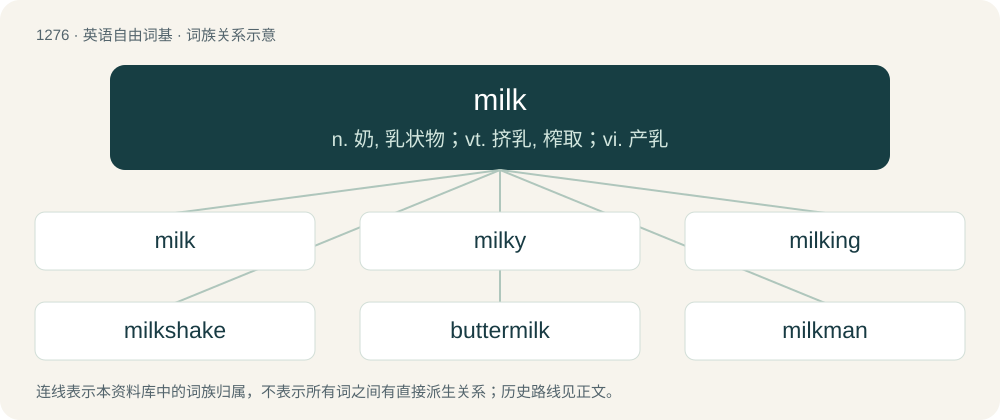

# 1362 · milk — n. 奶, 乳状物；vt. 挤乳, 榨取；vi. 产乳

[总目录](../00_总目录_按常用程度.md)

**类型**：英语自由词基　｜　**来源语言**：见词源记录

## 核心含义与来源

- 核心含义：n. 奶, 乳状物；vt. 挤乳, 榨取；vi. 产乳
- 英文含义：A white liquid produced by the mammary glands of female mammals to nourish their young. From certain animals, especially cows, it is also called dairy milk and is a common food for humans as a beverage or used to produce various dairy products such as butter, cheese, and yogurt.
- 词形：milk

**多个词源／构词路径**：同一拼写可能有不同来源；以下按词性和含义分别列出。

**来源记录 1**（名词；A white liquid produced by the mammary glands of female mammals to nourish their young. From certain animals, especially cows, it is also called dairy milk and is a common food for humans as a beverage or used to produce various dairy products such as butter, cheese, and yogurt.）

From Middle English milk, mylk, melk, mulc, from Old English meolc, meoluc (“milk”), from Proto-West Germanic \*meluk (“milk”), from Proto-Germanic \*meluks (“milk”), from Proto-Indo-European \*h₂melǵ- (“milk, to milk”). Cognates Cognate with West Frisian molke (“milk”), Dutch melk (“milk”), Dutch Low Saxon melk (“milk”), German Milch (“milk”), German Low German Melk (“milk”), Yiddish מילך (milkh, “milk”), Danish mælk (“milk”), Faroese and Icelandic mjólk (“milk”), Norn \*mjølk (“milk”), Norwegian Bokmål melk, mjølk (“milk”), Norwegian Nynorsk mjølk (“milk”), Swedish mjölk (“milk”), Gothic 𐌼𐌹𐌻𐌿𐌺𐍃 (miluks, “milk”), Greek αμέλγω (amélgo, “to milk”), Albanian mjel (“to milk”), Latvian malks, Lithuanian malkas, Belarusian малако́ (malakó, “milk”), Bulgarian мля́ко (mljáko, “milk”), Czech mléko, Macedonian мле́ко (mléko, “milk”), Polish mleko (“milk”), Russian and Ukrainian молоко́ (molokó, “milk”), Serbo-Croatian mlijéko (“milk”), Slovak mlieko (“milk”), Slovene mlẹ́ko (“milk”), Welsh blith, Tocharian A malke.

**来源记录 2**（动词；To express milk from (a mammal, especially a cow).）

From Middle English milken, from Old English melcan, from Proto-Germanic \*melkaną, ultimately from Proto-Indo-European \*h₂melǵ-, the same root as the noun. Compare Dutch and German melken, Danish malke, Norwegian mjølke, also Latin mulgeō (“to milk”), Ancient Greek ἀμέλγω (amélgō, “to milk”), Albanian mjel (“to milk”), Russian молоко́ (molokó), Lithuanian mélžti, Tocharian A mālk-.

## 词族图

## 单词速览（常用到不常用）

| 单词 | 音标 | 释义 |
|---|---|---|
| [milk](#w-1) | /mɪlk/ | n. 奶, 乳状物；vt. 挤乳, 榨取；vi. 产乳 |
| [milky](#w-2) | 英 /ˈmɪlki/ | a. 乳状的, 乳白色的, 柔和的 |
| [milking](#w-3) | /ˈmɪlkɪŋ/ | n. 挤奶, 一次的挤奶量；\[化\] 挤奶 |
| [milkshake](#w-4) | 英 /ˈmɪlk.ʃeɪk/ | n. 奶昔 |
| [buttermilk](#w-5) | 英 /ˈbʌtəˌmɪlk/；美 /ˈbʌtɚˌmɪlk/ | n. 脱脂乳, 酪乳；\[医\] 酪乳 |
| [milkman](#w-6) | /ˈmɪlkmən/ | n. 牛奶商, 送奶工, 挤奶的男人 |
| [milkweed](#w-7) | /ˈmilkwiːd/ | n. 马利筋；\[医\] 马利筋属植物 |

## 逐词详解

### 1. milk

**词性**：名词　｜　**音标**：/mɪlk/

**中文释义**：n. 奶, 乳状物；vt. 挤乳, 榨取；vi. 产乳

**英文义项**：A white liquid produced by the mammary glands of female mammals to nourish their young. From certain animals, especially cows, it is also called dairy milk and is a common food for humans as a beverage or used to produce various dairy products such as butter, cheese, and yogurt. / A white (or whitish) liquid obtained from a vegetable source such as almonds, coconuts, oats, rice, or soy beans.

**词源与演化**：

From Middle English milk, mylk, melk, mulc, from Old English meolc, meoluc (“milk”), from Proto-West Germanic \*meluk (“milk”), from Proto-Germanic \*meluks (“milk”), from Proto-Indo-European \*h₂melǵ- (“milk, to milk”). Cognates Cognate with West Frisian molke (“milk”), Dutch melk (“milk”), Dutch Low Saxon melk (“milk”), German Milch (“milk”), German Low German Melk (“milk”), Yiddish מילך (milkh, “milk”), Danish mælk (“milk”), Faroese and Icelandic mjólk (“milk”), Norn \*mjølk (“milk”), Norwegian Bokmål melk, mjølk (“milk”), Norwegian Nynorsk mjølk (“milk”), Swedish mjölk (“milk”), Gothic 𐌼𐌹𐌻𐌿𐌺𐍃 (miluks, “milk”), Greek αμέλγω (amélgo, “to milk”), Albanian mjel (“to milk”), Latvian malks, Lithuanian malkas, Belarusian малако́ (malakó, “milk”), Bulgarian мля́ко (mljáko, “milk”), Czech mléko, Macedonian мле́ко (mléko, “milk”), Polish mleko (“milk”), Russian and Ukrainian молоко́ (molokó, “milk”), Serbo-Croatian mlijéko (“milk”), Slovak mlieko (“milk”), Slovene mlẹ́ko (“milk”), Welsh blith, Tocharian A malke.

**例句**：

> I take my tea with two milks and two sugars.

该用例对应义项：An individual portion of milk, such as found in a creamer, for tea and coffee.

### 2. milky

**词性**：形容词　｜　**音标**：英 /ˈmɪlki/

**中文释义**：a. 乳状的, 乳白色的, 柔和的

**英文义项**：Resembling milk in color, consistency, smell, etc.; consisting of milk. / Of the black in an image, appearing as dark gray rather than black.

**构词拆分**：milk + -y

**词源与演化**：

From Middle English mylky, melky; from Old English \*meolciġ, from Proto-West Germanic \*melukig, from Proto-Germanic \*melukigaz. Equivalent to milk + -y. Cognate with Saterland Frisian moalkig (“milky”), West Frisian molkich (“milky”), Dutch melkig (“milky”), German Low German melkig (“milky”), German milchig (“milky”), Danish mælkig (“milky”), Swedish mjölkig (“milky”), Icelandic mjólkugur (“milky”). Doublet of milchig.

**用法示例／搭配（非完整句）**：

> milky cocoa milky tea

该用例对应义项：Containing (an especially large amount of) milk.

### 3. milking

**词性**：名词　｜　**音标**：/ˈmɪlkɪŋ/

**中文释义**：n. 挤奶, 一次的挤奶量；\[化\] 挤奶

**英文义项**：The act by which any animal is milked. / Male masturbation (or fellatio) that leads to the release of semen, especially when performed on a milking table.

**构词拆分**：milk + -ing

**词源与演化**：

From Middle English milkinge, mylkynge, equivalent to milk + -ing.

**例句**：

> The snake milker massages the glands to extract the full measure of venom during each milking.

该用例对应义项：The act by which any animal is milked.

### 4. milkshake

**词性**：名词　｜　**音标**：英 /ˈmɪlk.ʃeɪk/

**中文释义**：n. 奶昔

**英文义项**：A thick beverage consisting of milk and ice cream mixed together, often with fruit, chocolate, or other flavoring. / A thin beverage, similar to the above, but with no ice cream or significantly less of it.

**构词拆分**：milk + shake

**词源与演化**：

From milk + shake.

**例句**：

> This milkshake under the oil cap, or on the dipstick, indicates a blown head gasket.

该用例对应义项：Accidental emulsion of oil and water in an engine.

### 5. buttermilk

**词性**：名词　｜　**音标**：英 /ˈbʌtəˌmɪlk/；美 /ˈbʌtɚˌmɪlk/

**中文释义**：n. 脱脂乳, 酪乳；\[医\] 酪乳

**英文义项**：The liquid left over after producing butter from full cream milk by the churning process, also called traditional buttermilk. / Cultured buttermilk, a fermented dairy product produced from cow's milk, with a characteristically sour taste.

**构词拆分**：butter + milk

**词源与演化**：

Inherited from Middle English butter-melke, equivalent to butter + milk. Cognate with Dutch botermelk (“buttermilk”), German Buttermilch (“buttermilk”), Low German Bottermelk (“buttermilk”), Luxembourgish Bottermëllech (“buttermilk”), Plautdietsch Bottamalkj, Bottamaltj, Bottermalkj, Bottermaltj (“buttermilk”), and Yiddish פּוטערמילך (putermilkh), פּוטער־מילעך (puter-milekh, “buttermilk”).

**例句**：

> Buttermilk is no longer popular in the United States.

### 6. milkman

**词性**：名词　｜　**音标**：/ˈmɪlkmən/

**中文释义**：n. 牛奶商, 送奶工, 挤奶的男人

**英文义项**：A man who delivers milk to households and sometimes businesses early in the morning. / A black man who prefers dating white women.

**构词拆分**：milk + -man

**词源与演化**：

From milk + -man.

**例句**：

> Did you know that his wife was cheating on him with the milkman?

### 7. milkweed

**词性**：名词　｜　**音标**：/ˈmilkwiːd/

**中文释义**：n. 马利筋；\[医\] 马利筋属植物

**英文义项**：Principally of the genus Asclepias in order Gentianales, family Apocynaceae / Also of the genus Calotropis in order Gentianales, family Apocynaceae

**构词拆分**：milk + weed

**词源与演化**：

From milk + weed.

**例句**：

> We have milkweed growing in our backyard.
