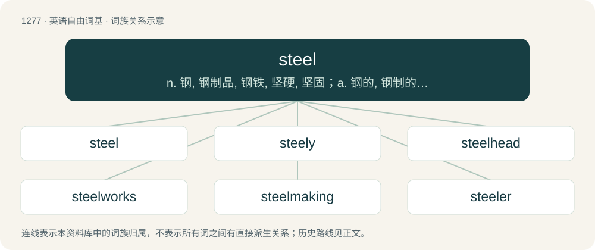

# 1363 · steel — n. 钢, 钢制品, 钢铁, 坚硬, 坚固；a. 钢的, 钢制的, 钢铁业的, 坚强的；vt. 使坚强, 钢化, 使冷酷

[总目录](../00_总目录_按常用程度.md)

**类型**：英语自由词基　｜　**来源语言**：见词源记录

## 核心含义与来源

- 核心含义：n. 钢, 钢制品, 钢铁, 坚硬, 坚固；a. 钢的, 钢制的, 钢铁业的, 坚强的；vt. 使坚强, 钢化, 使冷酷
- 英文含义：An artificial metal produced from iron, harder and more elastic than elemental iron; used figuratively as a symbol of hardness.
- 词形：steel

**来源记录 1**（名词；An artificial metal produced from iron, harder and more elastic than elemental iron; used figuratively as a symbol of hardness.）

From Middle English stele, stel, from Old English stīele, from Proto-West Germanic \*stahlī (“something made of steel”), enlargement of \*stahl (“steel”), from Proto-Germanic \*stahlą, from \*stah- or \*stag- (“to be firm, rigid”), from Proto-Indo-European \*stak- (“to stay, to be firm”). Compare Scots stele, Yola stehli, German Stahl, Dutch staal, Danish, Norwegian Bokmål, Norwegian Nynorsk, and Swedish stål.

## 词族图

## 单词速览（常用到不常用）

| 单词 | 音标 | 释义 |
|---|---|---|
| [steel](#w-1) | /stiːl/ | n. 钢, 钢制品, 钢铁, 坚硬, 坚固；a. 钢的, 钢制的, 钢铁业的, 坚强的；vt. 使坚强, 钢化, 使冷酷 |
| [steely](#w-2) | /ˈstiːli/ | a. 钢的, 钢制的, 钢铁般的 |
| [steelhead](#w-3) | /ˈstiːlˈhed/ | 虹鳟 |
| [steelworks](#w-4) | /ˈstiːlw\\\\ːks/ | n. 炼钢厂 |
| [steelmaking](#w-5) |  | n. 炼钢 |
| [steeler](#w-6) | /stiːl/ | n. 钢, 钢铁；钢制品；a. 钢的；钢制的；vt. 给…包钢；用钢作…的刀(或尖), 使钢化：；使如钢铁般硬 |

## 逐词详解

### 1. steel

**词性**：名词　｜　**音标**：/stiːl/

**中文释义**：n. 钢, 钢制品, 钢铁, 坚硬, 坚固；a. 钢的, 钢制的, 钢铁业的, 坚强的；vt. 使坚强, 钢化, 使冷酷

**英文义项**：An artificial metal produced from iron, harder and more elastic than elemental iron; used figuratively as a symbol of hardness. / Bladed or pointed weapons, as swords, javelins, daggers.

**词源与演化**：

From Middle English stele, stel, from Old English stīele, from Proto-West Germanic \*stahlī (“something made of steel”), enlargement of \*stahl (“steel”), from Proto-Germanic \*stahlą, from \*stah- or \*stag- (“to be firm, rigid”), from Proto-Indo-European \*stak- (“to stay, to be firm”). Compare Scots stele, Yola stehli, German Stahl, Dutch staal, Danish, Norwegian Bokmål, Norwegian Nynorsk, and Swedish stål.

**例句**：

> Despite a shortage of steel, industrial output has increased by five percent.

### 2. steely

**词性**：形容词　｜　**音标**：/ˈstiːli/

**中文释义**：a. 钢的, 钢制的, 钢铁般的

**英文义项**：Having qualities resembling those of steel, especially hardness and resoluteness. / Made of steel.

**构词拆分**：steel + -y

**词源与演化**：

From steel + -y.

**例句**：

> The bully backed down before his steely gaze.

该用例对应义项：Having qualities resembling those of steel, especially hardness and resoluteness.

### 3. steelhead

**词性**：名词　｜　**音标**：/ˈstiːlˈhed/

**中文释义**：虹鳟

**英文义项**：The anadromous form of the rainbow trout, Oncorhynchus mykiss. / The ruddy duck.

**构词拆分**：steel + head

**词源与演化**：

From steel + head.

**例句**：

> This remarkable life cycle is what makes salmon and steelhead truly unique.

### 4. steelworks

**词性**：名词　｜　**音标**：/ˈstiːlw\\\\ːks/

**中文释义**：n. 炼钢厂

**英文义项**：A place where steel is manufactured and/or shaped.

**构词拆分**：steel + works

**词源与演化**：

From steel + works.

**例句**：

> Our steelworks can produce up to 10,000 tons of steel per day.

### 5. steelmaking

**词性**：名词

**中文释义**：n. 炼钢

**英文义项**：The manufacture of steel.

**构词拆分**：steel + making

**词源与演化**：

From steel + making.

### 6. steeler

**词性**：名词　｜　**音标**：/stiːl/

**中文释义**：n. 钢, 钢铁；钢制品；a. 钢的；钢制的；vt. 给…包钢；用钢作…的刀(或尖), 使钢化：；使如钢铁般硬

**英文义项**：One who points, edges, plates or covers with steel. / A steelworker.

**构词拆分**：steel + -er

**词源与演化**：

From steel + -er.

**例句**：

> The heeler is as bad as the steeler.
