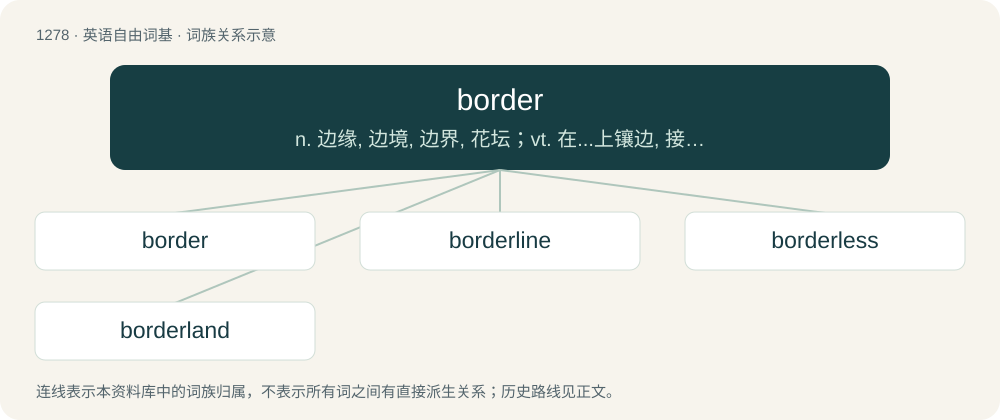

# 1364 · border — n. 边缘, 边境, 边界, 花坛；vt. 在...上镶边, 接近；vi. 接界, 近似

[总目录](../00_总目录_按常用程度.md)

**类型**：英语自由词基　｜　**来源语言**：见词源记录

## 核心含义与来源

- 核心含义：n. 边缘, 边境, 边界, 花坛；vt. 在...上镶边, 接近；vi. 接界, 近似
- 英文含义：The line or frontier area separating political or geographical regions.
- 词形：border

**来源记录 1**（名词；The line or frontier area separating political or geographical regions.）

Inherited from Middle English bordure, from Old French bordeure, of Germanic origin, from Frankish \*bord, equivalent to modern French bord (“a border”) + -er. Akin to Middle High German borte (“border, trim”), German Borte (“ribbon, trimming”). Doublet of bordure. More at board. Not cognate to beard, although inside Germanic there may have been influence between the senses of these two roots: see e.g. Old Norse barð (“edge”).

## 词族图

## 单词速览（常用到不常用）

| 单词 | 音标 | 释义 |
|---|---|---|
| [border](#w-1) | 英 /ˈbɔː.də/；美 /ˈbɔɹ.dɚ/ | n. 边缘, 边境, 边界, 花坛；vt. 在...上镶边, 接近；vi. 接界, 近似 |
| [borderline](#w-2) | 美 /ˈboɹ.dɚˌlaɪn/ | n. 边界, 界线；a. 边界的 |
| [borderless](#w-3) | /ˈbɔːdələs/ | a. 无边界的 |
| [borderland](#w-4) | /ˈbɔː(ɹ).də(ɹ)ˌlænd/ | n. 边界地方, 边陲, 两可间的状态 |

## 逐词详解

### 1. border

**词性**：名词　｜　**音标**：英 /ˈbɔː.də/；美 /ˈbɔɹ.dɚ/

**中文释义**：n. 边缘, 边境, 边界, 花坛；vt. 在...上镶边, 接近；vi. 接界, 近似

**英文义项**：The line or frontier area separating political or geographical regions. / The outer edge of something.

**词源与演化**：

Inherited from Middle English bordure, from Old French bordeure, of Germanic origin, from Frankish \*bord, equivalent to modern French bord (“a border”) + -er. Akin to Middle High German borte (“border, trim”), German Borte (“ribbon, trimming”). Doublet of bordure. More at board. Not cognate to beard, although inside Germanic there may have been influence between the senses of these two roots: see e.g. Old Norse barð (“edge”).

**例句**：

> The border between Canada and USA is the longest in the world.

该用例对应义项：The line or frontier area separating political or geographical regions.

### 2. borderline

**词性**：形容词　｜　**音标**：美 /ˈboɹ.dɚˌlaɪn/

**中文释义**：n. 边界, 界线；a. 边界的

**英文义项**：Nearly; not clearly on one side or the other of a border or boundary, ambiguous. / Of questionable taste or acceptability; approaching bad taste.

**构词拆分**：border + line

**词源与演化**：

From border + line.

**例句**：

> I would rather hire a talented layman than a university graduate with borderline qualifications.

该用例对应义项：Nearly; not clearly on one side or the other of a border or boundary, ambiguous.

### 3. borderless

**词性**：形容词　｜　**音标**：/ˈbɔːdələs/

**中文释义**：a. 无边界的

**英文义项**：Not having a border.

**构词拆分**：border + -less

**词源与演化**：

From border + -less.

### 4. borderland

**词性**：名词　｜　**音标**：/ˈbɔː(ɹ).də(ɹ)ˌlænd/

**中文释义**：n. 边界地方, 边陲, 两可间的状态

**英文义项**：Land near a border; marches. / An intermediate state, category, etc.

**构词拆分**：border + land

**词源与演化**：

From border + land.
