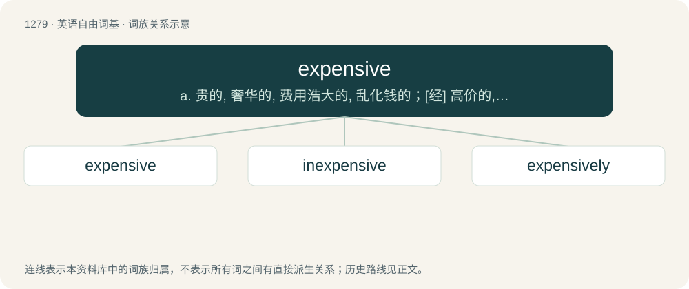

# 1365 · expensive — a. 贵的, 奢华的, 费用浩大的, 乱化钱的；\[经\] 高价的, 昂贵的, 浪费的

[总目录](../00_总目录_按常用程度.md)

**类型**：英语自由词基　｜　**来源语言**：见词源记录

## 核心含义与来源

- 核心含义：a. 贵的, 奢华的, 费用浩大的, 乱化钱的；\[经\] 高价的, 昂贵的, 浪费的
- 英文含义：Having a high price or cost.
- 词形：expensive

**来源记录 1**（形容词；Having a high price or cost.）

From Latin \*expēnsīvus, from expendō (“to weigh out (money), to pay out”) (whence English expend). By surface analysis, expense + -ive. In the sense of "high-priced" has largely displaced dear.

## 词族图

## 单词速览（常用到不常用）

| 单词 | 音标 | 释义 |
|---|---|---|
| [expensive](#w-1) | /ɪkˈspɛn.sɪv/ | a. 贵的, 奢华的, 费用浩大的, 乱化钱的；\[经\] 高价的, 昂贵的, 浪费的 |
| [inexpensive](#w-2) | 英 /ˌɪnɪkˈspɛnsɪv/ | a. 便宜的, 不贵重的 |
| [expensively](#w-3) | 美 /ɛkˈspɛn.sɪv.li/ | adv. 昂贵地；乱花钱地 |

## 逐词详解

### 1. expensive

**词性**：形容词　｜　**音标**：/ɪkˈspɛn.sɪv/

**中文释义**：a. 贵的, 奢华的, 费用浩大的, 乱化钱的；\[经\] 高价的, 昂贵的, 浪费的

**英文义项**：Having a high price or cost. / Taking a lot of system time or resources.

**词源与演化**：

From Latin \*expēnsīvus, from expendō (“to weigh out (money), to pay out”) (whence English expend). By surface analysis, expense + -ive. In the sense of "high-priced" has largely displaced dear.

**用法示例／搭配（非完整句）**：

> an unnecessarily expensive choice of algorithm

该用例对应义项：Taking a lot of system time or resources.

### 2. inexpensive

**词性**：形容词　｜　**音标**：英 /ˌɪnɪkˈspɛnsɪv/

**中文释义**：a. 便宜的, 不贵重的

**英文义项**：Involving little expense; reasonable in price; cheap. / Not extravagant in expenditure.

**构词拆分**：in- + expensive

**词源与演化**：

From in- + expensive.

**例句**：

> Everyone says the food in this restaurant is both delicious and inexpensive.

### 3. expensively

**词性**：副词　｜　**音标**：美 /ɛkˈspɛn.sɪv.li/

**中文释义**：adv. 昂贵地；乱花钱地

**英文义项**：In an expensive manner.

**构词拆分**：expensive + -ly

**词源与演化**：

From expensive + -ly.

**例句**：

> An expensively dressed little man turned a corner and approached her.

该用例对应义项：in an expensive manner
