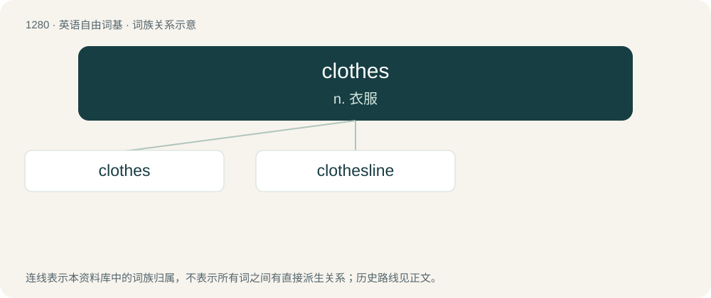

# 1366 · clothes — n. 衣服

[总目录](../00_总目录_按常用程度.md)

**类型**：英语自由词基　｜　**来源语言**：见词源记录

## 核心含义与来源

- 核心含义：n. 衣服
- 英文含义：Items of clothing; apparel.
- 词形：clothes

**来源记录 1**（名词；Items of clothing; apparel.）

From Middle English clothes, cloþes (plural of cloth, cloþ (“cloth, garment”)), from Old English clāþas (“clothes”, plural of clāþ (“cloth”)), equivalent to cloth + -es. Cognate with Scots clathes, claes (“clothes”), Dutch klederen, kleren (“clothes”), German Kleider (“clothes”), Danish klæder (“clothes”), Swedish kläder (“clothes”), Norwegian Bokmål klær (“clothes”), Norwegian Nynorsk klede (“clothes”), Faroese klæði, klæðir (“clothes”).

## 词族图

## 单词速览（常用到不常用）

| 单词 | 音标 | 释义 |
|---|---|---|
| [clothes](#w-1) | 英 /kləʊ(ð)z/；美 /kloʊ(ð)z/ | n. 衣服 |
| [clothesline](#w-2) | 英 /ˈkləʊðzlaɪn/；美 /ˈkloʊðzlaɪn/ | n. 晒衣绳 |

## 逐词详解

### 1. clothes

**词性**：名词　｜　**音标**：英 /kləʊ(ð)z/；美 /kloʊ(ð)z/

**中文释义**：n. 衣服

**英文义项**：Items of clothing; apparel. / The covering of a bed; bedclothes.

**构词拆分**：cloth + -es

**词源与演化**：

From Middle English clothes, cloþes (plural of cloth, cloþ (“cloth, garment”)), from Old English clāþas (“clothes”, plural of clāþ (“cloth”)), equivalent to cloth + -es. Cognate with Scots clathes, claes (“clothes”), Dutch klederen, kleren (“clothes”), German Kleider (“clothes”), Danish klæder (“clothes”), Swedish kläder (“clothes”), Norwegian Bokmål klær (“clothes”), Norwegian Nynorsk klede (“clothes”), Faroese klæði, klæðir (“clothes”).

**例句**：

> He always bought his clothes at the same store.

该用例对应义项：clothing in general

### 2. clothesline

**词性**：名词　｜　**音标**：英 /ˈkləʊðzlaɪn/；美 /ˈkloʊðzlaɪn/

**中文释义**：n. 晒衣绳

**英文义项**：A rope or cord tied up outdoors to hang clothes on so they can dry. / A structure with multiple cords for the same purpose, such as a Hills hoist.

**构词拆分**：clothes + line

**词源与演化**：

From clothes + line.

**例句**：

> Hang this towel out on the clothesline for me.

该用例对应义项：A rope or cord tied up outdoors to hang clothes on so they can dry.
