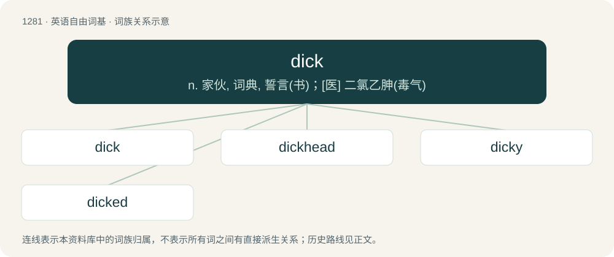

# 1367 · dick — n. 家伙, 词典, 誓言(书)；\[医\] 二氯乙胂(毒气)

[总目录](../00_总目录_按常用程度.md)

**类型**：英语自由词基　｜　**来源语言**：见词源记录

## 核心含义与来源

- 核心含义：n. 家伙, 词典, 誓言(书)；\[医\] 二氯乙胂(毒气)
- 英文含义：The penis.
- 词形：dick

**多个词源／构词路径**：同一拼写可能有不同来源；以下按词性和含义分别列出。

**来源记录 1**（名词；The penis.）

Ultimately from Dick, pet form of the name Richard. The name Dick came to mean everyman, whence the word acquired its other meanings.

**来源记录 2**（名词；A detective.）

A shortening and alteration of detective.

**来源记录 3**（数词；Ten, in Cumbrian sheep counting.）

Borrowed from Cumbric \*deg, from Proto-Brythonic \*deg. Cognate with Welsh deg.

## 词族图

## 单词速览（常用到不常用）

| 单词 | 音标 | 释义 |
|---|---|---|
| [dick](#w-1) | /dɪk/ | n. 家伙, 词典, 誓言(书)；\[医\] 二氯乙胂(毒气) |
| [dickhead](#w-2) | /ˈdɪkˌ(h)ɛd/ | n. 白痴 |
| [dicky](#w-3) | /ˈdɪki/ | a. 站不稳的, 靠不住的, 软弱的；n. 小孩围涎 |
| [dicked](#w-4) | /dɪkt/ | 【英文】Having a specified kind of penis. |

## 逐词详解

### 1. dick

**词性**：名词　｜　**音标**：/dɪk/

**中文释义**：n. 家伙, 词典, 誓言(书)；\[医\] 二氯乙胂(毒气)

**英文义项**：The penis. / A contemptible or obnoxious person; a jerk; traditionally, especially, a male jerk.

**词源与演化**：

Ultimately from Dick, pet form of the name Richard. The name Dick came to mean everyman, whence the word acquired its other meanings.

**例句**：

> Were you feeling lonely in bed? My dick feels ready to go!

该用例对应义项：The penis.

### 2. dickhead

**词性**：名词　｜　**音标**：/ˈdɪkˌ(h)ɛd/

**中文释义**：n. 白痴

**英文义项**：The glans penis. / A jerk; a mean or rude person.

**构词拆分**：dick + head

**词源与演化**：

From dick + head. Attested since the 1960s, with the jerk sense appearing earliest. Compare cockhead, knobhead.

### 3. dicky

**词性**：名词　｜　**音标**：/ˈdɪki/

**中文释义**：a. 站不稳的, 靠不住的, 软弱的；n. 小孩围涎

**英文义项**：A louse. / Dicky dirt = a shirt, meaning a shirt with a collar.

**构词拆分**：dick (“leather apron”) + -y

**词源与演化**：

From Dicky, pet form of Richard. \* In cover/apron senses: perhaps from English dialect dick (“leather apron”) + -y; perhaps from Dutch dek (“a cover”).

**例句**：

> Can you open the dicky for me?

该用例对应义项：The luggage storage compartment of a sedan/saloon style car.

### 4. dicked

**词性**：形容词　｜　**音标**：/dɪkt/

**英文义项**：Having a specified kind of penis. / In trouble; put in a difficult situation, or maliciously exploited.

**构词拆分**：From dick + -ed.

**词源与演化**：

From dick + -ed.

**例句**：

> He is really dicked. His car broke down and today is his first day on his new job.

该用例对应义项：In trouble; put in a difficult situation, or maliciously exploited.
