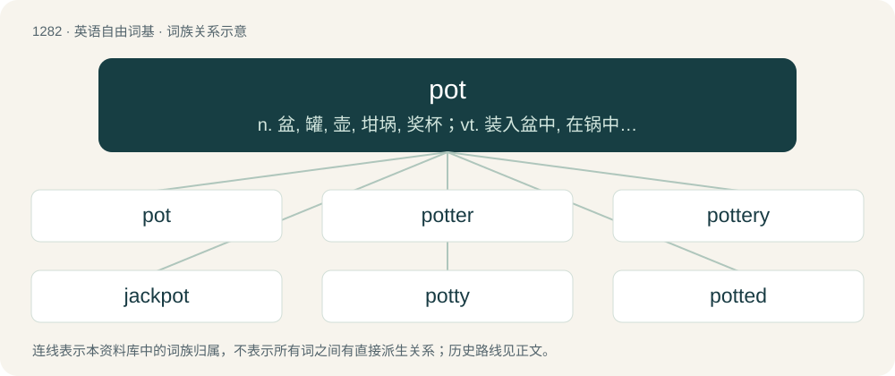

# 1368 · pot — n. 盆, 罐, 壶, 坩埚, 奖杯；vt. 装入盆中, 在锅中煮, 随手射击；vi. 随手射击

[总目录](../00_总目录_按常用程度.md)

**类型**：英语自由词基　｜　**来源语言**：见词源记录

## 核心含义与来源

- 核心含义：n. 盆, 罐, 壶, 坩埚, 奖杯；vt. 装入盆中, 在锅中煮, 随手射击；vi. 随手射击
- 英文含义：A flat-bottomed vessel (usually metal) used for cooking food, possibly excluding saucepans (see usage notes).
- 词形：pot

**多个词源／构词路径**：同一拼写可能有不同来源；以下按词性和含义分别列出。

**来源记录 1**（名词；A flat-bottomed vessel (usually metal) used for cooking food, possibly excluding saucepans (see usage notes).）

From Middle English pot, potte, from Old English pott (“pot”) and Old French pot (“pot”) (probably from Frankish \*pott); both Old English and Frankish from Proto-Germanic \*puttaz (“pot”), from Proto-Indo-European \*budnós (“a type of vessel”). Cognate with Saterland Frisian Pot (“pot”), Dutch pot (“pot”), German Low German Pott (“pot”), German Pott (“pot”), Swedish potta (“chamber pot”), Icelandic pottur (“tub, pot”), Old Armenian պոյտն (poytn, “pot, earthen pot”). Also, Old Norse pottr (“pot, tub, basin”). The sense of ruin or deterioration was originally a general allusion to "being chopped up and tossed in a (normally fiery) pot, like a piece of meat" (i.e. to get wasted or done with (by someone)). The 'clean' slang term which was used in reference to toilet rooms and lavatories apparently derives from English chamberpots, although now usually encountered as potty in the context of children's toilet training.

**来源记录 2**（名词；Marijuana.）

Possibly a shortened form of Mexican Spanish potiguaya or potaguaya (“cannabis leaves”), or potación de guaya (literally “drink of grief”), supposedly denoting a drink of wine or brandy in which marijuana buds were steeped, from pota + de + guaya (see guayar (“to lament”)).

**来源记录 3**（名词；A simple electromechanical device used to control resistance or voltage (often to adjust sound volume) in an electronic device by rotating or sliding when manipulated by a human thumb, screwdriver, etc.）

Clipping of potentiometer.

## 词族图

## 单词速览（常用到不常用）

| 单词 | 音标 | 释义 |
|---|---|---|
| [pot](#w-1) | 英 /pɒt/；美 /pɑt/ | n. 盆, 罐, 壶, 坩埚, 奖杯；vt. 装入盆中, 在锅中煮, 随手射击；vi. 随手射击 |
| [potter](#w-2) | 英 /ˈpɒtə/；美 /ˈpɑtɚ/ | n. 陶工, 制陶工人 |
| [pottery](#w-3) | 英 /ˈpɒtəɹi/；美 /ˈpɑtəɹi/ | n. 陶器, 陶器厂；\[化\] 陶器 |
| [jackpot](#w-4) | /ˈd͡ʒækpɒt/ | n. 最大赌注, (彩票的)头奖, 最大成功, 意外的成功/奖赏, 困境 |
| [potty](#w-5) | 英 /ˈpɒti/；美 /ˈpɑti/ | a. 微小的, 不足道的；n. 便壶 |
| [potted](#w-6) | /ˈpɒtid/ | a. 盆栽的, 罐装的 |
| [teapot](#w-7) | 英 /ˈtiː.pɒt/；美 /ˈti.pɔt/ | n. 茶壶 |
| [potash](#w-8) | 英 /ˈpɒt.æʃ/；美 /ˈpɑt.æʃ/ | \[化\] 钾碱；\[医\] 钾硷, 碳酸钾, 草硷 |
| [pothole](#w-9) | /ˈpɒthəul/ | n. 壶穴 |
| [crackpot](#w-10) | /ˈkɹæk.pɒt/ | a. 想入非非的, 不切实的；n. 疯子, 怪人, 狂想家 |
| [potluck](#w-11) | 英 /ˌpɒtˈlʌk/；美 /ˈpɑtˌlʌk/ | n. 家常便饭 |
| [honeypot](#w-12) | /ˈhʌnipɒt/ | n. 装蜜的罐子; 极有吸引力的事物 |
| [crockpot](#w-13) | /ˈkrɔkpɔt/ | n. 克罗克电锅(商标名) |
| [hodgepodge](#w-14) | 英 /ˈhɒd͡ʒˌpɒd͡ʒ/；美 /ˈhɑd͡ʒˌpɑd͡ʒ/ | n. 杂烩菜, 混杂物 |
| [pothead](#w-15) | /ˈpɔt,hed/ | n. 吸大麻者 |
| [potbelly](#w-16) | /ˈpɒtbeli/ | n. 大肚子, 大肚子的人, 圆火炉 |

## 逐词详解

### 1. pot

**词性**：名词　｜　**音标**：英 /pɒt/；美 /pɑt/

**中文释义**：n. 盆, 罐, 壶, 坩埚, 奖杯；vt. 装入盆中, 在锅中煮, 随手射击；vi. 随手射击

**英文义项**：A flat-bottomed vessel (usually metal) used for cooking food, possibly excluding saucepans (see usage notes). / The nominal household cooking vessel, metaphorically standing for the supply of food for a meal, or for the home.

**词源与演化**：

From Middle English pot, potte, from Old English pott (“pot”) and Old French pot (“pot”) (probably from Frankish \*pott); both Old English and Frankish from Proto-Germanic \*puttaz (“pot”), from Proto-Indo-European \*budnós (“a type of vessel”). Cognate with Saterland Frisian Pot (“pot”), Dutch pot (“pot”), German Low German Pott (“pot”), German Pott (“pot”), Swedish potta (“chamber pot”), Icelandic pottur (“tub, pot”), Old Armenian պոյտն (poytn, “pot, earthen pot”). Also, Old Norse pottr (“pot, tub, basin”). The sense of ruin or deterioration was originally a general allusion to "being chopped up and tossed in a (normally fiery) pot, like a piece of meat" (i.e. to get wasted or done with (by someone)). The 'clean' slang term which was used in reference to toilet rooms and lavatories apparently derives from English chamberpots, although now usually encountered as potty in the context of children's toilet training.

**例句**：

> No one's interested. You need to sweeten the pot.

该用例对应义项：The money available to be won in a hand of poker or a round of other games of chance; (figuratively) any sum of money being used as an enticement.

### 2. potter

**词性**：名词　｜　**音标**：英 /ˈpɒtə/；美 /ˈpɑtɚ/

**中文释义**：n. 陶工, 制陶工人

**英文义项**：One who makes pots and other ceramic wares. / One who places flowers or other plants inside their pots.

**构词拆分**：pot + -er

**词源与演化**：

From Middle English pottere, from Old English pottere (“potter”, in placenames), from Proto-West Germanic \*pottārī (“pot-maker”), equivalent to pot + -er. Influenced by Anglo-Norman poter, Old French potier (“potter”). Cognate with Dutch potter (“potter”), German Low German Pötter, Pütter (“potter”). Displaced Old English synonyms lāmwyrhta (“a worker in clay, potter”, literally “loam-worker”), tiġelwyrhta (“brickmaker, potter”, literally “tile-worker”), crocwyrhta (“crocker, potter”, literally “crock-worker”).

**例句**：

> Mr Potter keeps himself in good condition by going jogging every day.

### 3. pottery

**词性**：名词　｜　**音标**：英 /ˈpɒtəɹi/；美 /ˈpɑtəɹi/

**中文释义**：n. 陶器, 陶器厂；\[化\] 陶器

**英文义项**：Fired ceramic wares that contain clay when formed. / A potter's shop or workshop, where pottery is made.

**构词拆分**：pot + -ery

**词源与演化**：

From Old French poterie, from potier (“potter”), from the root of pot, equivalent to pot + -ery. First attested in the 13th century.

**例句**：

> The shelves were lined with pottery of all shapes and sizes.

该用例对应义项：Fired ceramic wares that contain clay when formed.

### 4. jackpot

**词性**：名词　｜　**音标**：/ˈd͡ʒækpɒt/

**中文释义**：n. 最大赌注, (彩票的)头奖, 最大成功, 意外的成功/奖赏, 困境

**英文义项**：A money prize pool which accumulates until the conditions are met for it to be won. / A large cash prize or money.

**构词拆分**：jack + pot

**例句**：

> John hit the jackpot. His efforts paid off beyond his wildest dreams.

### 5. potty

**词性**：动词　｜　**音标**：英 /ˈpɒti/；美 /ˈpɑti/

**中文释义**：a. 微小的, 不足道的；n. 便壶

**英文义项**：Synonym of go potty.

**构词拆分**：From pot (“chamberpot”) + -y (diminutive suffix).

**词源与演化**：

From pot (“chamberpot”) + -y (diminutive suffix).

**例句**：

> If anybody needs to potty, do it now before we go.

该用例对应义项：Synonym of go potty.

### 6. potted

**词性**：形容词　｜　**音标**：/ˈpɒtid/

**中文释义**：a. 盆栽的, 罐装的

**英文义项**：Grown or planted in a plant pot. / Prepared in advance, as though preserved by potting.

**构词拆分**：pot + -ed

**词源与演化**：

From pot + -ed. Adjective meaning "prepared in advance" by analogy with potted meat (canned meat), first used in a published work by L. Susan Stebbing in her Pelican classic Thinking to some purpose (1939), where "potted thinking" is defined as "a compressed statement to save us the trouble of thinking".

**例句**：

> Granny waters her potted plants on the windowsill every day.

该用例对应义项：Grown or planted in a plant pot.

### 7. teapot

**词性**：名词　｜　**音标**：英 /ˈtiː.pɒt/；美 /ˈti.pɔt/

**中文释义**：n. 茶壶

**英文义项**：A vessel for brewing and serving tea, typically with a handle and spout.

**构词拆分**：Endocentric compound of tea + pot

**词源与演化**：

Endocentric compound of tea + pot.

**例句**：

> Put the teapot on the burner, otherwise the tea will be cold.

### 8. potash

**词性**：名词　｜　**音标**：英 /ˈpɒt.æʃ/；美 /ˈpɑt.æʃ/

**中文释义**：\[化\] 钾碱；\[医\] 钾硷, 碳酸钾, 草硷

**英文义项**：The water-soluble part of wood ash, used for making soap and glass and as a fertilizer (chemically speaking, an impure form of potassium carbonate (K₂CO₃) mixed with other potassium salts). / A class of potassium minerals, of similar applicability to potassium carbonate, such as being a fertilizer. (ie. potassium chloride, potassium hydroxide)

**构词拆分**：pot + ash

**词源与演化**：

From pot + ash, because the substance was originally obtained by leaching ash in water and then boiling down the resulting solution in a pot. Compare Dutch potas, German Pottasche.

**例句**：

> These are the locations where potash is being mined today.

### 9. pothole

**词性**：名词　｜　**音标**：/ˈpɒthəul/

**中文释义**：n. 壶穴

**英文义项**：A shallow pit or other edged depression in a road's surface, especially when caused by erosion, weather or traffic. / A pit formed in the bed of a turbulent stream.

**构词拆分**：pot (“pit, hollow, cavity”) + hole

**词源与演化**：

From dialectal pot (“pit, hollow, cavity”) + hole. The "cave" senses, attested since at least 1809 (as pot-hole), may be from Middle English pot, potte (“a deep hole for a mine, or from peat-digging”), of uncertain origin; perhaps related to English pit, pote, or pot. Compare Scots pott, patt (“a pit dug in the ground; coalpit”).

**例句**：

> I got stuck in a pothole on my way to work.

### 10. crackpot

**词性**：名词　｜　**音标**：/ˈkɹæk.pɒt/

**中文释义**：a. 想入非非的, 不切实的；n. 疯子, 怪人, 狂想家

**英文义项**：An eccentric, crazy or foolish person. / Someone addicted to crack cocaine (i.e. a drug addict).

**构词拆分**：crack + pot；crack + pate

**词源与演化**：

Mostly likely a back-etymology of pot, to form crack + pot. Originally, from crack + pate. Compare typologically Russian чо́кнутый (čóknutyj) (&lt; чо́каться (čókatʹsja), onomatopoeic), see crack for the further typology.

**例句**：

> Time will tell whether he is a crackpot or a genius for promoting that sort of idea.

该用例对应义项：An eccentric, crazy or foolish person.

### 11. potluck

**词性**：名词　｜　**音标**：英 /ˌpɒtˈlʌk/；美 /ˈpɑtˌlʌk/

**中文释义**：n. 家常便饭

**英文义项**：A meal, especially one offered to a guest, consisting of whatever food is available. / Whatever is available in a particular situation.

**构词拆分**：pot + luck

**词源与演化**：

From pot + luck. According to the Oxford English Dictionary, sense 3 (“a shared meal consisting of whatever guests have brought”) is unlikely to have been influenced by potlatch.

**例句**：

> Here are some leftover beans and meat; we can make a good potluck stew from them.

该用例对应义项：A meal, especially one offered to a guest, consisting of whatever food is available.

### 12. honeypot

**词性**：名词　｜　**音标**：/ˈhʌnipɒt/

**中文释义**：n. 装蜜的罐子; 极有吸引力的事物

**英文义项**：A pot of honey. / A romantic pet name; "honey".

**构词拆分**：honey + pot

**词源与演化**：

From Middle English hwny pott; equivalent to honey + pot.

**例句**：

> Boys flocked to the attractive woman like flies around a honeypot.

### 13. crockpot

**词性**：名词　｜　**音标**：/ˈkrɔkpɔt/

**中文释义**：n. 克罗克电锅(商标名)

**英文义项**：A slow cooker.

**构词拆分**：crock + pot

**词源与演化**：

From Crock-Pot (1971), brand name of slow cooker by The Rival Company, from crock + pot. Coined by duplication and assonance.

### 14. hodgepodge

**词性**：名词　｜　**音标**：英 /ˈhɒd͡ʒˌpɒd͡ʒ/；美 /ˈhɑd͡ʒˌpɑd͡ʒ/

**中文释义**：n. 杂烩菜, 混杂物

**英文义项**：A collection containing a variety of miscellaneous things. / A confused mass of ingredients shaken or mixed together in the same pot.

**构词拆分**：hotch + pot

**词源与演化**：

From Middle English hochepoche, a variation of hochepot, from Old French hochepot, from Middle Dutch hutspot (“beef or mutton cut into small pieces and mixed and boiled together in a pot”), from hotsen, hutsen (“to shake; jog; jolt”) + pot (“pot”), equivalent to hotch + pot. Compare German Low German Hüttspott (“hodgepodge”).

**例句**：

> His latest sculpture is a hodgepodge of kitchen clutter and scrap glued together.

该用例对应义项：A collection containing a variety of miscellaneous things.

### 15. pothead

**词性**：名词　｜　**音标**：/ˈpɔt,hed/

**中文释义**：n. 吸大麻者

**英文义项**：A person who smokes cannabis frequently, or to excess. / An electric motor's terminal connection or wiring box.

**构词拆分**：pot + -head

**词源与演化**：

First sense appears c. 1957 in the writings of Jack Gelber. Third sense appears c. 1639.

**例句**：

> That pothead Shane has a nasty bong.

该用例对应义项：A person who smokes cannabis frequently, or to excess.

### 16. potbelly

**词性**：名词　｜　**音标**：/ˈpɒtbeli/

**中文释义**：n. 大肚子, 大肚子的人, 圆火炉

**英文义项**：A large, protruding, or swollen abdomen; a paunch.

**构词拆分**：pot + belly

**词源与演化**：

From pot + belly.
