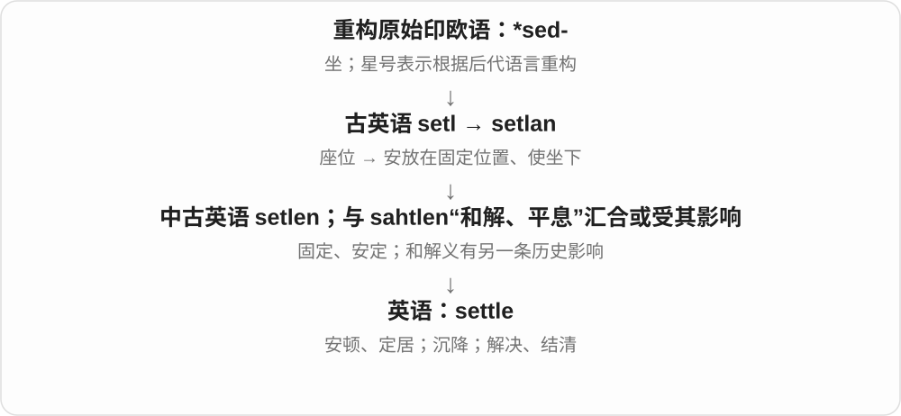
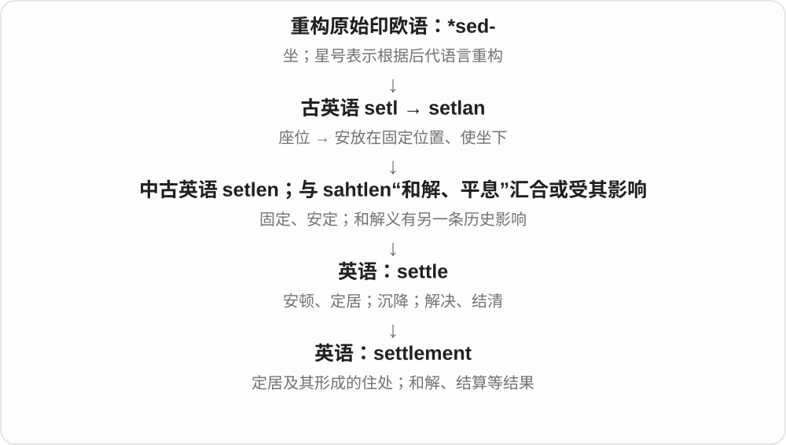
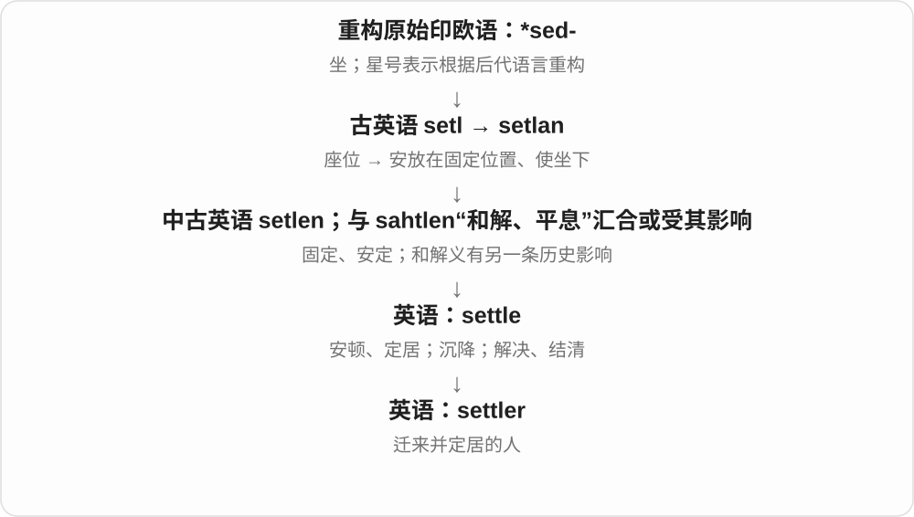
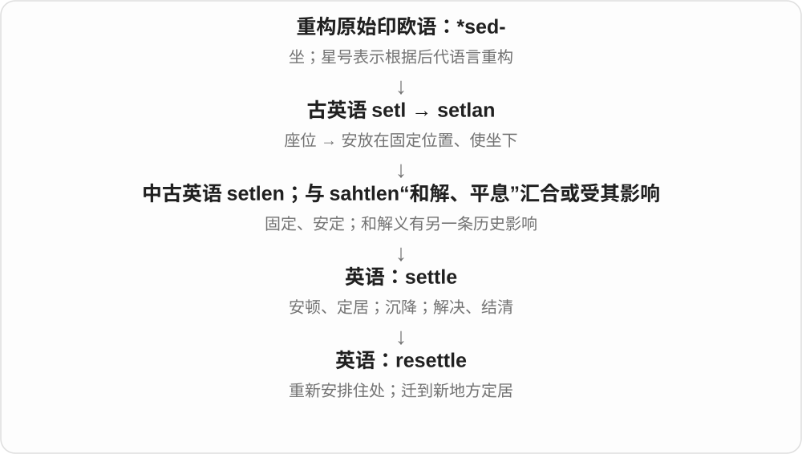

# 1369 · settle — 安顿、沉定、解决与座椅历史

[逐词精讲目录](../00_逐词精讲目录.md) · [总目录](../00_总目录_按常用程度.md)

## 核心词根与来源

安顿住所、泥沙沉下、争议解决，都有从动荡到定下来的画面。settee 长座椅的具体构词仍有不确定。

**SETTLE：让原来不定的东西有个固定、安稳的位置**

settle → settlement、settler；resettle 再安置，unsettle 使不安；settee 保留家具词的谨慎旁支。

- **安顿、居住与结果**：settle · settlement · settler
- **再次安置与扰动**：resettle · unsettle
- **家具旁支**：settee
- **settle、settlement → settlements：定居点与达成的解决安排**：settle · settlement · settlements
- **settle → settler → settlers**：settlers

## 词形与演化规律

古英语 setl 座位、setlan 使安坐 → settle；settle + -ment/-er；re-/un- + settle；settee 可能联系旧座椅词。

settl 座位材料与和解义的另一历史影响分开，现代 ment 名词加 s。

settle 去 e 加完整 -er，再加 -s，形成定居者名称。settle 远连安坐、安顿词族；新迁来者的定居不表示该地此前无人居住。

## 单词速览（按词族由简到繁）

同一基础词的相关扩展放在一起，先读基础形式，再读扩展；各组之间优先读常用的。具体词源关系见各词讲解。

| 单词 | 音标 | 核心意思 |
|---|---|---|
| [settle](#w-2) | /ˈsetəl/ | 安顿、定居；平息；沉降；解决；结清 |
| [settlement](#w-1) | /ˈsetəlmənt/ | 定居点；和解协议；解决；结算 |
| [settlements](#w-7) | /ˈsetəlmənts/ | 定居点；和解安排、解决结果；结算〔复数〕 |
| [settler](#w-3) | 英 /ˈsetlə/；美 /ˈsetlər/ | 移居者；定居者 |
| [settlers](#w-8) | 英 /ˈsetləz/；美 /ˈsetlɚz/ | 定居者；移居定居的人〔复数〕 |
| [settee](#w-5) | /seˈtiː/ | 长沙发、长软椅〔英式常见〕 |
| [resettle](#w-4) | /ˌriːˈsetəl/ | 重新定居；重新安置 |
| [unsettle](#w-6) | /ʌnˈsetəl/ | 使不安；扰乱；动摇原有稳定状态 |

## 逐词讲解

### 1. settle — 安顿、定居；平息；沉降；解决；结清

**音标**：/ˈsetəl/

**先抓住这个画面**

settle 像原本晃动、悬着的东西终于落到一个稳定位置：人安顿下来，尘土落下，争议也有了定论。

**怎么拆**

定居义继承古英语 setlan，来自 setl“座位”；现代词也汇入或受到中古英语 sahtlen“和解、平息”的影响，不能把所有义硬说成单一路线。

**怎么变成今天的意思**

settle in 是逐渐适应新环境；settle a dispute 是解决争议；settle a bill 是结清账单；settle for 是接受一个未必最满意的选择。

**常见搭配与例句**

settle down；settle in；settle a dispute；settle for；settle on。

> It took us a few weeks to settle into the new house.

我们花了几周时间才适应新家。

> The two sides settled the dispute after a long discussion.

双方经过长时间讨论，解决了争议。

> Leave the jar still so that the particles can settle.

让罐子静置，好让颗粒沉到底部。

**别混淆**

solve 常突出找出问题答案；settle 还可指达成约定、付款或安排妥当，不一定证明找到唯一正确答案。

### 2. settlement — 定居点；和解协议；解决；结算

**音标**：/ˈsetəlmənt/

**先抓住这个画面**

settlement 把 settle 的结果装进一个名词：人落脚形成住处，争议落定形成协议，账款落定形成结算。

**怎么拆**

settle + -ment；同时继承 settle 在定居、安定以及和解方面的多条意义。

**怎么变成今天的意思**

a small settlement 是小型聚居点；reach a settlement 是达成和解；payment settlement 谈款项结算。不要看到同一词就套同一个中文译法。

**常见搭配与例句**

a rural settlement；reach a settlement；a settlement agreement；final settlement。

> The road connects several small settlements in the valley.

这条路连接了山谷中的几个小型聚居点。

> The parties reached a settlement before the trial.

各方在开庭前达成了和解。

> Final settlement of the invoice is due next month.

这张发票对应款项应在下个月结清。

**别混淆**

village 指村庄；settlement 强调人们定居形成的聚居点。agreement 可是任何协议，settlement 常让一项争议或未了事项落定。

### 3. settlements — 定居点；和解安排、解决结果；结算〔复数〕

**音标**：/ˈsetəlmənts/

**先抓住这个画面**

人们落脚并固定生活下来，形成 settlements；一场争执落定、双方有了安排，也可以是 settlements。都抓住事情安定下来的一面。

**怎么拆**

settlement 现代对应 settle + -ment，settle 的座位、安顿材料与和解词的另一历史影响有交涉。名词再加 -s，/t/ 后读 /s/。

**怎么变成今天的意思**

**settle 的安顿、和解等路线 → settlement**  
定居、安定或解决 → 形成的地点、安排、结果

↓

**settlement + -s → settlements**  
多处定居点；多项解决安排、结算

ancient settlements 古代定居点；peace settlements 和平安排；reach settlements 达成解决协议。

**常见搭配与例句**

settlements along the river 沿河定居点；dispute settlements 争议解决安排。

> Small settlements grew along the river.

沿河逐渐形成了小型定居点。

> The book compares several peace settlements.

这本书比较了几项和平安排。

**别混淆**

settlements 不只指把一群人安置在哪里；在争议、款项语境里常说解决、结清的结果。地点和安排要按对象分开。

### 4. settler — 移居者；定居者

**音标**：英 /ˈsetlə/；美 /ˈsetlər/

**先抓住这个画面**

settler 是来到一个地方长期落脚、建立生活的人，重点是迁来并定居这个过程。

**怎么拆**

settle + -er，表示从事定居行为的人。

**怎么变成今天的意思**

历史书里常谈迁徙与殖民。称某人为 settler 不等于那片土地此前无人居住，也不能自动忽略原住群体。

**常见搭配与例句**

early settlers；new settlers；a settler community。

> The museum displays tools used by early settlers.

博物馆展出了早期移居者使用的工具。

> The account describes contact between settlers and Indigenous communities.

这份记述描述了移居者与原住民群体之间的接触。

**别混淆**

resident 是现在住在这里的人；settler 更强调迁来建立住处的经历或历史身份。

### 5. settlers — 定居者；移居定居的人〔复数〕

**音标**：英 /ˈsetləz/；美 /ˈsetlɚz/

**先抓住这个画面**

离开原来的地方，在新地方长期安顿下来的人，可以叫 settlers。重点是搬来并建立生活，而非短暂停留。

**怎么拆**

settle 去末尾 e，加完整 -er → settler，再加 -s。settle 的安顿、固定词族远连坐、安置的材料；settler 较早还可说使争论等定下来的事物，后来常指人。

**怎么变成今天的意思**

**settle 安顿、使固定 + -er → settler**  
较早用作使事情定下来的行为者、事物名

↓

**移居并固定住处的人 → settlers**  
现代常见历史、迁居语境

early settlers 是较早迁来的定居者；new settlers 是新来定居的人；settlers’ homes 是定居者的住宅。

**常见搭配与例句**

early settlers；new settlers；settlers’ homes。

> The museum reconstructs the homes of early settlers.

博物馆复原了早期移居定居者的住宅。

> The book follows several settlers as they build new lives.

这本书讲述了几位定居者建立新生活的经历。

**别混淆**

settlers 描述迁来定居的角色，不表示这片土地此前无人居住。历史文本里还要看他们与原有居民的关系。

### 6. settee — 长沙发、长软椅〔英式常见〕

**音标**：/seˈtiː/

**先抓住这个画面**

可以坐几个人、有靠背的长座椅，日常常和 sofa 接近；不是某个人被安排坐下的称呼。

**怎么拆**

十八世纪英语已有这种家具名，常被联系到 settle 长靠背椅等旧座位词，但具体构词路线不完全确定。-ee 不能照 employee 那样强解成被安置的人。

**怎么变成今天的意思**

**英语 settee 的早期家具用法**  
有靠背的长座椅

↓

**可能联系旧 settle〔座椅〕、set 等；具体路线有争议**  
现代长沙发、长软椅

sit on the settee 坐在沙发上，a small settee 小长沙发，the living-room settee 客厅沙发。

**常见搭配与例句**

sit on the settee；a small settee；a comfortable settee。

> We sat on the settee by the window.

我们坐在窗边的长沙发上。

> The small settee fitted neatly into the corner.

那张小长沙发正好放进角落。

**别混淆**

settee 家具，settle 现代主要动词安顿、解决；sofa/couch 在很多日常场景近义，地区、款式偏好不同。

### 7. resettle — 重新定居；重新安置

**音标**：/ˌriːˈsetəl/

**先抓住这个画面**

resettle 像原来的生活地点无法继续使用，于是把生活重新安放到另一个地方。

**怎么拆**

re-（重新）+ settle，英语中派生。

**怎么变成今天的意思**

可以是人自己 resettle，也可以是机构 resettle families。具体搬迁是否自愿，要由上下文说明，词本身并不保证。

**常见搭配与例句**

resettle in another town；resettle families；be resettled。

> The family resettled in a nearby town after the flood.

洪水之后，这家人在附近一座城镇重新定居。

> The programme helped residents resettle close to their workplaces.

这个项目帮助居民在工作地点附近重新安家。

**别混淆**

relocate 强调换位置；resettle 更强调搬去后重新建立生活或安排长期住处。

### 8. unsettle — 使不安；扰乱；动摇原有稳定状态

**音标**：/ʌnˈsetəl/

**先抓住这个画面**

unsettle 像把原先安稳放好的椅子轻轻晃了一下，让人一下找不到踏实感。

**怎么拆**

un- 在这里表示解除或逆转 + settle，形成“打破安定状态”的动词。

**怎么变成今天的意思**

常以消息、变化、陌生环境作主语。被 unsettle 的可以是人，也可以是习惯或原有看法。

**常见搭配与例句**

unsettle someone；unsettle the team；unsettle an assumption。

> The unexplained noise unsettled the passengers.

来历不明的声响让乘客感到不安。

> The discovery unsettled his long-held assumptions.

这个发现动摇了他长期以来的看法。

**别混淆**

upset 常直接说难过或打乱；unsettle 常是让人隐隐不安、失去原来的稳定感。

## 这一组要分清什么

settle down 安定，settle for 退而接受；settee 是家具，-ee 不按人物被动后缀机械理解。

## 串起来练习

After settling into the new house, they bought a small settee.

在新家安顿下来后，他们买了一张小长沙发。
