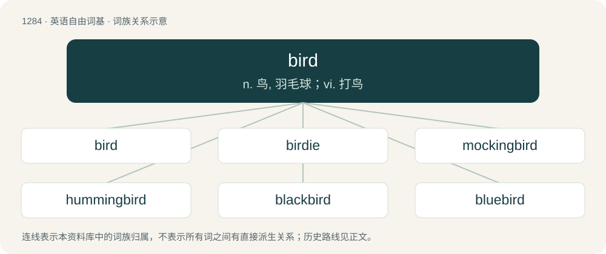

# 1370 · bird — n. 鸟, 羽毛球；vi. 打鸟

[总目录](../00_总目录_按常用程度.md)

**类型**：英语自由词基　｜　**来源语言**：见词源记录

## 核心含义与来源

- 核心含义：n. 鸟, 羽毛球；vi. 打鸟
- 英文含义：An animal of the clade (traditionally class) Aves in the phylum Chordata, characterized by being warm-blooded, having feathers and wings usually capable of flight, having a beaked mouth, and laying eggs.
- 词形：bird

**多个词源／构词路径**：同一拼写可能有不同来源；以下按词性和含义分别列出。

**来源记录 1**（名词；An animal of the clade (traditionally class) Aves in the phylum Chordata, characterized by being warm-blooded, having feathers and wings usually capable of flight, having a beaked mouth, and laying eggs.）

From Middle English bird, brid, from Old English bridd (“chick, fledgling, chicken”), of uncertain origin (see Old English bridd for more). Originally from a term used of birds that could not fly (chicks, fledglings, chickens) as opposed to the general Old English term for flying birds, fugol (modern fowl). Gradually replaced fowl as the most common term starting in the 14th century. The "booing/jeering" and "vulgar hand gesture" senses derived from the expression “to give the big bird”, as in “to hiss someone like a goose”, dated in the mid‐18th century.

**来源记录 2**（名词；A prison sentence.）

Originally Cockney rhyming slang, shortened from bird-lime for "time".

## 词族图

## 单词速览（常用到不常用）

| 单词 | 音标 | 释义 |
|---|---|---|
| [bird](#w-1) | 美 /ˈbɝd/；/ˈbɜɪ̯d/ | n. 鸟, 羽毛球；vi. 打鸟 |
| [birdie](#w-2) | 英 /ˈbɜː.di/；美 /ˈbɝ.di/ | n. 小鸟 |
| [mockingbird](#w-3) | 英 /ˈmɒkɪŋbɜːd/；美 /ˈmɑkɪŋˌbɝd/ | n. 嘲鸫 |
| [hummingbird](#w-4) | 英 /ˈhʌmɪŋˌbɜːd/；美 /ˈhʌmɪŋˌbɜɹd/ | n. 蜂鸟 |
| [blackbird](#w-5) | 英 /ˈblakbəːd/；美 /ˈblækˌbɚd/ | n. 黑鸟 |
| [bluebird](#w-6) | 美 /ˈbluˌbɝd/ | n. 蓝色鸣鸟(北美产) |
| [thunderbird](#w-7) | 英 /ˈθʌndə.bɜːd/；美 /ˈθʌndɚ.bɝd/ | interj. 妙哇! |
| [songbird](#w-8) | 英 /ˈsɒŋˌbɜːd/；美 /ˈsɔŋˌbɝd/ | n. 燕雀, 歌鸟, 女歌手 |
| [firebird](#w-9) | /ˈfaiəbəːd/ | n. 北美黄鹂鸟 |
| [birding](#w-10) | 英 /bɜː(ɹ)dɪŋ/ | 捕鸟, 玩鸟 |
| [birdsong](#w-11) | /ˈbɜːdsɒŋ/ | n. 鸟鸣声 |
| [birdy](#w-12) | 美 /ˈbɝdi/ | a. 如鸟的, 多鸟的 |
| [ladybird](#w-13) | 英 /ˈleɪ.di.bəːd/；美 /ˈleɪ.di.bɝd/ | n. 瓢虫 |
| [birdcage](#w-14) | /ˈbəːdkeidʒ/ | n. 鸟笼 |
| [seabird](#w-15) | /ˈsiːbɜː(ɹ)d/ | n. 海鸟 |
| [birdwatching](#w-16) | 英 /ˈbɜː(ɹ)dˌwɒtʃ.ɪŋ/ | 观鸟 |
| [birdhouse](#w-17) | /ˈbɝdhaʊs/ | n. 鸟笼, 鸟舍 |
| [birdlife](#w-18) | /ˈbɜːdlaɪf/ | 鸟类生活, （一地区的）鸟类 |
| [snowbird](#w-19) | 英 /ˈsnəʊbɜːd/；美 /ˈsnoʊbɝːd/ | n. 雀科小鸟 |

## 逐词详解

### 1. bird

**词性**：名词　｜　**音标**：美 /ˈbɝd/；/ˈbɜɪ̯d/

**中文释义**：n. 鸟, 羽毛球；vi. 打鸟

**英文义项**：An animal of the clade (traditionally class) Aves in the phylum Chordata, characterized by being warm-blooded, having feathers and wings usually capable of flight, having a beaked mouth, and laying eggs. / A man, fellow.

**词源与演化**：

From Middle English bird, brid, from Old English bridd (“chick, fledgling, chicken”), of uncertain origin (see Old English bridd for more). Originally from a term used of birds that could not fly (chicks, fledglings, chickens) as opposed to the general Old English term for flying birds, fugol (modern fowl). Gradually replaced fowl as the most common term starting in the 14th century. The "booing/jeering" and "vulgar hand gesture" senses derived from the expression “to give the big bird”, as in “to hiss someone like a goose”, dated in the mid‐18th century.

**例句**：

> Mike went out with his bird last night.

该用例对应义项：A girlfriend.

### 2. birdie

**词性**：名词　｜　**音标**：英 /ˈbɜː.di/；美 /ˈbɝ.di/

**中文释义**：n. 小鸟

**英文义项**：A bird; especially, a small and cute one. / The completion of a hole one stroke below par.

**构词拆分**：bird + -ie

**词源与演化**：

From bird + -ie.

**例句**：

> Aw, that's a cute little birdie. Is it a budgie?

该用例对应义项：A bird; especially, a small and cute one.

### 3. mockingbird

**词性**：名词　｜　**音标**：英 /ˈmɒkɪŋbɜːd/；美 /ˈmɑkɪŋˌbɝd/

**中文释义**：n. 嘲鸫

**英文义项**：Any of various long-tailed American songbirds of the genera Mimus and Melanotis, noted for their ability to mimic calls of other birds.

**构词拆分**：mocking + bird

**词源与演化**：

From mocking + bird, from the ability of the birds to mimic sounds and, in some cases, hum as a wake-up call.

**例句**：

> A wide variety of mockingbird species are found in South America.

### 4. hummingbird

**词性**：名词　｜　**音标**：英 /ˈhʌmɪŋˌbɜːd/；美 /ˈhʌmɪŋˌbɜɹd/

**中文释义**：n. 蜂鸟

**英文义项**：Any of various small American birds in the family Trochilidae that have the ability to hover.

**构词拆分**：humming (noun) + bird

**词源与演化**：

From humming (noun) + bird, in reference to the humming sound made by the rapidly moving wings.

**例句**：

> I cannot see the hummingbird, because it is too far away.

### 5. blackbird

**词性**：名词　｜　**音标**：英 /ˈblakbəːd/；美 /ˈblækˌbɚd/

**中文释义**：n. 黑鸟

**英文义项**：A common true thrush, Turdus merula, found in woods and gardens over much of Eurasia, and introduced elsewhere. / A variety of New World birds of the family Icteridae (26 species of icterid bird).

**构词拆分**：black + bird

**词源与演化**：

From Middle English blakebird, blacbrid (“ouzel; Eurasian blackbird”), equivalent to black + bird.

**例句**：

> The blackbird found a little red worm in the green grass.

### 6. bluebird

**词性**：名词　｜　**音标**：美 /ˈbluˌbɝd/

**中文释义**：n. 蓝色鸣鸟(北美产)

**英文义项**：Any of various North American birds of the genus Sialia in the thrush family. Their plumage is blue or blue and red. / Any of various African starlings of the genus Lamprotornis, family Sturnidae, having predominantly glossy blue plumage.

**构词拆分**：blue + bird

**词源与演化**：

From blue + bird.

**例句**：

> The eastern bluebird is the state bird of Missouri and New York.

### 7. thunderbird

**词性**：名词　｜　**音标**：英 /ˈθʌndə.bɜːd/；美 /ˈθʌndɚ.bɝd/

**中文释义**：interj. 妙哇!

**英文义项**：A mythological bird, often associated with stormy weather, especially in various indigenous North American mythologies. / The golden whistler, an Australian insectivorous songbird (Pachycephala pectoralis, formerly Pachycephala gutturalis), whose male is conspicuously marked with black and yellow, and has a black crescent on the breast.

**构词拆分**：thunder + bird

**词源与演化**：

From thunder + bird.

**例句**：

> The Mozilla Foundation released the latest version of its email/news-client software, "Thunderbird 2.0.0.14" on May 1st.

### 8. songbird

**词性**：名词　｜　**音标**：英 /ˈsɒŋˌbɜːd/；美 /ˈsɔŋˌbɝd/

**中文释义**：n. 燕雀, 歌鸟, 女歌手

**英文义项**：A bird having a melodious song or call. / Any bird in the passerine suborder Passeri, which are distinguished by a more sophisticated vocal apparatus.

**构词拆分**：song + bird

**词源与演化**：

From song + bird.

**例句**：

> The blackbird is a well-known songbird.

### 9. firebird

**词性**：名词　｜　**音标**：/ˈfaiəbəːd/

**中文释义**：n. 北美黄鹂鸟

**英文义项**：A scarlet tanager (Piranga olivacea). (This species is now classified as belonging to the cardinal family: Cardinalidae) / A Baltimore oriole (Icterus galbula).

**构词拆分**：fire + bird

**词源与演化**：

From fire + bird, so called because of their bright red or orange plumage.

### 10. birding

**词性**：名词　｜　**音标**：英 /bɜː(ɹ)dɪŋ/

**中文释义**：捕鸟, 玩鸟

**英文义项**：birdwatching / The catching of birds; fowling

**构词拆分**：bird + -ing

**词源与演化**：

From bird + -ing.

**例句**：

> The nature preserve offers excellent birding.

### 11. birdsong

**词性**：名词　｜　**音标**：/ˈbɜːdsɒŋ/

**中文释义**：n. 鸟鸣声

**英文义项**：Vocalisations made by birds, considered collectively. / A vocalisation made by a bird, more complex than a call, for purposes associated with courtship and territory.

**构词拆分**：bird + song

**词源与演化**：

From bird + song.

**例句**：

> First a solitary blackbird started up, and soon the whole forest was alive with birdsong.

该用例对应义项：Vocalisations made by birds, considered collectively.

### 12. birdy

**词性**：形容词　｜　**音标**：美 /ˈbɝdi/

**中文释义**：a. 如鸟的, 多鸟的

**英文义项**：Resembling or characteristic of a bird. / Having an interest in birds.

**构词拆分**：bird + -y

**词源与演化**：

From bird + -y.

**例句**：

> I think your dog is getting birdy.

该用例对应义项：Excited due to having encountered a bird or its scent.

### 13. ladybird

**词性**：名词　｜　**音标**：英 /ˈleɪ.di.bəːd/；美 /ˈleɪ.di.bɝd/

**中文释义**：n. 瓢虫

**英文义项**：Any of the Coccinellidae family of beetles, typically having a round shape and red or yellow spotted elytra.

**构词拆分**：lady + bird

**词源与演化**：

From lady + bird. Lady here refers to the Virgin Mary, the mother of Jesus. Compare German Marienkäfer (literally “Mary beetle or bug”), Danish mariehøne, Latvian mārīte, Macedonian бубамара (bubamara) and Spanish mariquita. Also compare damselfly.

**例句**：

> A bright red ladybird landed on my fingertip.

### 14. birdcage

**词性**：名词　｜　**音标**：/ˈbəːdkeidʒ/

**中文释义**：n. 鸟笼

**英文义项**：A cage to keep pet or zoological specimen birds in. / A game of chance played with dice; chuck-a-luck.

**构词拆分**：bird + cage

**词源与演化**：

From bird + cage.

**例句**：

> There was a pile of feathers underneath the birdcage and a content cat sleeping near the fireplace.

### 15. seabird

**词性**：名词　｜　**音标**：/ˈsiːbɜː(ɹ)d/

**中文释义**：n. 海鸟

**英文义项**：Any bird that spends most of its time in coastal waters or over the oceans.

**构词拆分**：sea + bird

**词源与演化**：

From sea + bird.

**例句**：

> Sami got sick from eating a seabird.

### 16. birdwatching

**词性**：名词　｜　**音标**：英 /ˈbɜː(ɹ)dˌwɒtʃ.ɪŋ/

**中文释义**：观鸟

**英文义项**：Observing or identifying wild birds in their natural environment. / The hobby of watching rocket launches.

**构词拆分**：bird + watching

**词源与演化**：

From bird + watching.

**例句**：

> Matthew loves birdwatching and has built a beautiful birdhouse in his backyard.

### 17. birdhouse

**词性**：名词　｜　**音标**：/ˈbɝdhaʊs/

**中文释义**：n. 鸟笼, 鸟舍

**英文义项**：A small house or nest box for birds. / An aviary.

**构词拆分**：bird + house

**词源与演化**：

From bird + house.

**例句**：

> Matthew loves birdwatching and has built a beautiful birdhouse in his backyard.

### 18. birdlife

**词性**：名词　｜　**音标**：/ˈbɜːdlaɪf/

**中文释义**：鸟类生活, （一地区的）鸟类

**英文义项**：Birds collectively; avifauna.

**构词拆分**：bird + life

**词源与演化**：

From bird + life.

### 19. snowbird

**词性**：名词　｜　**音标**：英 /ˈsnəʊbɜːd/；美 /ˈsnoʊbɝːd/

**中文释义**：n. 雀科小鸟

**英文义项**：A bird, Junco hyemalis, the dark-eyed junco. / A migratory bird seen primarily in the winter time.

**构词拆分**：snow + bird

**词源与演化**：

From snow + bird.
