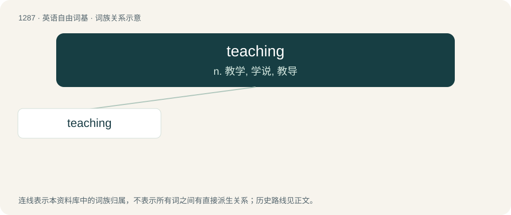

# 1372 · teaching — n. 教学, 学说, 教导

[总目录](../00_总目录_按常用程度.md)

**类型**：英语自由词基　｜　**来源语言**：见词源记录

## 核心含义与来源

- 核心含义：n. 教学, 学说, 教导
- 英文含义：Something taught by a religious or philosophical authority.
- 词形：teaching

**来源记录 1**（名词；Something taught by a religious or philosophical authority.）

From Middle English teching, techinge, from Old English tǣċing, tǣċung (“instruction, direction, teaching”), equivalent to teach + -ing.

## 词族图

## 单词速览（常用到不常用）

| 单词 | 音标 | 释义 |
|---|---|---|
| [teaching](#w-1) | /ˈtiːt͡ʃɪŋ/ | n. 教学, 学说, 教导 |

## 逐词详解

### 1. teaching

**词性**：名词　｜　**音标**：/ˈtiːt͡ʃɪŋ/

**中文释义**：n. 教学, 学说, 教导

**英文义项**：Something taught by a religious or philosophical authority. / The profession of educating people; the activity that a teacher does when he/she teaches.

**构词拆分**：teach + -ing

**词源与演化**：

From Middle English teching, techinge, from Old English tǣċing, tǣċung (“instruction, direction, teaching”), equivalent to teach + -ing.

**例句**：

> Teaching has seen continual changes over the past decades.

该用例对应义项：The profession of educating people; the activity that a teacher does when he/she teaches.
