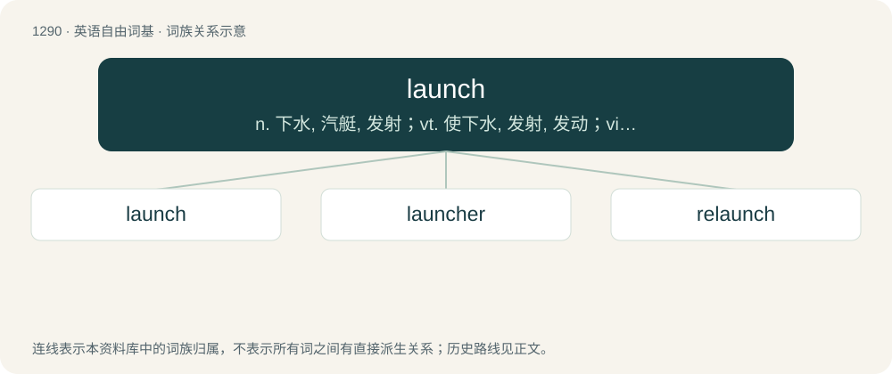

# 1374 · launch — n. 下水, 汽艇, 发射；vt. 使下水, 发射, 发动；vi. 起飞, 下水, 投入, 开始

[总目录](../00_总目录_按常用程度.md)

**类型**：英语自由词基　｜　**来源语言**：见词源记录

## 核心含义与来源

- 核心含义：n. 下水, 汽艇, 发射；vt. 使下水, 发射, 发动；vi. 起飞, 下水, 投入, 开始
- 英文含义：To throw (a projectile such as a lance, dart or ball); to hurl; to propel with force.
- 词形：launch

**多个词源／构词路径**：同一拼写可能有不同来源；以下按词性和含义分别列出。

**来源记录 1**（动词；To throw (a projectile such as a lance, dart or ball); to hurl; to propel with force.）

From Middle English launchen (“to throw as a lance”), Old French lanchier, another form (Old Northern French/Norman variant, compare Jèrriais lanchi) of lancier, French lancer, from lance.

**来源记录 2**（名词；The boat of the largest size and/or of most importance belonging to a ship of war, and often called the "captain's boat" or "captain's launch".）

From Portuguese lancha (“barge, launch”), apparently from Malay lancar (“quick, agile”). Spelling influenced by the verb above.

## 词族图

## 单词速览（常用到不常用）

| 单词 | 音标 | 释义 |
|---|---|---|
| [launch](#w-1) | 英 /lɔːnt͡ʃ/；/lɔnt͡ʃ/ | n. 下水, 汽艇, 发射；vt. 使下水, 发射, 发动；vi. 起飞, 下水, 投入, 开始 |
| [launcher](#w-2) | 英 /ˈlɔːntʃ.ə/；美 /ˈlɑnt͡ʃ.ɚ/ | n. 发射者, 发射台 |
| [relaunch](#w-3) | /ˌriːˈlɔːntʃ/ | v. 重新发动, 重新发射；n. 再下水, 再发射; 重整旗鼓, 重新开业; （商品等的）重新投放市场; 重新推向公众, 重新开张 |

## 逐词详解

### 1. launch

**词性**：动词　｜　**音标**：英 /lɔːnt͡ʃ/；/lɔnt͡ʃ/

**中文释义**：n. 下水, 汽艇, 发射；vt. 使下水, 发射, 发动；vi. 起飞, 下水, 投入, 开始

**英文义项**：To throw (a projectile such as a lance, dart or ball); to hurl; to propel with force. / To cause (a vessel) to move or slide from the land or a larger vessel into the water; to set afloat.

**词源与演化**：

From Middle English launchen (“to throw as a lance”), Old French lanchier, another form (Old Northern French/Norman variant, compare Jèrriais lanchi) of lancier, French lancer, from lance.

**例句**：

> NASA launched several unmanned rockets before launching any of the Mercury astronauts.

该用例对应义项：To cause (a rocket, balloon, etc., or the payload thereof) to begin its flight upward from the ground.

### 2. launcher

**词性**：名词　｜　**音标**：英 /ˈlɔːntʃ.ə/；美 /ˈlɑnt͡ʃ.ɚ/

**中文释义**：n. 发射者, 发射台

**英文义项**：One who or that which launches. A device that throws something or the person who initiates a launch. / An application that launches another or others, often holding icons or menus for frequently used programs.

**构词拆分**：From launch + -er.

**词源与演化**：

From launch + -er.

**例句**：

> The catapult made a good launcher for the small projectile.

该用例对应义项：One who or that which launches. A device that throws something or the person who initiates a launch.

### 3. relaunch

**词性**：动词　｜　**音标**：/ˌriːˈlɔːntʃ/

**中文释义**：v. 重新发动, 重新发射；n. 再下水, 再发射; 重整旗鼓, 重新开业; （商品等的）重新投放市场; 重新推向公众, 重新开张

**英文义项**：To launch again.

**构词拆分**：re- + launch

**词源与演化**：

From re- + launch.
